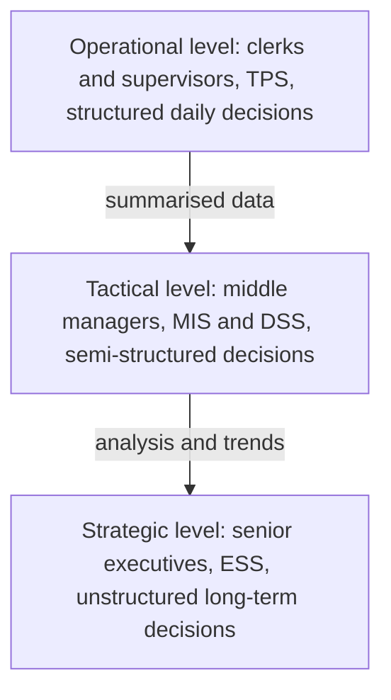
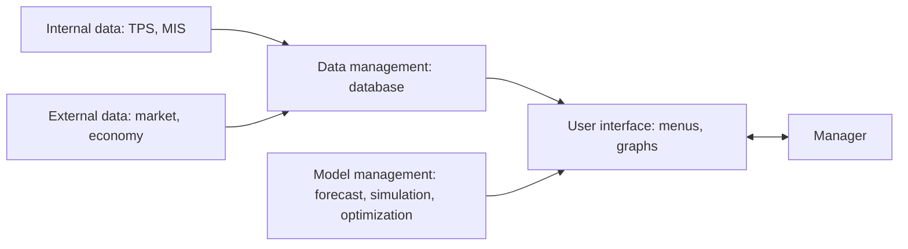

**In one line:** <mark>A DSS is an interactive computer system that combines data, models and an easy interface to help managers make semi-structured and unstructured decisions; it supports the manager and never decides for them</mark>. <Cite id="business-intelligence-wiki-dss" />

<Box kind="key">

**Key points to write (any DSS question):**

- <mark>DSS = interactive system with data + models + user interface for semi-structured problems</mark>.
- <mark>Three components: data management, model management, user interface</mark>.
- <mark>MIS hierarchy: operational (TPS), tactical (MIS and DSS), strategic (ESS)</mark>.
- <mark>DSS answers "what if" questions; MIS gives fixed regular reports</mark>.
- Analyses: **what-if, sensitivity, goal seeking**.
- Applications: healthcare, banking, agriculture, manufacturing, marketing, transport.

</Box>

## Core answer (5 marks, fits every question here)

<Box kind="definition">

A **Decision Support System (DSS)** is an interactive, computer-based system that combines data, models and an easy interface to help managers solve semi-structured and unstructured problems. It supports the decision; the manager still makes it. <Cite id="business-intelligence-wiki-dss" />

</Box>

It is like a GPS app for a manager: it shows options and effects, but the manager drives. <Cite id="business-intelligence-tp-dss" />

**Where it sits (MIS hierarchy):** a business has three levels of managers, and each needs a different system. The higher the level, the less structured the decisions. <Cite id="is-fundamentals-gfg-types" />

**Components:** (1) data management: internal and external data, (2) model management: forecasting, simulation, optimization, (3) user interface: menus and graphs. <Cite id="is-fundamentals-tp-dss" />

**Conclusion:** <mark>the hierarchy matches system to manager, and DSS is the tool that turns data into choices at the middle level</mark>.

## Extended answer (10 marks): add these

### 1. Architecture of a DSS

### 2. Analyses a DSS offers

- **What-if analysis:** "what if we raise the price by 5 percent?"
- **Sensitivity analysis:** which input changes the result most. <Cite id="business-intelligence-wiki-sensitivity" />
- **Goal seeking:** "how many units must we sell to earn a profit of 10 lakh?"

### 3. Applications of DSS

| Field | Use of DSS |
|---|---|
| Healthcare | Clinical decision support for diagnosis and treatment |
| Banking | Credit checks, loan approval, branch performance |
| Agriculture | Planning crops and inputs from soil and weather data |
| Manufacturing and logistics | Production schedule, inventory levels, route planning |
| Marketing and finance | Pricing, budgeting, sales forecasting, investment choice |
| Transport | Airlines and railways schedule crew and equipment |

<Cite id="is-fundamentals-gfg-dss" />

### 4. MIS versus DSS

| Point | MIS | DSS |
|---|---|---|
| Output | Fixed, regular reports | Answers to new questions |
| Problem | Structured | Semi-structured, unstructured |
| User role | Reads the report | Interacts, tries options |
| Focus | Past and present | Future effects |

<Cite id="is-fundamentals-gfg-mis-vs-dss" />

### 5. Advantages and limits

**Advantages:** faster, better-informed decisions; many options tried safely. **Limits:** costly to build; results are only as good as the data and model; managers may trust the model too much.

## Fit it to each question

- **"Evaluate the MIS Hierarchy to comment on Decision Support System."** (5 marks) <PYQ id="2022-12-ce/q1d" />: core answer; stress the hierarchy diagram first, then comment on DSS: strengths, limits and the comparison with MIS from section 4. Example: an Amazon pricing team tests "what if we cut the price by 5 percent".
- **"What is Decision Support System. Explain the application of DSS."** (10 marks) <PYQ id="2025-05-ce/q6a" />: definition, architecture diagram, analyses, then the **applications table** as the main part, advantages and limits.

## Exam tips

- **Draw** the hierarchy for question 1 and the architecture for question 2.
- Use the phrase **"supports, never replaces, the manager"**.
- For applications, give at least **five fields** with one use each.
