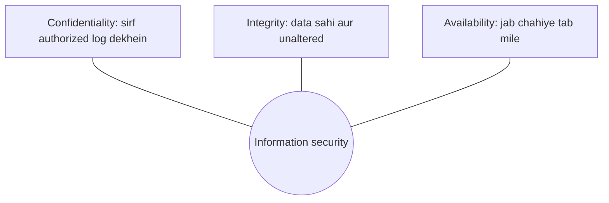
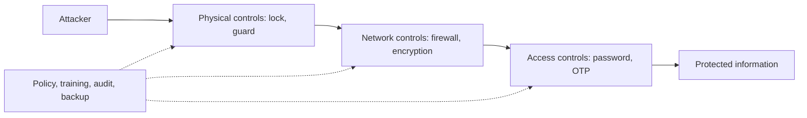

**Ek line mein:** <mark>Information security matlab information aur information systems ko unauthorized access, use, disclosure, disruption, modification ya destruction se bachana</mark>, taaki wo **confidential, correct aur available** rahein. <Cite id="web-mis-2-nist-glossary-infosec" /> <Cite id="note-information-security-ibm-infosec" />

<Box kind="key">

**"Define information security" ke har question mein ye points likho:**

- <mark>Information aur information systems ki protection unauthorized access, use, disclosure, modification ya destruction se</mark>.
- Goal: **CIA triad**, <mark>Confidentiality, Integrity, Availability</mark>.
- Ismein data, software, hardware, network, paper records aur log sab aate hain.
- Zaroori kyun: information firm ka sabse valuable **asset** hai; loss matlab paisa, trust aur legal problem.
- **Ek example zaroor do**: net banking (password plus OTP, HTTPS, backup server).
- Ye layered **controls** se hota hai: physical, access, communications, business continuity, audit.

</Box>

## Core answer (5 marks, yahan ke har question ke liye)

<Box kind="definition">

**Information security** is the protection of information and information systems from unauthorized access, use, disclosure, disruption, modification or destruction, in order to provide confidentiality, integrity and availability. <Cite id="web-mis-2-nist-glossary-infosec" />

</Box>

**Kyun chahiye:** information ab kai firms ka sabse valuable asset hai (bank ke accounts, Amazon ka customer data). Wo leak ho, badal jaye ya kho jaye to firm paisa, customers aur apna naam kho deti hai. <Cite id="note-information-security-gfg-infosec" />

**Teen goals (CIA):** <Cite id="note-information-security-gfg-cia" />

1. **Confidentiality:** sirf sahi log information dekh sakein.
2. **Integrity:** information sahi rahe aur sirf authorized log hi badal sakein.
3. **Availability:** sahi log ko jab chahiye tab mile.

**Example (net banking):** SBI customer user ID, password aur OTP se login karta hai (**confidentiality**), data encrypted HTTPS pe jaata hai aur raaste mein amount badal nahi sakta (**integrity**), aur ek server fail ho to backup server service chalu rakhta hai (**availability**). <Cite id="note-information-security-gfg-infosec" />

**Conclusion:** <mark>information security information ko confidential, correct aur available rakhti hai</mark>, technology, log aur rules saath mil ke.

## Extended answer (10 marks): ye add karo

### 1. Basic terms

| Term | Matlab | Banking example |
|---|---|---|
| Asset | Value wali cheez | Customer account data |
| Threat | Kuch bhi jo nuksaan kar sake | Hacker, virus |
| Vulnerability | Kamzori jo threat use kar sake | Unpatched server, weak password |
| Risk | Threat ke vulnerability se milne ka chance | Hacker unpatched server use karta hai |
| Control | Risk kam karne wala safeguard | Firewall, backup, OTP |

<Cite id="web-mis-2-wiki-vulnerability" /> <Cite id="note-information-security-wiki-infosec" />

### 2. Milte-julte words, chhote se bade

**Data security** digital data bachati hai, **IT security** technology, **cybersecurity** network attacks se systems, aur **information security** sabse wide hai: ismein paper records aur physical protection bhi aate hain. <Cite id="note-information-security-ibm-infosec" />

### 3. Protection ki layers (ye kaise hota hai)

### 4. Aur examples

| Area | Teeno goals kaise dikhte hain |
|---|---|
| Hospital records | Sirf doctors dekhte hain (C), galat blood group enter nahi hota (I), emergency mein records khulte hain (A) |
| Online shopping | Card details chhupi (C), order amount nahi badalta (I), sale ke din site chalti rehti hai (A) |

**Balance:** safe mein band bina network ka computer poori tarah confidential hai lekin available nahi. Security safety, cost aur ease of use ke beech ka trade-off hai.

## Har question mein kaise fit karein

- **"Define Information security with an example."** (5 marks) <PYQ id="2024-05-ce/q1c" /> <PYQ id="2025-05-ce/q1b" />: **core answer** likho: definition, CIA teen lines mein, net banking example aur one-line conclusion. CIA triangle draw karo.

## Exam tips

- **Definition word for word likho** aur C, I, A ka naam lo; example mein marks hain.
- **Real example** do (net banking, hospital, shopping), "data bachana" jaisi general line nahi.
- Information security ko cybersecurity se mat milao: information security wide word hai.

Exam mein English mein likho.
