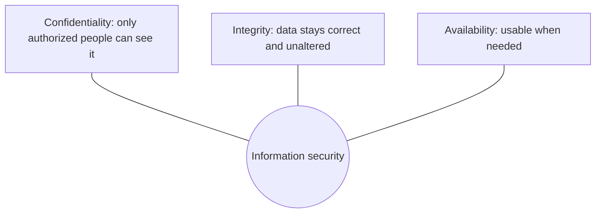
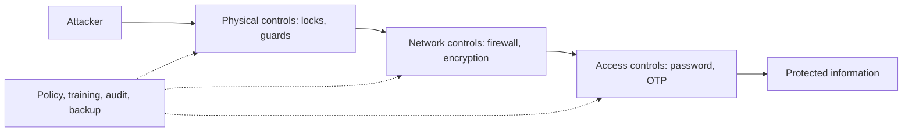

**In one line:** <mark>Information security is the protection of information and information systems from unauthorized access, use, disclosure, disruption, modification or destruction</mark>, so that they stay **confidential, correct and available**. <Cite id="web-mis-2-nist-glossary-infosec" /> <Cite id="note-information-security-ibm-infosec" />

<Box kind="key">

**Key points to write (any "define information security" question):**

- <mark>Protection of information and information systems from unauthorized access, use, disclosure, modification or destruction</mark>.
- Goal: the **CIA triad**, <mark>Confidentiality, Integrity, Availability</mark>.
- It covers data, software, hardware, networks, paper records and people.
- Needed because information is a firm's most valuable **asset**: loss means money, trust and legal trouble.
- **Always give one example**: net banking (password plus OTP, HTTPS, backup server).
- Done with layered **controls**: physical, access, communications, business continuity, audit.

</Box>

## Core answer (5 marks, fits every question here)

<Box kind="definition">

**Information security** is the protection of information and information systems from unauthorized access, use, disclosure, disruption, modification or destruction, in order to provide confidentiality, integrity and availability. <Cite id="web-mis-2-nist-glossary-infosec" />

</Box>

**Why it is needed:** information is now the most valuable asset of many firms (a bank's accounts, Amazon's customer data). If it leaks, is changed or is lost, the firm loses money, customers and its name. <Cite id="note-information-security-gfg-infosec" />

**The three goals (CIA):** <Cite id="note-information-security-gfg-cia" />

1. **Confidentiality:** only the right people can see the information.
2. **Integrity:** the information is correct and changed only by authorized people.
3. **Availability:** the right people can use it whenever needed.

**Example (net banking):** an SBI customer logs in with a user ID, password and OTP (**confidentiality**), the data travels over encrypted HTTPS and the amount cannot be altered on the way (**integrity**), and a backup server keeps the service running if one server fails (**availability**). <Cite id="note-information-security-gfg-infosec" />

**Conclusion:** <mark>information security keeps information confidential, correct and available</mark> through technology, people and rules working together.

## Extended answer (10 marks): add these

### 1. Basic terms

| Term | Meaning | Banking example |
|---|---|---|
| Asset | Something of value | Customer account data |
| Threat | Anything that can cause harm | A hacker, a virus |
| Vulnerability | A weakness a threat can use | Unpatched server, weak password |
| Risk | Chance that a threat meets a vulnerability | Hacker uses the unpatched server |
| Control | A safeguard that reduces risk | Firewall, backups, OTP |

<Cite id="web-mis-2-wiki-vulnerability" /> <Cite id="note-information-security-wiki-infosec" />

### 2. Related words, small to big

**Data security** protects digital data, **IT security** protects technology, **cybersecurity** protects systems from attacks over networks, and **information security** is the widest: it also covers paper records and physical protection. <Cite id="note-information-security-ibm-infosec" />

### 3. Layers of protection (how it is achieved)

### 4. More examples

| Area | How the three goals show up |
|---|---|
| Hospital records | Only doctors see them (C), a wrong blood group is not entered (I), records open in an emergency (A) |
| Online shopping | Card details hidden (C), order amount not changed (I), site stays up on a sale day (A) |

**Balance:** a computer locked in a safe with no network is fully confidential but not available. Security is a trade-off between safety, cost and ease of use.

## Fit it to each question

- **"Define Information security with an example."** (5 marks) <PYQ id="2024-05-ce/q1c" /> <PYQ id="2025-05-ce/q1b" />: write the **core answer**: definition, CIA in three lines, the net banking example and the one-line conclusion. Draw the CIA triangle.

## Exam tips

- **Always write the definition word for word** and name C, I and A; the example is where the marks are.
- Use a **real example** (net banking, hospital, shopping), not a general line like "protecting data".
- Do not mix up information security with cybersecurity: information security is the wider word.
