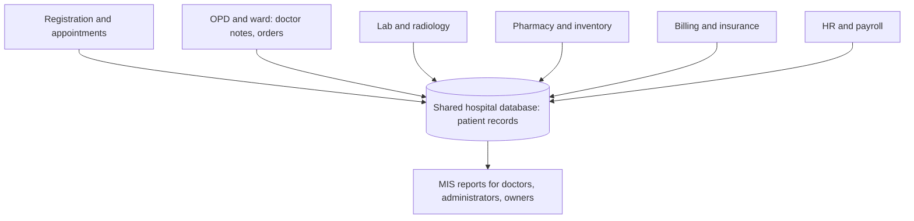
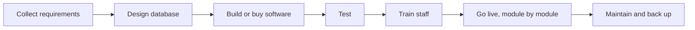

**Ek line mein:** <mark>Hospital MIS har department ka data (patients, tests, medicines, bills) ek shared database mein record karta hai aur doctors, nurses aur managers ke liye reports banata hai</mark>. <Cite id="is-fundamentals-wiki-his" />

<Box kind="key">

**"Design an MIS" mein ye points likho:**

- <mark>Aim: ek patient record, fast service, kam errors, beds, staff aur paise ka better use</mark>.
- <mark>Level ke hisaab se users: operational (TPS), middle (MIS reports), top (dashboards)</mark>.
- <mark>Modules: registration, clinical (OPD, ward), lab, pharmacy aur stores, billing, HR</mark>, sab ek **shared database** mein likhte hain.
- <mark>Design steps: requirements, database design, build ya buy, test, train, go live, maintain</mark>.
- Sample reports: bed occupancy, test turnaround, reorder level se kam stock, pending claims.
- Challenges: **patient privacy**, cost, training, downtime (backup chahiye).

</Box>

## Core answer (5 marks, yahan ke har question ke liye)

<Box kind="definition">

A **hospital MIS** is a computer system that collects the data of all hospital departments in one database and gives each user the reports needed to treat patients and manage the hospital. <Cite id="is-fundamentals-wiki-his" /> <Cite id="is-fundamentals-gfg-mis" />

</Box>

**Aim:** ek patient record, fast service, kam errors, aur beds, staff, paise ka better use.

| Level | Users | Kaunsi information chahiye |
|---|---|---|
| Operational | Receptionists, nurses, lab aur pharmacy staff | Patient details, orders, bills (TPS) |
| Middle | Department heads, ward managers | Bed occupancy, test turnaround, stock (MIS) |
| Top | Medical director, owners | Revenue, patient trends, plans (dashboards) |

<Cite id="it-impact-society-tp-mis" />

**Conclusion:** <mark>hospital MIS saare departments ko ek shared database se jodta hai</mark>, aur har insaan ko zaroori information deta hai.

## Extended answer (10 marks): ye add karo

### 1. Modules, transactions aur reports

| Module | Transactions | Reports |
|---|---|---|
| Registration | Registration, booking | Daily OPD count, waiting time |
| Clinical | Admission, diagnosis, discharge | Bed occupancy, average stay |
| Laboratory | Test orders aur results | Tests per day, turnaround time |
| Pharmacy aur stores | Drugs ka issue aur purchase | Reorder level se kam stock, expiry alerts |
| Billing aur finance | Bills, claims, payments | Department-wise revenue, pending claims |
| Human resources | Roster, attendance, payroll | Staff per shift, overtime |

### 2. Ise kaise banate hain

### 3. Benefits aur challenges

| Benefits | Challenges |
|---|---|
| Ek patient record | Patient data private rakhna; sirf authorised staff record khol sakein |
| Quick billing | Setup cost aur staff training |
| Medicine aur test mein kam errors | Emergency mein downtime; backup power aur data chahiye |
| Beds aur staff ki better planning | Staff ka change ke liye resistance |

<Cite id="note-tps-fais-erp-wiki-mis" />

**Example report:** exception report jo expire hone wali medicines list karti hai, taaki pharmacy time pe action le.

## Har question mein kaise fit karein

- **"Create MIS system for any hospital."** (10 marks) <PYQ id="2022-12-ce/q5b" />: aim, level ke hisaab se users, module diagram, module table, build steps, benefits aur challenges, example report.

## Exam tips

- **Ek-database wala diagram pehle draw karo**; isse dikhta hai ki MIS samajh aaya.
- **Modules ke saath unke reports** likho; examiner reports dhoondhte hain.
- **Privacy aur backup** hamesha likho; yahi points aksar chhoot jaate hain.

Exam mein English mein likho.
