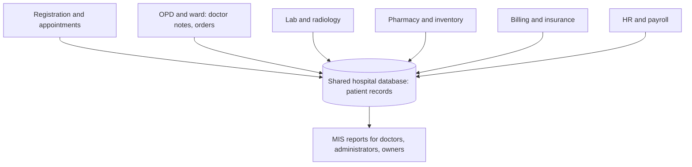
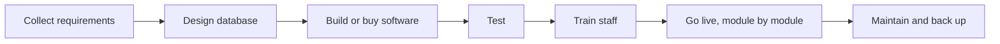

**In one line:** <mark>A hospital MIS records what happens in every department (patients, tests, medicines, bills) in one shared database and turns it into reports for doctors, nurses and managers</mark>. <Cite id="is-fundamentals-wiki-his" />

<Box kind="key">

**Key points to write (design an MIS):**

- <mark>Aim: one patient record, faster service, fewer errors, better use of beds, staff and money</mark>.
- <mark>Users by level: operational (TPS), middle (MIS reports), top (dashboards)</mark>.
- <mark>Modules: registration, clinical (OPD, ward), lab, pharmacy and stores, billing, HR</mark>, all writing to a **shared database**.
- <mark>Design steps: requirements, database design, build or buy, test, train, go live, maintain</mark>.
- Sample reports: bed occupancy, test turnaround, stock below reorder level, pending claims.
- Challenges: **patient privacy**, cost, training, downtime (needs backup).

</Box>

## Core answer (5 marks, fits every question here)

<Box kind="definition">

A **hospital MIS** is a computer system that collects the data of all hospital departments in one database and gives each user the reports needed to treat patients and manage the hospital. <Cite id="is-fundamentals-wiki-his" /> <Cite id="is-fundamentals-gfg-mis" />

</Box>

**Aim:** one patient record, faster service, fewer errors, and better use of beds, staff and money.

| Level | Users | Information needed |
|---|---|---|
| Operational | Receptionists, nurses, lab and pharmacy staff | Patient details, orders, bills (TPS) |
| Middle | Department heads, ward managers | Bed occupancy, test turnaround, stock (MIS) |
| Top | Medical director, owners | Revenue, patient trends, plans (dashboards) |

<Cite id="it-impact-society-tp-mis" />

**Conclusion:** <mark>a hospital MIS joins all departments through one shared database</mark>, giving each person the information they need.

## Extended answer (10 marks): add these

### 1. Modules, transactions and reports

| Module | Transactions recorded | Reports produced |
|---|---|---|
| Registration | Registration, booking | Daily OPD count, waiting time |
| Clinical | Admission, diagnosis, discharge | Bed occupancy, average stay |
| Laboratory | Test orders and results | Tests per day, turnaround time |
| Pharmacy and stores | Issue and purchase of drugs | Stock below reorder level, expiry alerts |
| Billing and finance | Bills, claims, payments | Revenue by department, pending claims |
| Human resources | Roster, attendance, payroll | Staff per shift, overtime |

### 2. Steps to build it

### 3. Benefits and challenges

| Benefits | Challenges |
|---|---|
| Single patient record | Patient data must stay private; only authorised staff may open a record |
| Quick billing | Setup cost and staff training |
| Fewer medicine and test errors | Downtime in an emergency needs backup power and data |
| Better planning of beds and staff | Staff resistance to change |

<Cite id="note-tps-fais-erp-wiki-mis" />

**Example report:** an exception report listing medicines about to expire, so the pharmacy acts in time.

## Fit it to each question

- **"Create MIS system for any hospital."** (10 marks) <PYQ id="2022-12-ce/q5b" />: aim, users by level, module diagram, module table, build steps, benefits and challenges, example report.

## Exam tips

- **Draw** the one-database diagram first; it shows you understand an MIS.
- Write **modules with the reports** each gives; examiners look for reports.
- Always mention **privacy and backup**; they are the common missing points.
