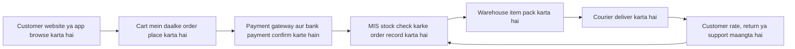
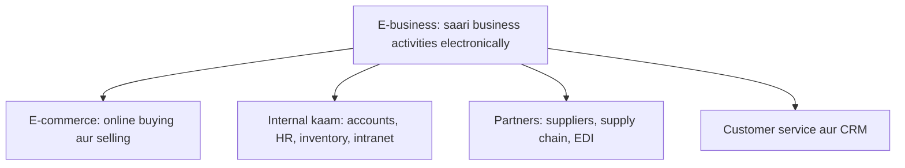
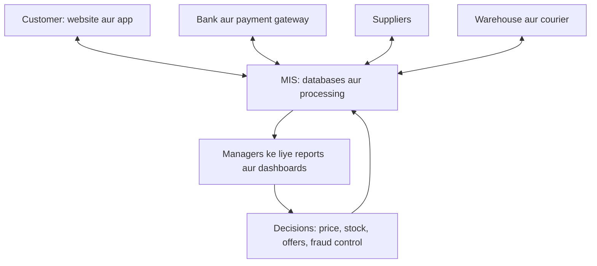

**Ek line mein:** <mark>E-commerce matlab internet pe goods, services ya information ki khareed-bikri</mark>; <mark>e-business matlab internet aur IT se business ki saari activities chalana</mark>, isliye e-commerce e-business ka ek hissa hai, aur MIS dono ke peeche ka system hai. <Cite id="e-commerce-wiki-ecommerce" /> <Cite id="e-commerce-wiki-ebusiness" />

<Box kind="key">

**E-commerce / e-business ke har question mein ye points likho:**

- <mark>E-commerce = internet ya electronic networks pe buying aur selling</mark>.
- <mark>E-business = business ki saari activities electronically</mark> (selling, buying, serving, partners, internal kaam). E-commerce uska **ek hissa** hai.
- **Need:** 24 ghante open, wide reach, bada choice, kam cost.
- **Models:** B2B, B2C, C2C, C2B, B2G.
- **Order flow:** browse, cart, pay, stock check, pack, deliver, support.
- <mark>MIS online business ka data collect, store, process aur report karta hai</mark>, aur website ko stock, accounts, delivery se jodta hai.
- **Advantages aur disadvantages** table aur ek real company example (Amazon, Flipkart).

</Box>

## Core answer (5 marks, yahan ke har question ke liye)

<Box kind="definition">

**E-commerce** is the buying and selling of goods, services or information over the internet or other electronic networks. **E-business** is the use of the internet and information technology to run *all* the activities of a business: selling, buying, serving customers, working with partners and managing internal work. <Cite id="e-commerce-wiki-ecommerce" /> <Cite id="e-commerce-rainer-intro-is" />

</Box>

**Kyun chahiye:** street ki shop kuch ghante khuli rehti hai, sirf paas ke log aa sakte hain aur stock limited hota hai. Online business 24 ghante khula, poore desh tak pahunchta, bahut bada range dikhata aur building aur middlemen ka cost kam karta hai. <Cite id="e-commerce-ibm" />

**Online order ka flow:** <Cite id="e-commerce-tp-overview" />

1. Customer website ya app browse karke cart mein daalta hai.
2. UPI, card, net banking, wallet ya cash on delivery se pay karta hai.
3. **MIS** stock check karta hai aur order record karta hai.
4. Warehouse pack karta hai, courier deliver karta hai.
5. Customer rate, return ya support maangta hai. Data MIS mein wapas jaata hai.

**MIS e-commerce ko kaise support karta hai (short):**

| Business need | MIS kya karta hai |
|---|---|
| Catalogue dikhana | Price, stock, reviews wala product database |
| Order aur payment lena | Order system order record karta hai, payment gateway se judta hai |
| Stock manage karna | Inventory system har item track karta hai, stock kam ho to warning |
| Deliver karna | Logistics system nearest warehouse aur courier chunta hai, tracking deta hai |
| Customer ko jaanna | Customer database aur CRM personal offers bhejte hain |
| Control aur decide | Reports: daily sales, returns, delivery time, fraud alerts |

<Cite id="e-commerce-laudon-mis" />

**Conclusion:** <mark>e-commerce tabhi chalta hai jab information system, payments aur delivery sab reliable hon</mark>.

## Extended answer (10 marks): ye add karo

### 1. E-commerce versus e-business

| Point | E-commerce | E-business |
|---|---|---|
| Scope | Chhota: sirf transaction | Bada: transactions plus internal aur partner kaam |
| Relation | E-business ka hissa | Poora |
| Paisa involved | Hamesha (sale) | Hamesha nahi (supplier ko stock data dena) |
| Network | Zyadatar internet | Internet, intranet, extranet |
| Example | Flipkart pe shoes kharidna | Flipkart ka warehouses, supplier portal, HR online chalana |

<Cite id="e-commerce-gfg-ecom-vs-ebiz" />

### 2. E-business pe note

- **Parts:** e-commerce, **e-procurement** (supplies online kharidna), **e-supply chain** (stock aur order data share karna, aksar **EDI** se: standard documents ka computer-to-computer exchange), **e-CRM**, internal systems (ERP, intranet, online HR). <Cite id="e-commerce-wiki-edi" />
- **Networks:** internet (sab), **intranet** (firm ke andar private), **extranet** (chune hue partners ke saath).
- **Benefits:** kam cost, kam paper, 24 ghante service, wide reach, tez decisions. **Limits:** technology cost, security threats, staff training, network pe dependence.
- **Example:** Walmart suppliers ke saath sales data share karta hai taaki wo time pe restock karein; Amazon selling, warehousing, payments aur service ek e-business ki tarah chalata hai.

### 3. E-commerce ke models

| Model | Seller se buyer | Example |
|---|---|---|
| B2B | Business to business | Infosys bank ko services, IndiaMART |
| B2C | Business to consumer | Amazon, Flipkart, Zomato |
| C2C | Consumer to consumer | OLX |
| C2B | Consumer to business | Upwork pe freelancer |
| B2G | Business to government | GeM portal pe tender |

<Cite id="e-commerce-tp-models" /> <Cite id="e-commerce-gfg-types" />

### 4. Advantages aur disadvantages

| Advantages | Disadvantages |
|---|---|
| 24 ghante open, internet wali har jagah pahunch | Product chhu nahi sakte, isliye returns zyada |
| Bada choice, price comparison aasan | Fraud, chori hue cards, fake sites, phishing |
| Seller ka cost kam | Delivery delay, mehnga last mile |
| Customer data se personal offers | Privacy concerns |
| Chhote sellers ko national buyers | Heavy discounts, platform fees, sale ke din failure se sales ruk jaati hain |

<Cite id="e-commerce-gfg-intro" />

### 5. Case: Flipkart-style online shop (MIS action mein)

1. Customer phone search karta hai. Product database price aur live stock dikhata hai; recommendation system accessories suggest karta hai.
2. Order aur UPI payment transaction processing system record karta hai. <Cite id="e-commerce-wiki-upi" />
3. Inventory system stock kam karta hai, nearest warehouse chunta hai aur stock kam ho to purchase order raise karta hai.
4. Logistics system courier assign karta hai aur SMS se tracking bhejta hai.
5. Delivery ke baad manager ke reports best sellers, high-return sellers aur late deliveries dikhate hain, taaki action liya ja sake.

*Result:* tez delivery, kam stock-outs, kam errors, behtar decisions.

## Har question mein kaise fit karein

- **"Write note on e-commerce."** (10 marks) <PYQ id="2023-05-ce/q2b" /> <PYQ id="2024-12-ce/q6b" />: definition (e-business pe ek line ke saath), need, order-flow diagram, models table (section 3), advantages aur disadvantages (section 4), examples, conclusion.
- **"Write note on e-business."** (10 marks) <PYQ id="2023-12-ce/q4b" />: definition, e-commerce versus e-business diagram aur table (section 1), phir poora **section 2** (parts, networks, benefits, limits, example) aur conclusion: "e-business poori firm ko chalane ka digital tareeka hai".
- **"How is E-commerce supported by MIS? Give one case to describe same."** (5 marks) <PYQ id="2024-05-ce/q1e" />: **core MIS table**, phir **section 5 case** paanch lines mein, MIS hub diagram ke saath.

## Exam tips

- **Order-flow diagram** aur e-business tree draw karo; marks inhi se aate hain.
- Kabhi mat likho ki e-commerce aur e-business same hain; aur do firms ke beech bulk order **B2B** hai, B2C nahi.
- Hamesha **real company example** do (Amazon, Flipkart, Walmart); MIS answers bina example ke marks khote hain.

Exam mein English mein likho.
