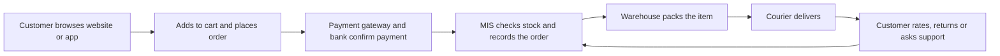
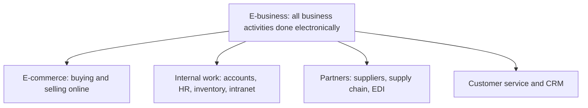
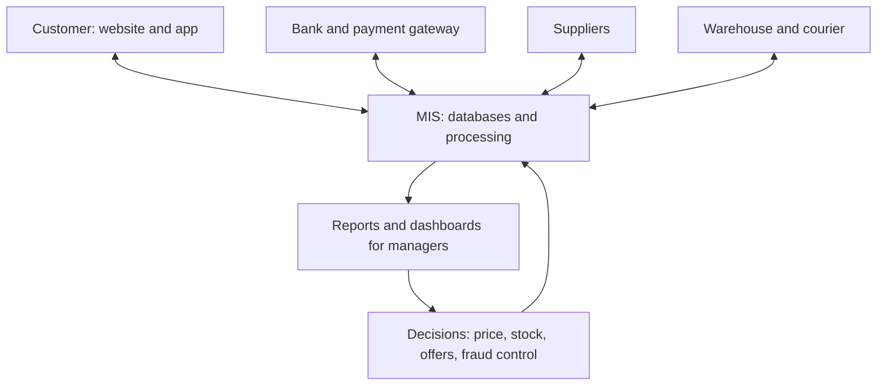

**In one line:** <mark>E-commerce is buying and selling of goods, services or information over the internet</mark>; <mark>e-business is using the internet and IT to run all the activities of a business</mark>, so e-commerce is one part of e-business, and MIS is the system behind both. <Cite id="e-commerce-wiki-ecommerce" /> <Cite id="e-commerce-wiki-ebusiness" />

<Box kind="key">

**Key points to write (any e-commerce / e-business question):**

- <mark>E-commerce = buying and selling over the internet or electronic networks</mark>.
- <mark>E-business = all business activities done electronically</mark> (selling, buying, serving, partners, internal work). E-commerce is a **part** of it.
- **Need:** open 24 hours, wide reach, large choice, lower cost.
- **Models:** B2B, B2C, C2C, C2B, B2G.
- **Order flow:** browse, cart, pay, stock check, pack, deliver, support.
- <mark>MIS collects, stores, processes and reports</mark> the data that the online business runs on, and links the website to stock, accounts and delivery.
- **Advantages and disadvantages** table and a real company example (Amazon, Flipkart).

</Box>

## Core answer (5 marks, fits every question here)

<Box kind="definition">

**E-commerce** is the buying and selling of goods, services or information over the internet or other electronic networks. **E-business** is the use of the internet and information technology to run *all* the activities of a business: selling, buying, serving customers, working with partners and managing internal work. <Cite id="e-commerce-wiki-ecommerce" /> <Cite id="e-commerce-rainer-intro-is" />

</Box>

**Why it is needed:** a street shop is open a few hours, serves only people who can walk there and holds limited stock. Online business is open 24 hours, reaches the whole country, shows a very large range and cuts the cost of buildings and middlemen. <Cite id="e-commerce-ibm" />

**How an online order flows:** <Cite id="e-commerce-tp-overview" />

1. Customer browses website or app and adds to cart.
2. Pays by UPI, card, net banking, wallet or cash on delivery.
3. **MIS** checks stock and records the order.
4. Warehouse packs, courier delivers.
5. Customer rates, returns or asks for support. The data goes back to the MIS.

**How MIS supports e-commerce (short):**

| Business need | What the MIS does |
|---|---|
| Show the catalogue | Product database with price, stock, reviews |
| Take orders and payment | Order system records the order, links to the payment gateway |
| Manage stock | Inventory system tracks every item, warns when stock is low |
| Deliver | Logistics system picks the nearest warehouse and courier, gives tracking |
| Know the customer | Customer database and CRM send personal offers |
| Control and decide | Reports: sales by day, returns, delivery time, fraud alerts |

<Cite id="e-commerce-laudon-mis" />

**Conclusion:** <mark>e-commerce works only when the information system, payments and delivery are all reliable</mark>.

## Extended answer (10 marks): add these

### 1. E-commerce versus e-business

| Point | E-commerce | E-business |
|---|---|---|
| Scope | Narrow: only the transaction | Wide: transactions plus internal and partner work |
| Relation | A part of e-business | The whole |
| Money involved | Always (a sale) | Not always (sharing stock data with a supplier) |
| Network | Mostly internet | Internet, intranet, extranet |
| Example | Buying shoes on Flipkart | Flipkart also running warehouses, supplier portal, HR online |

<Cite id="e-commerce-gfg-ecom-vs-ebiz" />

### 2. Note on e-business

- **Parts:** e-commerce, **e-procurement** (buying supplies online), **e-supply chain** (sharing stock and order data, often by **EDI**: computer-to-computer exchange of standard documents), **e-CRM**, internal systems (ERP, intranet, online HR). <Cite id="e-commerce-wiki-edi" />
- **Networks:** internet (everyone), **intranet** (private, inside the firm), **extranet** (shared with chosen partners).
- **Benefits:** lower cost, less paper, 24 hours service, wider reach, faster decisions. **Limits:** technology cost, security threats, staff training, dependence on the network.
- **Example:** Walmart shares sales data with suppliers so they restock on time; Amazon runs selling, warehousing, payments and service as one e-business.

### 3. Models of e-commerce

| Model | Seller to buyer | Example |
|---|---|---|
| B2B | Business to business | Infosys selling services to a bank, IndiaMART |
| B2C | Business to consumer | Amazon, Flipkart, Zomato |
| C2C | Consumer to consumer | OLX |
| C2B | Consumer to business | Freelancer on Upwork |
| B2G | Business to government | Tender on the GeM portal |

<Cite id="e-commerce-tp-models" /> <Cite id="e-commerce-gfg-types" />

### 4. Advantages and disadvantages

| Advantages | Disadvantages |
|---|---|
| Open 24 hours, reaches any place with internet | Cannot touch the product, so returns are common |
| Large choice, easy price comparison | Fraud, stolen cards, fake sites, phishing |
| Lower cost for the seller | Delivery delay, costly last mile |
| Customer data gives personal offers | Privacy concerns |
| Small sellers reach national buyers | Heavy discounts, platform fees, a sale-day failure stops sales |

<Cite id="e-commerce-gfg-intro" />

### 5. Case: Flipkart-style online shop (MIS in action)

1. Customer searches a phone. The product database shows price and live stock; the recommendation system suggests accessories.
2. Order and UPI payment are recorded by the transaction processing system. <Cite id="e-commerce-wiki-upi" />
3. The inventory system reduces stock, picks the nearest warehouse and raises a purchase order if stock is low.
4. The logistics system assigns a courier and sends tracking by SMS.
5. After delivery the manager's reports show best sellers, high-return sellers and late deliveries, so action can be taken.

*Result:* faster delivery, fewer stock-outs, fewer errors, better decisions.

## Fit it to each question

- **"Write note on e-commerce."** (10 marks) <PYQ id="2023-05-ce/q2b" /> <PYQ id="2024-12-ce/q6b" />: definition (with one line on e-business), need, order-flow diagram, models table (section 3), advantages and disadvantages (section 4), examples, conclusion.
- **"Write note on e-business."** (10 marks) <PYQ id="2023-12-ce/q4b" />: definition, the e-commerce versus e-business diagram and table (section 1), then the full **section 2** (parts, networks, benefits, limits, example) and conclusion: "e-business is the digital way of running the whole firm".
- **"How is E-commerce supported by MIS? Give one case to describe same."** (5 marks) <PYQ id="2024-05-ce/q1e" />: the **core MIS table**, then the **section 5 case** in five lines, with the MIS hub diagram.

## Exam tips

- **Draw the order-flow diagram** and the e-business tree; they carry the marks.
- Never say e-commerce and e-business are the same; and a bulk order between two firms is **B2B**, not B2C.
- Always give a **real company example** (Amazon, Flipkart, Walmart); MIS answers without one lose marks.
