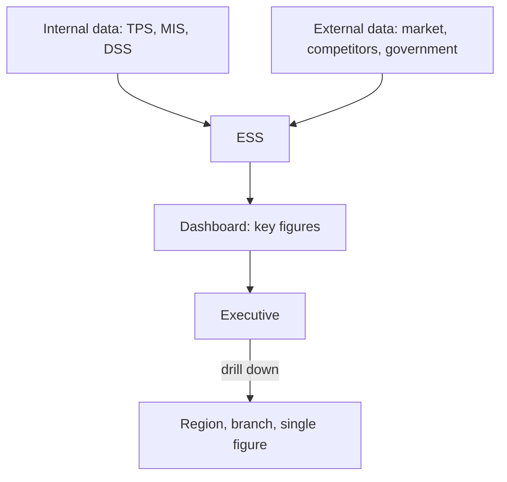

**Ek line mein:** <mark>ESS senior executives ko key internal aur external information tak aasaan access deta hai, taaki wo organization monitor kar sakein aur strategic decisions le sakein</mark>. <Cite id="is-fundamentals-tp-ess" />

<Box kind="key">

**Har ESS question mein ye points likho:**

- <mark>ESS (EIS bhi kehte hain) top management ke liye bana hai, strategic aur unstructured decisions ke liye</mark>.
- <mark>Use karna aasaan: dashboard, graphs, menus, computer skill nahi chahiye</mark>.
- <mark>Drill-down: summary figure pe click karke uske peeche ka detail dekho</mark>.
- <mark>Internal aur external dono data use karta hai</mark> (competitors, market, government).
- **Key indicators** aur **trends** dikhata hai; email, scheduling; **timely** information.
- Ye business ko **dekhne** ke liye hai; heavy what-if modelling DSS ka kaam hai.

</Box>

## Core answer (5 marks, yahan ke har question ke liye)

<Box kind="definition">

An **Executive Support System (ESS)** is a computer-based system that gives senior executives easy access to key internal and external information, so they can monitor the organization and take strategic decisions. <Cite id="is-fundamentals-tp-ess" /> <Cite id="is-fundamentals-wiki-eis" />

</Box>

CEO ke liye ye car ke dashboard jaisa hai.

**Features**

1. **Top management ke liye:** strategic, non-routine decisions support karta hai.
2. **Aasaan use:** graphs, menus, simple screens.
3. **Drill-down:** company profit se region, phir branch tak.
4. **Dashboard pe key indicators:** revenue, profit, market share ek screen pe.
5. **Internal aur external data:** company summaries plus competitor, market, government info.
6. **Trend analysis:** time ke saath figures compare karke problems jaldi pakadta hai.
7. **Communication support:** email, alerts, scheduling.
8. **Timely information:** quick decisions ke liye up-to-date data. <Cite id="is-fundamentals-gfg-types" />

**Conclusion:** <mark>ESS executives ko internal aur external data ka simple, summarized, drillable view deta hai strategic decisions ke liye</mark>.

## Extended answer (10 marks): ye add karo

### 1. Example

Retail chain ka CEO ek dashboard pe sales, profit aur delivery time dekhta hai, ek city mein high returns milte hain, wo city pe click karta hai, phir store pe, aur cause mil jaata hai. <Cite id="business-intelligence-tp-ess" />

### 2. ESS vs MIS vs DSS

| Point | MIS | DSS | ESS |
|---|---|---|---|
| Users | Middle managers | Managers, analysts | Top executives |
| Output | Fixed reports | What-if results | Dashboard, drill-down |
| Decisions | Structured | Semi-structured | Unstructured, strategic |
| Data | Mostly internal | Internal + models | Internal + external |

<Cite id="business-intelligence-wiki-eis" />

### 3. Advantages aur limits

| Advantages | Limits |
|---|---|
| Poore business ka quick view | Banana costly |
| Problems ki early warning | Benefit napna mushkil |
| Executives ka time bachta hai | Information overload ho sakta hai |
| Better strategic decisions | Data hamesha current chahiye |

## Har question mein kaise fit karein

- **"What are the features of Executive Support System?"** (5 marks) <PYQ id="2024-05-ce/q1b" /> <PYQ id="2025-05-ce/q1a" />: definition, aath features numbered list mein, ek example, ek-line conclusion.

## Exam tips

- **Keywords:** drill-down, dashboard, key indicators, internal aur external data, top management.
- Chhota ESS flow diagram draw karo; 5-marker mein easy marks milte hain.
- DSS se confuse mat karo: ESS **monitor** karta hai, DSS **model** karta hai.

Exam mein English mein likho.
