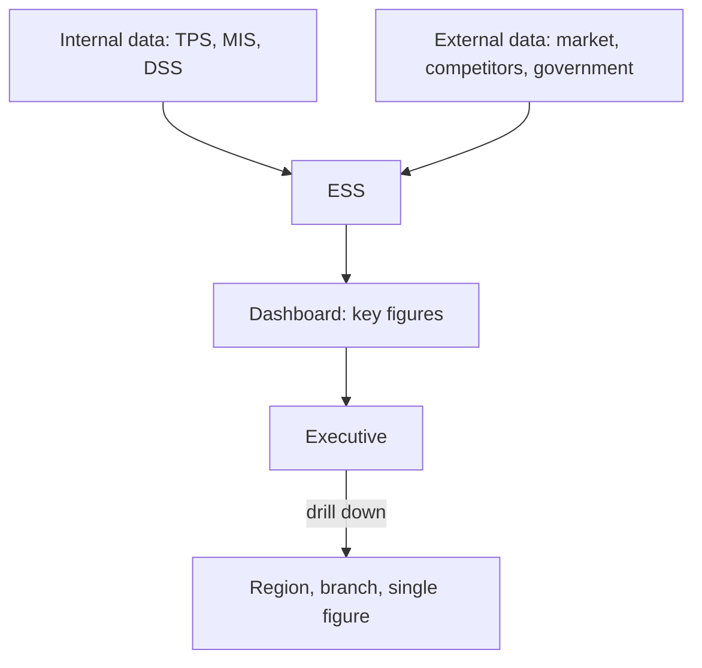

**In one line:** <mark>An ESS gives senior executives easy access to key internal and external information, so they can monitor the organization and take strategic decisions</mark>. <Cite id="is-fundamentals-tp-ess" />

<Box kind="key">

**Key points to write (any ESS question):**

- <mark>ESS (also called EIS) is built for top management and strategic, unstructured decisions</mark>.
- <mark>Easy to use: dashboard, graphs and menus, no computer skill needed</mark>.
- <mark>Drill-down: click a summary figure to see the detail behind it</mark>.
- <mark>Uses both internal and external data</mark> (competitors, market, government).
- Shows **key indicators** and **trends**; has email and scheduling; gives **timely** information.
- It is for **watching** the business; heavy what-if modelling belongs to a DSS.

</Box>

## Core answer (5 marks, fits every question here)

<Box kind="definition">

An **Executive Support System (ESS)** is a computer-based system that gives senior executives easy access to key internal and external information, so they can monitor the organization and take strategic decisions. It is like the dashboard of a car for the CEO. <Cite id="is-fundamentals-tp-ess" /> <Cite id="is-fundamentals-wiki-eis" />

</Box>

**Features**

1. **Built for top management:** supports strategic, non-routine decisions.
2. **Easy to use:** graphs, menus and simple screens.
3. **Drill-down:** from company profit to region, then branch.
4. **Key indicators on a dashboard:** revenue, profit, market share on one screen.
5. **Internal and external data:** company summaries plus competitor, market and government information.
6. **Trend analysis:** compares figures over time to spot problems early.
7. **Communication support:** email, alerts, scheduling.
8. **Timely information:** up-to-date data for quick decisions. <Cite id="is-fundamentals-gfg-types" />

**Conclusion:** <mark>an ESS gives executives a simple, summarized and drillable view of internal and external data for strategic decisions</mark>.

## Extended answer (10 marks): add these

### 1. Example

The CEO of a retail chain sees sales, profit and delivery time on one dashboard, finds one city with high returns, clicks that city and then the store, and finds the cause. <Cite id="business-intelligence-tp-ess" />

### 2. ESS compared with MIS and DSS

| Point | MIS | DSS | ESS |
|---|---|---|---|
| Users | Middle managers | Managers, analysts | Top executives |
| Output | Fixed reports | What-if results | Dashboard, drill-down |
| Decisions | Structured | Semi-structured | Unstructured, strategic |
| Data | Mostly internal | Internal plus models | Internal plus external |

<Cite id="business-intelligence-wiki-eis" />

### 3. Advantages and limits

| Advantages | Limits |
|---|---|
| Quick view of the whole business | Costly to build |
| Early warning of problems | Benefit is hard to measure |
| Saves executives' time | May cause information overload |
| Better strategic decisions | Data must always be current |

## Fit it to each question

- **"What are the features of Executive Support System?"** (5 marks) <PYQ id="2024-05-ce/q1b" /> <PYQ id="2025-05-ce/q1a" />: definition, the eight features as a numbered list, one example, one-line conclusion.

## Exam tips

- **Keywords:** drill-down, dashboard, key indicators, internal and external data, top management.
- Draw the small ESS flow diagram; it adds easy marks to a 5-marker.
- Do not confuse with DSS: ESS **monitors**, DSS **models**.
