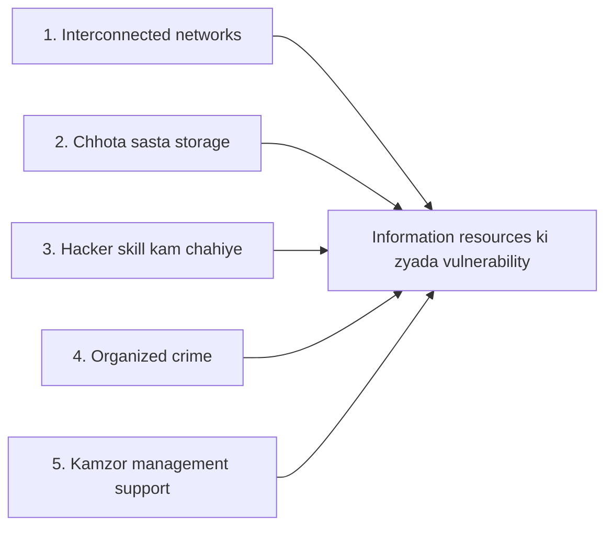
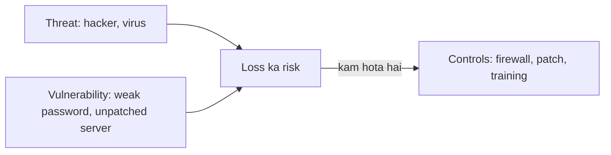

**Ek line mein:** Information resource aaj zyada **vulnerable** (attack ke liye khula) hai kyunki <mark>paanch factors: interconnected networks, chhota sasta storage, hacker banne ki skill ka kam hona, organized crime, aur management support ki kami</mark>. <Cite id="is-fundamentals-wiley-rainer" />

<Box kind="key">

**Ye points likho (paanch factors, har ek ke saath example):**

- <mark>Today's interconnected, interdependent, wirelessly networked business environment</mark>: har connected device ek darwaza hai.
- <mark>Smaller, faster, cheaper computers and storage devices</mark>: pen drive ya phone mein bahut data aata hai aur kho jaana aasan hai.
- <mark>Decreasing skills necessary to be a computer hacker</mark>: online free attack tools.
- <mark>International organized crime taking over cybercrime</mark>: paise wale gangs, ransomware.
- <mark>Lack of management support</mark>: budget nahi, patching nahi, policy nahi.
- **Vulnerability** define karo: ek kamzori jo threat use kar sake.

</Box>

## Core answer (5 marks, yahan ke har question ke liye)

<Box kind="definition">

A **vulnerability** is a weakness in an information resource that a threat (a hacker, a virus, a careless employee) can use to cause harm. Information resources are becoming more vulnerable every year for five reasons. <Cite id="web-mis-2-wiki-vulnerability" /> <Cite id="is-fundamentals-wiley-rainer" />

</Box>

| # | Factor | Risk kyun badhta hai | Specific example |
|---|---|---|---|
| 1 | Interconnected, interdependent, wirelessly networked environment | Har connected device aur partner attacker ke liye darwaza ban sakta hai | Shop ka payment system Internet se juda; kamzor supplier link se attacker andar aata hai |
| 2 | Smaller, faster, cheaper computers and storage devices | Pen drive ya phone mein bahut data aata hai, kho ya chori ho jaata hai | Customer records wala laptop gaadi se chori |
| 3 | Decreasing skill needed to be a hacker | Ready-made attack tools online free hain | Ek teenager downloaded password-cracking tool chalata hai |
| 4 | International organized crime taking over cybercrime | Paise wale gangs profit ke liye attack karte hain aur borders ke paar trace karna mushkil | Ransomware gang hospital ki files lock karke paisa maangta hai |
| 5 | Lack of management support | Budget, policy aur dhyan na ho to basic protection chhoot jaati hai | Management server patch karne mein deri karta hai, baad mein breach |

<Cite id="is-fundamentals-wiley-rainer" /> <Cite id="note-information-security-wiki-cybercrime" />

**Conclusion:** <mark>zyada connections, portable data, aasan attacks aur kamzor support resources ko zyada vulnerable banate hain</mark>, isliye layered controls chahiye.

## Extended answer (10 marks): ye add karo

### 1. Aur reasons jo aksar jodte hain

Zyada mobile aur cloud use, remote work, bring-your-own-device, aur zyada access wale **insiders**. <Cite id="note-information-security-ibm-infosec" />

### 2. Real case: WannaCry (2017)

May 2017 mein WannaCry ransomware ne lagbhag 150 deshon mein 300,000 se zyada computers infect kiye, kai NHS hospitals bhi. Ye ek Windows flaw use karta tha jiska patch Microsoft do mahine pehle de chuka tha, lekin kai systems mein install nahi hua tha. Ye factor 1 (connected networks) aur 5 (patching ke liye weak management support) dikhata hai. <Cite id="note-information-security-wiki-wannacry" />

### 3. Threat, vulnerability, risk

## Har question mein kaise fit karein

- **"Identify the five factors that contribute to the increasing vulnerability of information resources, and provide a specific example of each one?"** (5 marks) <PYQ id="2023-12-ce/q1b" />: **core answer table** likho: paanch factors exact words mein, har ek ka specific example, aur one-line conclusion.

## Exam tips

- **Paanch factors order mein yaad karo**; examiner yehi exact phrases dhoondhte hain.
- **Har factor ka ek specific example** do (chori hua laptop, ransomware gang), general line nahi.
- Factors ko threats (virus, phishing) se mat milao: factors batate hain vulnerability *kyun* badhti hai.

Exam mein English mein likho.
