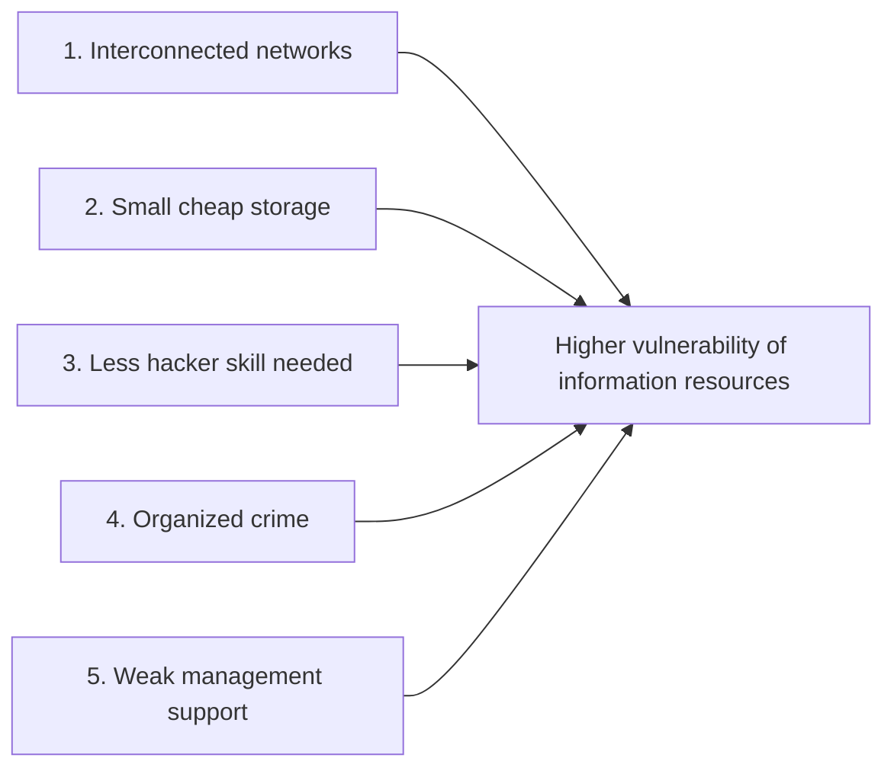
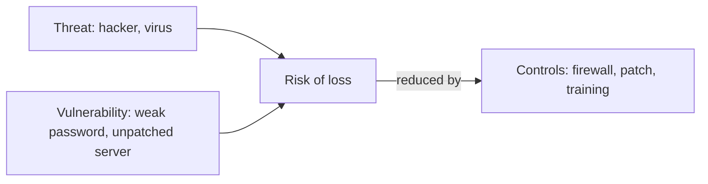

**In one line:** An information resource is more **vulnerable** (open to attack) today because of <mark>five factors: interconnected networks, small cheap storage, decreasing hacker skill needed, organized crime, and lack of management support</mark>. <Cite id="is-fundamentals-wiley-rainer" />

<Box kind="key">

**Key points to write (the five factors, each with an example):**

- <mark>Today's interconnected, interdependent, wirelessly networked business environment</mark>: every connected device is a door.
- <mark>Smaller, faster, cheaper computers and storage devices</mark>: a pen drive or phone holds huge data and is easy to lose.
- <mark>Decreasing skills necessary to be a computer hacker</mark>: free attack tools online.
- <mark>International organized crime taking over cybercrime</mark>: well-funded gangs, ransomware.
- <mark>Lack of management support</mark>: no budget, no patching, no policy.
- Define **vulnerability**: a weakness that a threat can use.

</Box>

## Core answer (5 marks, fits every question here)

<Box kind="definition">

A **vulnerability** is a weakness in an information resource that a threat (a hacker, a virus, a careless employee) can use to cause harm. Information resources are becoming more vulnerable every year for five reasons. <Cite id="web-mis-2-wiki-vulnerability" /> <Cite id="is-fundamentals-wiley-rainer" />

</Box>

| # | Factor | Why it increases risk | Specific example |
|---|---|---|---|
| 1 | Interconnected, interdependent, wirelessly networked environment | Every connected device and partner is a possible door for an attacker | A shop's payment system linked to the Internet; a weak supplier link lets attackers in |
| 2 | Smaller, faster, cheaper computers and storage devices | Huge data fits in a pen drive or phone and is easy to lose or steal | A laptop with customer records is stolen from a car |
| 3 | Decreasing skill needed to be a hacker | Ready-made attack tools are free online | A teenager runs a downloaded password-cracking tool |
| 4 | International organized crime taking over cybercrime | Well-funded gangs attack for profit and are hard to trace across borders | A ransomware gang locks a hospital's files and demands payment |
| 5 | Lack of management support | Without budget, policy and attention, basic protections are skipped | Management delays patching a server, and it is later breached |

<Cite id="is-fundamentals-wiley-rainer" /> <Cite id="note-information-security-wiki-cybercrime" />

**Conclusion:** <mark>more connections, more portable data, easier attacks and weaker support make resources more vulnerable</mark>, so layered controls are needed.

## Extended answer (10 marks): add these

### 1. Other reasons often added

More mobile and cloud use, remote work, bring-your-own-device, and **insiders** with too much access. <Cite id="note-information-security-ibm-infosec" />

### 2. A real case: WannaCry (2017)

In May 2017 the WannaCry ransomware infected over 300,000 computers in about 150 countries, including many NHS hospitals. It used a Windows flaw for which Microsoft had already released a patch two months earlier, but many systems had not installed it. This shows factors 1 (connected networks) and 5 (weak management support for patching). <Cite id="note-information-security-wiki-wannacry" />

### 3. Threat, vulnerability, risk

## Fit it to each question

- **"Identify the five factors that contribute to the increasing vulnerability of information resources, and provide a specific example of each one?"** (5 marks) <PYQ id="2023-12-ce/q1b" />: write the **core answer table**: five factors in the exact words, one specific example each, plus the one-line conclusion.

## Exam tips

- **Learn the five factors in order**; examiners look for these exact phrases.
- Give **one specific example per factor** (stolen laptop, ransomware gang), not a general line.
- Do not mix factors with threats (virus, phishing): factors explain *why* vulnerability grows.
