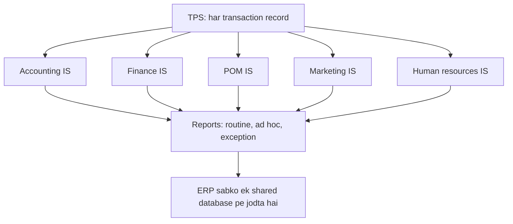
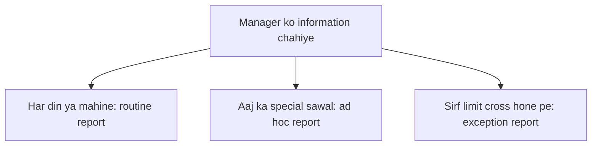

**Ek line mein:** <mark>Functional area information system (FAIS) ek department ko plan, control aur decide karne ke liye information deta hai</mark>; paanch classic FAIS hain accounting, finance, production aur operations management (POM), marketing aur human resources, aur ye <mark>routine, ad hoc aur exception reports</mark> banate hain. <Cite id="crm-rainer-iis" /> <Cite id="note-tps-fais-erp-wiki-mis" />

<Box kind="key">

**FAIS aur reports mein ye points likho:**

- <mark>FAIS ek functional area (department) ko plan, control aur decide ke liye information se support karta hai</mark>; ye mainly TPS ka data use karta hai.
- Paanch FAIS: <mark>accounting IS, finance IS, POM IS, marketing IS, human resources IS</mark>.
- Support: accounting (ledger, payables, receivables, payroll, statements), finance (cash, budgeting, forecasting, investment), POM (inventory, MRP, scheduling, quality), marketing (research, sales tracking, pricing), HR (recruitment, payroll, attendance, training).
- <mark>Report types: routine (fixed schedule), ad hoc (maangne pe), exception (sirf limit cross hone pe)</mark>.
- Ad hoc forms: **drill-down, key-indicator, comparative**.
- <mark>FAIS reports ek department ke hain; ERP reports departments ke across ek shared database pe integrated hain</mark>.

</Box>

## Core answer (5 marks, yahan ke har question ke liye)

<Box kind="definition">

A **functional area information system (FAIS)** supports one functional area (a department) by giving it information to plan, control and decide, and so raises that area's efficiency and effectiveness. Each FAIS mainly uses data collected by the **transaction processing system (TPS)**. <Cite id="crm-rainer-iis" /> <Cite id="note-tps-fais-erp-wiki-functional-area" />

</Box>

**Sirf FAIS ki problem:** har ek ek department ke liye bana hai, isliye data repeat hota hai aur departments ke numbers match nahi karte. **ERP** (poori firm ke liye ek shared database) isse theek karta hai.

**Conclusion:** <mark>FAIS har department ko uski zaroori information dete hain; ERP unhe ek version of the truth mein jodta hai</mark>.

## Extended answer (10 marks): ye add karo

### 1. Har FAIS ka support

| FAIS | Kya support karta hai | Example |
|---|---|---|
| **Accounting IS** | Saare paise ke events record aur report: general ledger, accounts payable aur receivable, billing, payroll, budgets; financial statements; auditing aur internal control; cost accounting | AIS vendor ko pay karne se pehle invoice, goods receipt aur purchase order match karta hai <Cite id="note-tps-fais-erp-wiki-ais" /> |
| **Finance IS** | Paisa aana aur jaana: cash management, investment decisions, budgeting, financial forecasting aur analysis, credit aur risk, financial markets tak access | Firm agle quarter ka cash forecast karti hai aur surplus cash kahan lagana hai decide karti hai |
| **Production and operations management (POM) IS** | Goods banana ya services dena: inventory control, purchasing aur supplier management, production planning aur scheduling (MRP), quality control, maintenance, logistics | MRP batata hai kya kab kharidna aur product kab banana hai <Cite id="note-tps-fais-erp-wiki-mrp" /> |
| **Marketing IS** | Product, price, place, promotion: market research, customer data, sales forecasting aur tracking, pricing, advertising results, customer service | Flipkart dekhta hai kaunse offers kis city mein sales badhate hain |
| **Human resources IS** | Log: recruitment, records, payroll aur benefits, attendance aur leave, training, performance appraisal, workforce planning, compliance | HRIS payslips deta hai aur training aur leave track karta hai <Cite id="note-tps-fais-erp-wiki-hris" /> |

<Cite id="crm-rainer-iis" /> <Cite id="it-impact-society-tp-mis" />

### 2. Reports ke basic types

| Report type | Kya hai | Example |
|---|---|---|
| **Routine report** | Fixed schedule pe fixed format mein | Daily sales summary, monthly payroll register |
| **Ad hoc (on-demand) report** | Manager ke maangne pe, special need ke liye | Pichhle hafte ek city mein ek product ki sales |
| **Exception report** | Sirf jab koi value limit cross kare | Reorder level se kam items, credit limit se zyada accounts |

Ad hoc reports ke common forms: **drill-down** (total se uske peeche ki detail), **key-indicator** (kuch key numbers jaise cash on hand) aur **comparative** (is saal versus pichhla saal, ya ek branch versus doosri). <Cite id="note-tps-fais-erp-wiki-mis" />

### 3. FAIS reports versus ERP reports

| Point | FAIS reports | ERP reports |
|---|---|---|
| Scope | Ek department | Poori firm, departments ke across |
| Data source | Department ka apna database | Sabke liye ek shared database |
| Types | Routine, ad hoc (drill-down, key-indicator, comparative), exception | Wahi types, lekin har ek finance, stock, sales aur HR mila sakti hai |
| View | Tasveer ka hissa; departments ke numbers alag ho sakte hain | Ek version of the truth |
| Timing | Aksar periodic (daily, monthly) | Real-time ya near real-time |
| Example | Marketing system ki sales report | Ek report jo order, uska stock, delivery aur payment status saath dikhaye |

Dono same report types use karte hain; farq ye hai ki ERP reports integrated aur hamesha consistent hain. <Cite id="note-tps-fais-erp-tp-erp" /> <Cite id="note-tps-fais-erp-wiki-erp" />

## Har question mein kaise fit karein

- **"Compare and contrast basic types of reports which are closely associated with FAIS and ERP system."** (10 marks) <PYQ id="2023-05-ce/q3b" />: FAIS aur ERP ki one-line definitions, **section 2** (teen report types examples aur ad hoc forms ke saath), phir **section 3** (FAIS versus ERP reports table) aur conclusion ki dono same report types share karte hain par ERP integrated hai.
- **"List down the types of support provided by Accounting IS, finance IS, production/operations management (POM) IS, marketing IS, and human resources IS."** (10 marks) <PYQ id="2024-12-ce/q5a" /> <PYQ id="2025-05-ce/q2a" />: FAIS define karo (core answer), phir **section 1** (paanch-row support table, har ke do-teen support points example ke saath).

## Exam tips

- **Paanch FAIS ke naam aur har ke teen-chaar support points yaad karo**; table hi answer hai.
- "Reports" ke liye teen types **aur** teen ad hoc forms (drill-down, key-indicator, comparative) likho.
- Ye sentence likho: "FAIS ek department ki report deta hai; ERP poori firm ki report ek database se deta hai."

Exam mein English mein likho.
