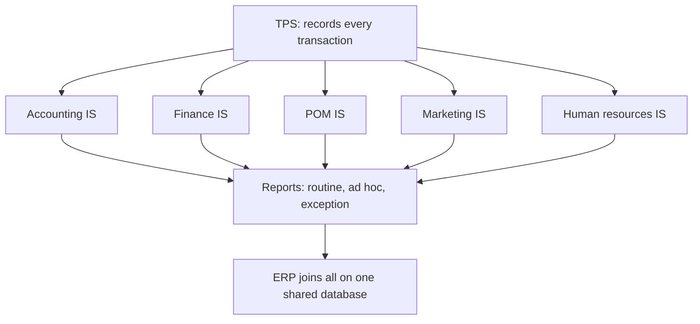
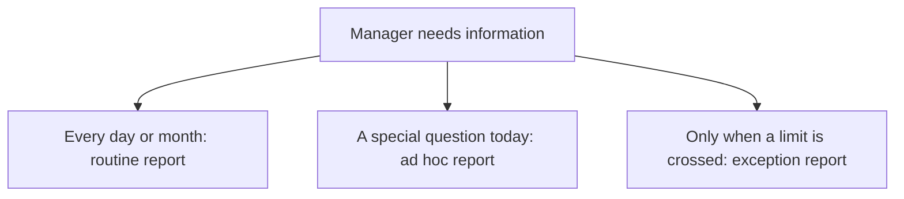

**In one line:** <mark>A functional area information system (FAIS) supports one department by giving it information to plan, control and decide</mark>; the five classic FAIS are accounting, finance, production and operations management (POM), marketing and human resources, and they produce <mark>routine, ad hoc and exception reports</mark>. <Cite id="crm-rainer-iis" /> <Cite id="note-tps-fais-erp-wiki-mis" />

<Box kind="key">

**Key points to write (FAIS and reports):**

- <mark>FAIS supports one functional area (a department) with information to plan, control and decide</mark>; it mainly uses data from the TPS.
- Five FAIS: <mark>accounting IS, finance IS, POM IS, marketing IS, human resources IS</mark>.
- Support: accounting (ledger, payables, receivables, payroll, statements), finance (cash, budgeting, forecasting, investment), POM (inventory, MRP, scheduling, quality), marketing (research, sales tracking, pricing), HR (recruitment, payroll, attendance, training).
- <mark>Report types: routine (fixed schedule), ad hoc (on demand), exception (only when a limit is crossed)</mark>.
- Ad hoc forms: **drill-down, key-indicator, comparative**.
- <mark>FAIS reports cover one department; ERP reports are integrated across departments on one shared database</mark>.

</Box>

## Core answer (5 marks, fits every question here)

<Box kind="definition">

A **functional area information system (FAIS)** supports one functional area (a department) by giving it information to plan, control and decide, and so raises that area's efficiency and effectiveness. Each FAIS mainly uses data collected by the **transaction processing system (TPS)**. <Cite id="crm-rainer-iis" /> <Cite id="note-tps-fais-erp-wiki-functional-area" />

</Box>

**Problem with FAIS alone:** each is built for one department, so data is repeated and numbers do not match across departments. **ERP** (one shared database for the whole firm) is the fix.

**Conclusion:** <mark>FAIS give each department the information it needs; ERP joins them into one version of the truth</mark>.

## Extended answer (10 marks): add these

### 1. Types of support given by each FAIS

| FAIS | What it supports | Example |
|---|---|---|
| **Accounting IS** | Records and reports all money events: general ledger, accounts payable and receivable, billing, payroll, budgets; financial statements; auditing and internal control; cost accounting | An AIS matches invoice, goods receipt and purchase order before paying a vendor <Cite id="note-tps-fais-erp-wiki-ais" /> |
| **Finance IS** | Money coming in and going out: cash management, investment decisions, budgeting, financial forecasting and analysis, credit and risk, access to financial markets | A firm forecasts cash for the next quarter and decides where to invest surplus cash |
| **Production and operations management (POM) IS** | Making goods or delivering services: inventory control, purchasing and supplier management, production planning and scheduling (MRP), quality control, maintenance, logistics | MRP works out what to buy and when to make a product <Cite id="note-tps-fais-erp-wiki-mrp" /> |
| **Marketing IS** | Product, price, place, promotion: market research, customer data, sales forecasting and tracking, pricing, advertising results, customer service | Flipkart studying which offers raise sales in which city |
| **Human resources IS** | People: recruitment, records, payroll and benefits, attendance and leave, training, performance appraisal, workforce planning, compliance | A HRIS gives payslips and tracks training and leave <Cite id="note-tps-fais-erp-wiki-hris" /> |

<Cite id="crm-rainer-iis" /> <Cite id="it-impact-society-tp-mis" />

### 2. Basic types of reports

| Report type | What it is | Example |
|---|---|---|
| **Routine report** | Produced on a fixed schedule in a fixed format | Daily sales summary, monthly payroll register |
| **Ad hoc (on-demand) report** | Produced when a manager asks, for a special need | Sales of one product in one city last week |
| **Exception report** | Produced only when a value crosses a limit | Items below reorder level, accounts over credit limit |

Ad hoc reports take common forms: **drill-down** (from a total to the detail behind it), **key-indicator** (a few key numbers such as cash on hand) and **comparative** (this year against last year, or one branch against another). <Cite id="note-tps-fais-erp-wiki-mis" />

### 3. FAIS reports versus ERP reports

| Point | FAIS reports | ERP reports |
|---|---|---|
| Scope | One department | Whole firm, across departments |
| Data source | The department's own database | One shared database for all |
| Types | Routine, ad hoc (drill-down, key-indicator, comparative), exception | The same types, but each can combine finance, stock, sales and HR |
| View | Part of the picture; numbers may differ between departments | One version of the truth |
| Timing | Often periodic (daily, monthly) | Real-time or near real-time |
| Example | The sales report from the marketing system | A report showing an order, its stock, delivery and payment status together |

Both use the same report types; the difference is that ERP reports are integrated and always consistent. <Cite id="note-tps-fais-erp-tp-erp" /> <Cite id="note-tps-fais-erp-wiki-erp" />

## Fit it to each question

- **"Compare and contrast basic types of reports which are closely associated with FAIS and ERP system."** (10 marks) <PYQ id="2023-05-ce/q3b" />: one-line definitions of FAIS and ERP, **section 2** (the three report types with examples and the ad hoc forms), then **section 3** (the FAIS versus ERP reports table) and the conclusion that both share report types but ERP is integrated.
- **"List down the types of support provided by Accounting IS, finance IS, production/operations management (POM) IS, marketing IS, and human resources IS."** (10 marks) <PYQ id="2024-12-ce/q5a" /> <PYQ id="2025-05-ce/q2a" />: define FAIS (core answer), then **section 1** (the five-row support table, two or three support points each with an example).

## Exam tips

- **Learn the five FAIS names and three or four support points for each**; the table is the answer.
- For "reports", name the three types **and** the three ad hoc forms (drill-down, key-indicator, comparative).
- Use the sentence: "FAIS reports one department; ERP reports the whole firm from one database."
