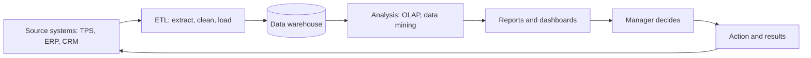

**Ek line mein:** <mark>Business intelligence (BI) firm ke bikhre data ko reports aur dashboards mein badalta hai, taaki managers andaze ki jagah facts se decide karein, fast aur early warning ke saath</mark>. <Cite id="business-intelligence-wiki-bi" />

<Box kind="key">

**Ye points likho:**

- <mark>BI = data collect, store, access aur analyse karne wali applications, technologies aur processes, better decisions ke liye</mark>.
- <mark>Flow: source systems, ETL, data warehouse, OLAP aur data mining, dashboard, decision</mark>.
- <mark>Impact: fact-based, faster, single view, better forecasting, early warning</mark>.
- Aur: customer understanding, har level pe decisions, **KPIs** se measurement.
- <mark>Limits: kharab data quality, high cost, overload, judgment ki jagah nahi le sakta</mark>.
- Ek example do: retail dashboard se jackets ka stock pehle hi shift.

</Box>

## Core answer (5 marks, yahan ke har question ke liye)

<Box kind="definition">

**Business intelligence (BI)** is a set of applications, technologies and processes for collecting, storing, accessing and analysing data to help business users make better decisions. <Cite id="business-intelligence-wiki-bi" /> <Cite id="business-intelligence-ibm-bi" />

</Box>

Car ke dashboard jaisa: speed aur fuel ek nazar mein dikh jaate hain, driver ko andaza nahi lagana padta.

**Decision making pe impact** <Cite id="business-intelligence-gfg-bi" />

1. **Fact-based decisions:** data intuition ki jagah leta hai.
2. **Faster decisions:** data pehle se integrated hai, isliye jawab minutes mein, hafton mein nahi.
3. **Business ka single view:** sales, finance aur stock ek saath dikhte hain.
4. **Better forecasting:** trends se demand aur budget plan hote hain.
5. **Early warning:** dashboards girti sales ya badhta cost pehle hi flag karte hain.

**Conclusion:** <mark>BI decisions ko fast, better informed aur measurable banata hai, bas data clean ho aur managers judgment bhi use karein</mark>.

## Extended answer (10 marks): ye add karo

### 1. Aur impacts

6. **Customer understanding:** data mining buying patterns dikhata hai, targeted offers ke liye.
7. **Har level pe decisions:** self-service BI operational staff ki bhi help karta hai, sirf executives ki nahi.
8. **Measurement:** KPIs (key performance indicators) batate hain ki decision kaam aaya ya nahi. <Cite id="business-intelligence-tp-bi" />

### 2. BI ke bina vs BI ke saath

| Point | BI ke bina | BI ke saath |
|---|---|---|
| Basis | Experience, andaza | Data aur trends |
| Speed | Report mein din ya hafte | Minutes, live dashboard |
| View | Alag department reports | Ek combined view |
| Problems | Loss ke baad dikhti hain | Early warning |

### 3. Data-driven decisions kaam karte hain, iska saboot

McAfee aur Brynjolfsson ki 330 companies ki study mein mila ki data-driven decision making mein industry ke top third firms average mein competitors se 5 percent zyada productive aur 6 percent zyada profitable thi. <Cite id="web-mis-1-hbr-big-data-revolution" />

### 4. Example

Retail chain ke dashboard mein North India mein winter jackets ki sales do hafte pehle badhti dikhti hai. Manager turant southern stores se stock shift karta hai aur shortage se bachta hai. Amazon aur Flipkart bhi aisa analysis karte hain ki kaun sa stock kis warehouse mein rakhna hai.

### 5. Limits

Kharab data quality se galat jawab, setup cost high, bahut dashboards se overload, aur numbers human judgment ki jagah nahi le sakte.

## Har question mein kaise fit karein

- **"Analyze the impact of BI on Decision making."** (5 marks) <PYQ id="2023-12-ce/q1c" />: definition, core answer ke paanch impacts, example ki ek line, limits ek line mein.
- **"Analyze the impact of BI on Decision making"** (10 marks) <PYQ id="2024-12-ce/q2a" />: core answer plus aathon impacts, with-without table, saboot, example aur limits.

## Exam tips

- **BI flow diagram draw karo**; dikhata hai ki data decision kaise banta hai.
- Words use karo: **fact-based, faster, single view, early warning, KPI**.
- End mein **limits** likho; "analyze" mein dono sides chahiye.

Exam mein English mein likho.
