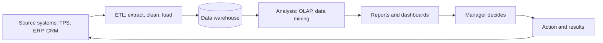

**In one line:** <mark>Business intelligence (BI) turns a firm's scattered data into reports and dashboards, so managers decide using facts instead of guesses, faster and with early warning</mark>. <Cite id="business-intelligence-wiki-bi" />

<Box kind="key">

**Key points to write:**

- <mark>BI = applications, technologies and processes for collecting, storing, accessing and analysing data to help users make better decisions</mark>.
- <mark>Flow: source systems, ETL, data warehouse, OLAP and data mining, dashboard, decision</mark>.
- <mark>Impact: fact-based, faster, single view, better forecasting, early warning</mark>.
- Also: customer understanding, decisions at every level, measurement by **KPIs**.
- <mark>Limits: poor data quality, high cost, overload, cannot replace judgment</mark>.
- Give one example: a retail dashboard moves jacket stock early.

</Box>

## Core answer (5 marks, fits every question here)

<Box kind="definition">

**Business intelligence (BI)** is a set of applications, technologies and processes for collecting, storing, accessing and analysing data to help business users make better decisions. <Cite id="business-intelligence-wiki-bi" /> <Cite id="business-intelligence-ibm-bi" />

</Box>

Think of a car dashboard: speed and fuel are shown at a glance, so the driver need not guess.

**Impact on decision making** <Cite id="business-intelligence-gfg-bi" />

1. **Fact-based decisions:** data replaces intuition.
2. **Faster decisions:** data is already integrated, so answers come in minutes, not weeks.
3. **Single view of the business:** sales, finance and stock are seen together.
4. **Better forecasting:** trends help plan demand and budgets.
5. **Early warning:** dashboards flag falling sales or rising cost early.

**Conclusion:** <mark>BI makes decisions faster, better informed and measurable, provided the data is clean and managers still use judgment</mark>.

## Extended answer (10 marks): add these

### 1. More impacts

6. **Customer understanding:** data mining shows buying patterns for targeted offers.
7. **Decisions at every level:** self-service BI helps operational staff, not only executives.
8. **Measurement:** KPIs (key performance indicators) show whether a decision worked. <Cite id="business-intelligence-tp-bi" />

### 2. Without BI versus with BI

| Point | Without BI | With BI |
|---|---|---|
| Basis | Experience, guess | Data and trends |
| Speed | Days or weeks for a report | Minutes, live dashboard |
| View | Separate department reports | One combined view |
| Problems seen | After the loss | Early warning |

### 3. Evidence that data-driven decisions pay

A study of 330 companies by McAfee and Brynjolfsson found that firms in the top third of their industry in data-driven decision making were, on average, 5 percent more productive and 6 percent more profitable than their competitors. <Cite id="web-mis-1-hbr-big-data-revolution" />

### 4. Example

A retail chain's dashboard shows winter jacket sales in North India rising two weeks early. The manager moves stock from southern stores at once and avoids a shortage. Amazon and Flipkart use similar analysis to decide what stock to keep in which warehouse.

### 5. Limits

Poor data quality gives wrong answers, setup cost is high, too many dashboards cause overload, and numbers cannot replace human judgment.

## Fit it to each question

- **"Analyze the impact of BI on Decision making."** (5 marks) <PYQ id="2023-12-ce/q1c" />: definition, the five impacts of the core answer, one example line, limits in one line.
- **"Analyze the impact of BI on Decision making"** (10 marks) <PYQ id="2024-12-ce/q2a" />: core answer plus all eight impacts, the with and without table, the evidence, example and limits.

## Exam tips

- **Draw** the BI flow diagram; it shows how data becomes a decision.
- Use the words **fact-based, faster, single view, early warning, KPI**.
- Always end with **limits**; "analyze" asks for both sides.
