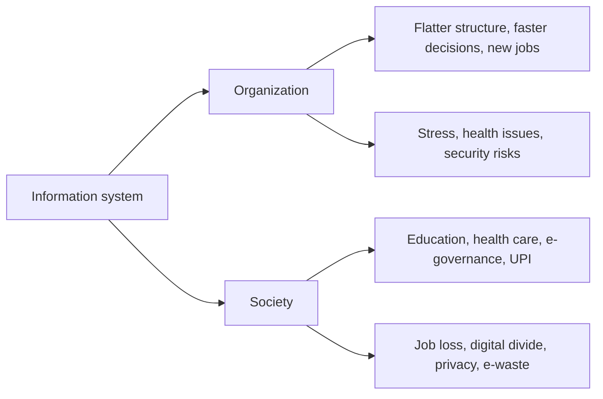
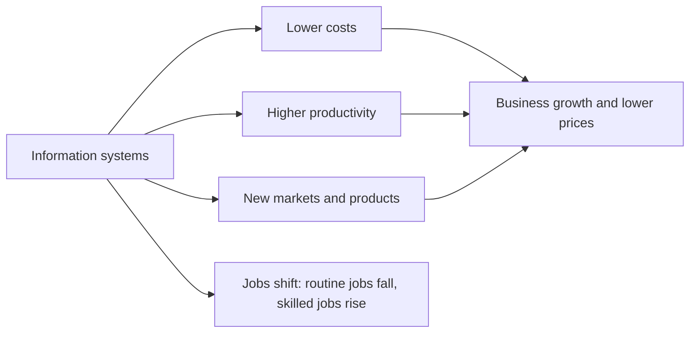

**Ek line mein:** <mark>IT andar organization ka structure, jobs, decisions aur health badalta hai, aur bahar society ki economy, education, health care aur daily life badalta hai, dono taraf benefits aur problems ke saath</mark>. <Cite id="it-impact-society-rainer-iis7" loc="Ch. 1" />

<Box kind="key">

**Har impact question mein ye points likho:**

- <mark>Organization: flatter structure, faster decisions, changed business processes, changed jobs</mark>.
- <mark>Society: quality of life, health care, education, e-governance, robots, disabled logon ki help</mark>.
- <mark>Economy: kam transaction aur coordination cost, zyada productivity, naye markets aur jobs</mark>.
- <mark>Problems: job loss, digital divide, privacy aur security risk, health issues, e-waste</mark>.
- Hamesha **dono sides** table mein likho: positive aur negative.
- Indian examples do: **UPI, NPTEL, e-filing, Flipkart, SBI core banking**.

</Box>

## Core answer (5 marks, yahan ke har question ke liye)

<Box kind="definition">

The **impact of IT and IS** is the change that information technology brings to how a firm is structured and works (organization), and to how people live, learn, earn and get services (society). An information system is people, hardware, software, data and procedures that collect, process and share information. <Cite id="it-impact-society-rainer-iis7" loc="Ch. 1" />

</Box>

Shehar mein bijli ki tarah: ghar aur schools roshan hote hain, lekin galat wiring se nuksaan hota hai aur jinke paas connection nahi wo peeche reh jaate hain.

| Area | Positive | Negative |
|---|---|---|
| Structure | Flatter, fast communication | Middle-manager posts kam |
| Decisions | Real-time information | Information overload |
| Jobs | Naye skilled jobs | Routine jobs automate |
| Health | Bhaari manual kaam kam | Eye strain, back pain, stress |
| Society | Convenience, information access | Digital divide, privacy risk |

**Conclusion:** <mark>IT organizations aur society ko fast aur better connected banata hai, lekin retraining, ergonomics, privacy aur equal access ki planning zaroori hai</mark>.

## Extended answer (10 marks): ye add karo

### 1. Organizations pe impact

1. **Flatter structure:** systems reports summarize karte hain, isliye middle managers kam chahiye aur ek manager zyada logon ko supervise karta hai.
2. **Better aur faster decisions:** dashboards paper ke dher ki jagah lete hain.
3. **Business processes badalte hain:** kaam system ke around redesign hota hai (business process re-engineering). <Cite id="it-impact-society-wiki-bpr" />
4. **Better coordination:** departments ek database share karte hain.
5. **Jobs badalte hain:** routine jobs automate; developers, analysts, security staff ke naye jobs.
6. **Employee health:** screen time se eye strain, back pain, repetitive strain injury, isliye ergonomics zaroori. <Cite id="it-impact-society-wiki-ergonomics" />
7. **Naye risks:** systems pe dependence, cyber attacks, breaches.

### 2. Society pe impact

1. **Quality of life:** online shopping, banking, booking, government services.
2. **Robots aur automation** khatarnaak ya repetitive kaam ke liye.
3. **Health care:** electronic health records aur telehealth. <Cite id="it-impact-society-wiki-telehealth" />
4. **Education:** NPTEL aur SWAYAM courses internet wale kisi ko bhi milte hain.
5. **Government services:** income-tax e-filing aur UPI se queues kam.
6. **Disabled logon:** assistive technology unhe padhne aur kaam karne mein help karti hai. <Cite id="it-impact-society-gfg-media-society" />

### 3. Economic impact (examples ke saath)

| Effect | Example |
|---|---|
| Kam transaction cost | Wholesale market jaane ki jagah B2B app pe stock order |
| Kam coordination cost | SBI hazaaron branches ek core-banking system pe chalata hai |
| Zyada productivity | Supermarket mein barcode billing |
| Naye markets aur models | Zomato, Flipkart, UPI; artisan poore India mein bechta hai |
| Naye jobs aur industries | Infosys, data analysts, delivery partners |
| Globalization | Indian IT firms foreign clients ko serve karti hain |

<Cite id="it-impact-society-laudon-mis" /> <Cite id="it-impact-society-porter-millar1985" />

**Dono sides:** kuch workers routine jobs kho dete hain aur naye skills chahiye, aur **digital divide** kuch logon ko peeche chhod deta hai. <Cite id="it-impact-society-wiki-tech-unemployment" /> <Cite id="it-impact-society-wiki-digital-divide" />

## Har question mein kaise fit karein

- **"How Does IT Impact Organizations?"** (5 marks) <PYQ id="2023-05-ce/q1a" /> <PYQ id="2024-12-ce/q1a" />: core answer, table ki organization rows (structure, decisions, jobs, health) aur section 1 pe zor; example: Infosys aur SBI systems share karte hain, head office ko branch figures usi din milte hain. <Cite id="it-impact-society-gfg-mis" />
- **"Explain the impact of information system on organization and society."** (10 marks) <PYQ id="2023-05-ce/q2a" /> <PYQ id="2024-12-ce/q6a" />: flow diagram, section 1 aur section 2, phir positive-negative table aur conclusion.
- **"Explain the importance of Information systems to Society"** (5 marks) <PYQ id="2023-12-ce/q1e" />: sirf section 2 (saat points) aur IS ki problems (job loss, privacy, digital divide, fake news, e-waste).
- **"Highlight the Economic impacts of IS. Give example."** (10 marks) <PYQ id="2024-05-ce/q2a" />: definition (costs, output, jobs, markets aur prices pe effect), section 3 diagram aur example table, phir dono sides.

## Exam tips

- **Organization aur society ka flow diagram** hamesha draw karo.
- End mein **dono sides** likho: benefits aur problems; one-sided answer mein marks kat'te hain.
- "Economic" ke liye words use karo: **transaction cost, coordination cost, productivity, new markets**.

Exam mein English mein likho.
