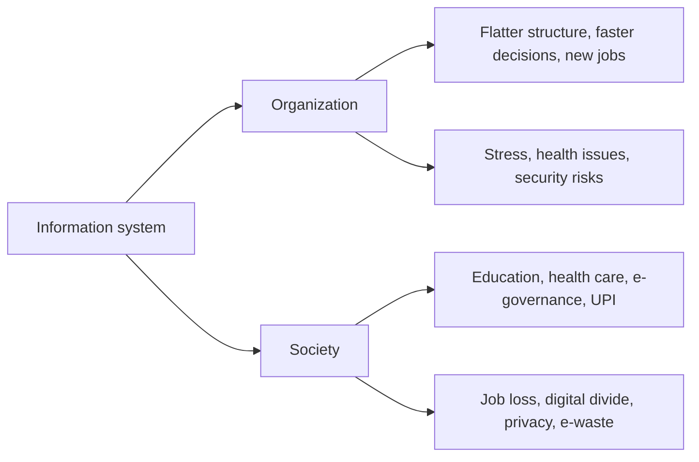
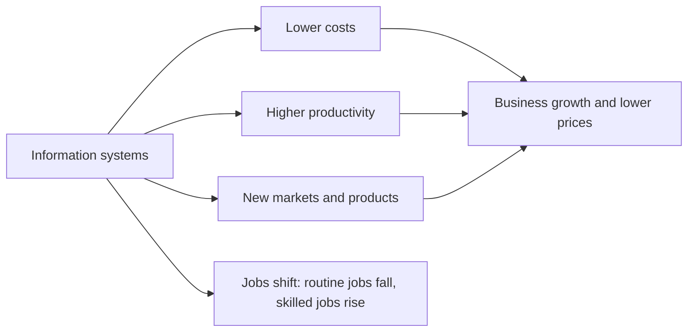

**In one line:** <mark>IT changes the structure, jobs, decisions and health of an organization inside, and the economy, education, health care and daily life of society outside, with benefits and problems on both sides</mark>. <Cite id="it-impact-society-rainer-iis7" loc="Ch. 1" />

<Box kind="key">

**Key points to write (any impact question):**

- <mark>Organization: flatter structure, faster decisions, changed business processes, changed jobs</mark>.
- <mark>Society: quality of life, health care, education, e-governance, robots, help for the disabled</mark>.
- <mark>Economy: lower transaction and coordination costs, higher productivity, new markets and jobs</mark>.
- <mark>Problems: job loss, digital divide, privacy and security risk, health issues, e-waste</mark>.
- Always give **both sides** in a table: positive and negative.
- Give Indian examples: **UPI, NPTEL, e-filing, Flipkart, SBI core banking**.

</Box>

## Core answer (5 marks, fits every question here)

<Box kind="definition">

The **impact of IT and IS** is the change that information technology brings to how a firm is structured and works (organization), and to how people live, learn, earn and get services (society). An information system is people, hardware, software, data and procedures that collect, process and share information. <Cite id="it-impact-society-rainer-iis7" loc="Ch. 1" />

</Box>

Like electricity in a town: it lights homes and schools, but unsafe wiring hurts and houses without a connection fall behind.

| Area | Positive | Negative |
|---|---|---|
| Structure | Flatter, faster communication | Fewer middle-manager posts |
| Decisions | Real-time information | Information overload |
| Jobs | New skilled jobs | Routine jobs automated |
| Health | Less heavy manual work | Eye strain, back pain, stress |
| Society | Convenience, access to information | Digital divide, privacy risk |

**Conclusion:** <mark>IT makes organizations and society faster and better connected, but people must plan for retraining, ergonomics, privacy and equal access</mark>.

## Extended answer (10 marks): add these

### 1. Impact on organizations

1. **Flatter structure:** systems summarize reports, so fewer middle managers are needed and each manager supervises more people.
2. **Better and faster decisions:** dashboards replace piles of paper.
3. **Changed business processes:** work is redesigned around the system (business process re-engineering). <Cite id="it-impact-society-wiki-bpr" />
4. **Better coordination:** departments share one database.
5. **Jobs change:** routine jobs automated; new jobs for developers, analysts, security staff.
6. **Employee health:** screen time causes eye strain, back pain and repetitive strain injury, so ergonomics matters. <Cite id="it-impact-society-wiki-ergonomics" />
7. **New risks:** dependence on systems, cyber attacks, breaches.

### 2. Impact on society

1. **Quality of life:** online shopping, banking, booking and government services.
2. **Robots and automation** for dangerous or repetitive work.
3. **Health care:** electronic health records and telehealth. <Cite id="it-impact-society-wiki-telehealth" />
4. **Education:** NPTEL and SWAYAM courses reach anyone with internet.
5. **Government services:** income-tax e-filing and UPI cut queues.
6. **People with disabilities:** assistive technology helps them study and work. <Cite id="it-impact-society-gfg-media-society" />

### 3. Economic impact (with examples)

| Effect | Example |
|---|---|
| Lower transaction cost | Ordering stock on a B2B app, not at a wholesale market |
| Lower coordination cost | SBI runs thousands of branches on one core-banking system |
| Higher productivity | Barcode billing at a supermarket |
| New markets and models | Zomato, Flipkart, UPI; an artisan sells across India |
| New jobs and industries | Infosys, data analysts, delivery partners |
| Globalization | Indian IT firms serving foreign clients |

<Cite id="it-impact-society-laudon-mis" /> <Cite id="it-impact-society-porter-millar1985" />

**Both sides:** some workers lose routine jobs and need new skills, and the **digital divide** leaves some people behind. <Cite id="it-impact-society-wiki-tech-unemployment" /> <Cite id="it-impact-society-wiki-digital-divide" />

## Fit it to each question

- **"How Does IT Impact Organizations?"** (5 marks) <PYQ id="2023-05-ce/q1a" /> <PYQ id="2024-12-ce/q1a" />: core answer, stress the organization rows of the table (structure, decisions, jobs, health) and section 1; example: Infosys and SBI share systems so head office sees branch figures the same day. <Cite id="it-impact-society-gfg-mis" />
- **"Explain the impact of information system on organization and society."** (10 marks) <PYQ id="2023-05-ce/q2a" /> <PYQ id="2024-12-ce/q6a" />: the flow diagram, section 1 and section 2, then the positive and negative table and conclusion.
- **"Explain the importance of Information systems to Society"** (5 marks) <PYQ id="2023-12-ce/q1e" />: write only section 2 (seven points) plus the problems IS creates (job loss, privacy, digital divide, fake news, e-waste).
- **"Highlight the Economic impacts of IS. Give example."** (10 marks) <PYQ id="2024-05-ce/q2a" />: definition (effect on costs, output, jobs, markets and prices), section 3 diagram and example table, then both sides.

## Exam tips

- **Always draw** the organization and society flow diagram.
- End with **both sides**: benefits and problems; marks are lost for one-sided answers.
- For "economic", use the words **transaction cost, coordination cost, productivity, new markets**.
