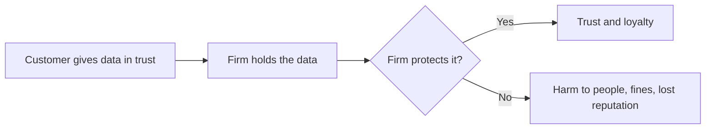
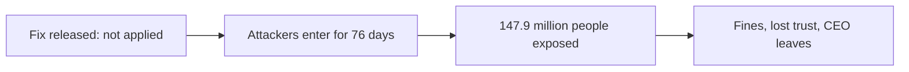

**Ek line mein:** <mark>Haan, security ek ethical responsibility hai: jo organization doosron ka data rakhti hai uska duty of care hai ki use protect kare, aur aisa na karne se asli logon ko nuksaan hota hai</mark>. <Cite id="ethics-privacy-rainer-ch3" />

<Box kind="key">

**Ye points likho:**

- <mark>Information security = information ko unauthorized access, change ya loss se bachana; ethical responsibility = sahi karne aur doosron ko nuksaan na pahunchane ka duty</mark>.
- <mark>Reasons: duty of care, asli logon ko harm, privacy security pe depend karti hai, accountability, society mein trust</mark>.
- <mark>Case study: Equifax breach, 2017: na lagaya gaya patch attackers ko andar le aaya; lagbhag 147.9 million log exposed</mark>.
- Consequences: share price giri, CEO retire hua, kam se kam lagbhag **USD 575 million** ke settlements.
- Lessons: **responsibility, accountability, liability** ki failure.
- Answer saaf **"Yes"** se shuru karo aur case pe khatam karo.

</Box>

## Core answer (5 marks, yahan ke har question ke liye)

<Box kind="definition">

An **ethical responsibility** is a duty to do what is right and not harm others. **Information security** is the protection of information from unauthorized access, change or loss. Together: an organization that collects data must protect it. <Cite id="ethics-privacy-rainer-ch3" />

</Box>

Doosron ka data rakhne wali company us locker attendant jaisi hai jo aapka saaman rakhta hai. "Lock karna bahut mehnat hai" kehkar locker khula chhodna galat hai, chahe koi rule na ho.

**Security ethical responsibility kyun hai**

1. **Duty of care:** data customers ka hai, jo firm pe bharosa karte hain.
2. **Asli logon ko harm:** leak se fraud, identity theft, stress aur paise ka nuksaan.
3. **Privacy security pe depend karti hai:** data secure nahi to private nahi.
4. **Accountability:** firm ko failures ka jawab dena hai, honestly aur jaldi report karna aur fix karna.
5. **Society mein trust:** log digital services tabhi use karte hain jab data safe lage. <Cite id="is-fundamentals-pearson-laudon" /> <Cite id="ethics-privacy-gfg-ethical-issues" />

**Conclusion:** <mark>security ek ethical responsibility hai, kyunki data protect karna logon ko protect karna hai</mark>.

## Extended answer (10 marks): ye add karo

### 1. Case study: Equifax breach, 2017

Equifax ek badi US credit reporting company hai. Apache Struts web software ke flaw ka fix 7 March 2017 ko release hua, lekin Equifax ne use apni ek website pe apply nahi kiya. Attackers ne May 2017 se flaw use kiya, aur breach 76 din tak pakda nahi gaya. Lagbhag 147.9 million logon ke naam, birth dates, social security numbers aur addresses exposed hue. <Cite id="note-information-security-wiki-equifax" />

**Consequences:** ek din mein share price lagbhag 13 percent giri, CEO retire hua, aur 2019 mein Equifax ne US regulators aur states ke saath kam se kam lagbhag USD 575 million ke settlements maane. <Cite id="ethics-privacy-ftc-equifax" />

### 2. Ethical lessons

- **Responsibility:** known flaw patch na karna.
- **Accountability:** der se detection aur der se disclosure.
- **Liability:** penalties aur legal claims.
- Jin logon ko harm hua unhone Equifax ko data diya hi nahi tha, isliye duty aur mazboot.

### 3. Ek chhota doosra example

Facebook aur Cambridge Analytica mein lagbhag 87 million users ka data political profiling ke liye use hua, jo data sharing pe weak control ka example hai. <Cite id="ethics-privacy-wiki-cambridge-analytica" />

| Ethical security ke bina | Ethical security ke saath |
|---|---|
| Customers ke liye fraud aur identity theft | Safe, bharosemand customers |
| Firm ke liye fines, lawsuits, reputation loss | Trust aur loyalty |

## Har question mein kaise fit karein

- **"Is security an ethical responsibility? Justify with a case study."** (10 marks) <PYQ id="2024-05-ce/q5b" />: "Yes" se shuru, definitions, paanch reasons, duty-of-care diagram, Equifax case apne flow diagram ke saath, consequences, ethical lessons, table, conclusion.

## Exam tips

- **"Yes" se shuru karo** aur saaf reason do.
- Bahut kamzor cases ki jagah **ek detailed case** (Equifax) dates aur numbers ke saath.
- Case ko **responsibility, accountability, liability** se jodo.

Exam mein English mein likho.
