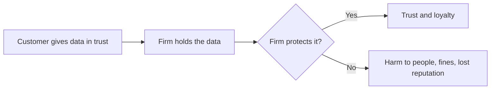

**In one line:** <mark>Yes, security is an ethical responsibility: an organization that holds other people's data has a duty of care to protect it, and failing to do so harms real people</mark>. <Cite id="ethics-privacy-rainer-ch3" />

<Box kind="key">

**Key points to write:**

- <mark>Information security = protecting information from unauthorized access, change or loss; ethical responsibility = a duty to do what is right and not harm others</mark>.
- <mark>Reasons: duty of care, harm to real people, privacy depends on security, accountability, trust in society</mark>.
- <mark>Case study: Equifax breach, 2017: an unapplied patch let attackers in; about 147.9 million people were exposed</mark>.
- Consequences: share price fall, CEO retired, settlements of at least about **USD 575 million**.
- Lessons: failure of **responsibility, accountability, liability**.
- Answer begins with a clear **"Yes"** and ends with the case.

</Box>

## Core answer (5 marks, fits every question here)

<Box kind="definition">

An **ethical responsibility** is a duty to do what is right and not harm others. **Information security** is the protection of information from unauthorized access, change or loss. Together: an organization that collects data must protect it. <Cite id="ethics-privacy-rainer-ch3" />

</Box>

A company that holds other people's data is like a locker attendant holding your valuables. Leaving the locker open because locking was "too much work" is wrong, even if no rule forced him.

**Why security is an ethical responsibility**

1. **Duty of care:** the data belongs to customers, who trust the firm.
2. **Harm to real people:** a leak causes fraud, identity theft, stress and money loss.
3. **Privacy depends on security:** data cannot be private if it is not secure.
4. **Accountability:** the firm must answer for failures, report them honestly and quickly, and fix them.
5. **Trust in society:** people use digital services only if they believe data is safe. <Cite id="is-fundamentals-pearson-laudon" /> <Cite id="ethics-privacy-gfg-ethical-issues" />

**Conclusion:** <mark>security is an ethical responsibility, because protecting data protects people</mark>.

## Extended answer (10 marks): add these

### 1. Case study: Equifax breach, 2017

Equifax is a large US credit reporting company. A fix for a flaw in the Apache Struts web software was released on 7 March 2017, but Equifax did not apply it to one of its websites. Attackers used the flaw from May 2017, and the breach went unnoticed for 76 days. About 147.9 million people had names, birth dates, social security numbers and addresses exposed. <Cite id="note-information-security-wiki-equifax" />

**Consequences:** the share price fell about 13 percent in a day, the CEO retired, and in 2019 Equifax agreed to settlements of at least about USD 575 million with US regulators and states. <Cite id="ethics-privacy-ftc-equifax" />

### 2. Ethical lessons

- **Responsibility:** failure to patch a known flaw.
- **Accountability:** late detection and late disclosure.
- **Liability:** penalties and legal claims.
- The people harmed never chose to give Equifax their data, which makes the duty stronger.

### 3. A second example (short)

In the Facebook and Cambridge Analytica case, data of about 87 million users was used for political profiling, an example of weak control over data sharing. <Cite id="ethics-privacy-wiki-cambridge-analytica" />

| Without ethical security | With ethical security |
|---|---|
| Fraud and identity theft for customers | Safe, trusting customers |
| Fines, lawsuits, lost reputation for the firm | Trust and loyalty |

## Fit it to each question

- **"Is security an ethical responsibility? Justify with a case study."** (10 marks) <PYQ id="2024-05-ce/q5b" />: start with "Yes", definitions, five reasons, duty-of-care diagram, Equifax case with its flow diagram, consequences, ethical lessons, table, conclusion.

## Exam tips

- **Start with "Yes"** and a clear reason.
- Use **one detailed case** (Equifax) with dates and numbers rather than many weak cases.
- Link the case back to **responsibility, accountability, liability**.
