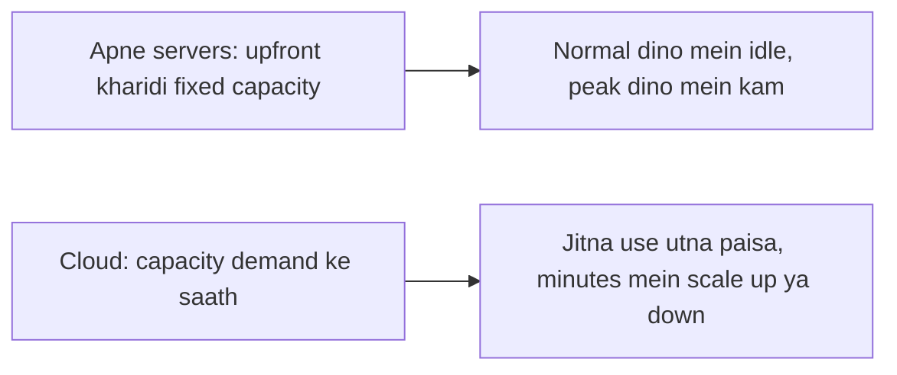
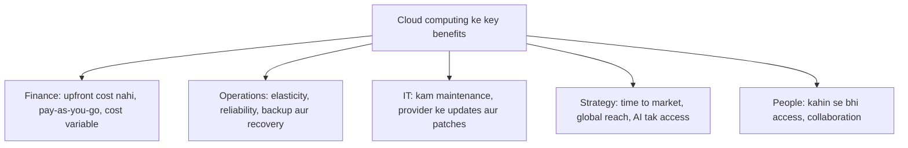

**Ek line mein:** <mark>Cloud computing ke key benefits hain: kam upfront cost, pay-as-you-go, scalability aur elasticity, speed aur agility, global reach, reliability aur recovery, kahin se bhi access, aur kam IT burden</mark>. <Cite id="note-cloud-computing-aws-cloud" /> <Cite id="note-cloud-computing-gfg-cloud" />

<Box kind="key">

**Cloud ke benefits ke question mein ye points likho:**

- <mark>Kam upfront cost</mark>: capital cost operating cost ban jaata hai; servers kharidne nahi padte.
- <mark>Pay-as-you-go</mark>: jitna use utna paisa.
- <mark>Scalability aur elasticity</mark>: demand ke hisaab se capacity badhao ya ghatao.
- <mark>Speed aur agility</mark>: naye resources minutes mein, time to market kam.
- <mark>Reliability, backup aur disaster recovery</mark> aur **kahin se bhi access**.
- Kam IT burden, AI aur analytics tak access, behtar collaboration.
- **Analysis:** benefits uneven demand aur chhoti ya nayi firms ke liye sabse zyada; steady workloads aur strict rules wale data ke liye kam. Risks chhote mein likho.

</Box>

## Core answer (5 marks, yahan ke har question ke liye)

<Box kind="definition">

**Cloud computing** is on-demand access over the network to a shared pool of computing resources that can be quickly provisioned and released with minimal management effort. You rent what you need and pay for what you use. <Cite id="note-cloud-computing-nist-800-145" />

</Box>

**Benefits kyun aate hain:** jo firm apne servers rakhti hai wo pehle paisa deti hai, capacity ka andaza lagati hai aur spare capacity rakhti hai jo normal dino mein khaali rehti hai. Cloud isse hatata hai: capacity abhi lo, baad mein chhod do. <Cite id="note-cloud-computing-aws-cloud" />

| Benefit | Kyun zaroori | Example |
|---|---|---|
| Kam upfront cost | Servers kharidne nahi padte | Start-up bina data center ke launch |
| Pay-as-you-go | Sirf use ka paisa, waste kam | Test server ka per hour paisa |
| Scalability aur elasticity | Demand ke saath badho ya ghato | Shopping site badi sale ke liye capacity badhati hai |
| Speed aur agility | Naye resources minutes mein | Team same din naye server pe idea try karti hai |
| Global reach | Naye regions mein users ke paas deploy | Streaming service kai deshon mein |
| Reliability aur recovery | Sasta backup aur disaster recovery | Doosre region mein copy kiya data failure mein bach jaata hai |
| Kahin se bhi access | Internet wale kisi bhi device se kaam | Staff ghar se Microsoft 365 |
| Kam IT burden | Provider maintenance aur updates karta hai | IT team ke bina chhoti firm SaaS use karti hai |

<Cite id="note-cloud-computing-gfg-cloud" /> <Cite id="note-cloud-computing-wiki-cloud" />

**Conclusion:** <mark>cloud computing computing ko utility bana deta hai, isliye firm sirf jitna use kare utna deti hai aur tezi se badh sakti hai</mark>.

## Extended answer (10 marks): ye add karo

### 1. Do aur benefits

- **Advanced services tak access:** AI, analytics aur machine learning ready services ki tarah. *Example:* firm khud banane ke bajay ready speech service use karti hai.
- **Behtar collaboration:** kai log ek hi file ek saath edit karte hain. *Example:* class group ka shared Google Doc. <Cite id="note-cloud-computing-gfg-models" />

### 2. Business area ke hisaab se benefits

### 3. Analysis: benefits kab sabse zyada

| Situation | Cloud ka benefit |
|---|---|
| Demand uneven (sale days) | Bahut zyada: scale up aur down |
| Firm chhoti ya nayi | Bahut zyada: capital nahi chahiye |
| Speed zaroori | Zyada: resources minutes mein |
| Steady, predictable workload | Kam: apna hardware sasta ho sakta hai |
| Strict rules wala data | Kam: compliance mushkil |

Cost budget se bhi upar ja sakta hai: Wikipedia mein cited ek survey ke mutabik 2023 mein 69% IT leaders cloud budgets se aage nikle. <Cite id="note-cloud-computing-wiki-cloud" />

### 4. Answer balance karne ke liye risks

| Risk | Matlab |
|---|---|
| Security aur privacy | Data provider ke paas; security shared |
| Internet dependence | Link ya provider down to kaam band |
| Vendor lock-in | Provider badalna mehnga |
| Cost overruns | Pay-per-use bills chupke se badh sakte hain |

<Cite id="note-cloud-computing-wiki-lockin" />

**Conclusion:** <mark>benefits variable demand aur chhoti firms ke liye sabse zyada hain; manager ko phir bhi security, cost aur lock-in manage karna hota hai</mark>.

## Har question mein kaise fit karein

- **"Analyze the key benefits of cloud computing."** (10 marks) <PYQ id="2024-05-ce/q6a" />: definition, reason aur example ke saath benefits table (core), sections 1 aur 2 (do aur benefits aur grouped diagram), phir **section 3 (analysis)** aur chhoti risks table. "Analyze" ke liye analysis section zaroori hai.

## Exam tips

- **Har benefit ke teen parts:** naam, kyun zaroori, ek example.
- "Analyze" matlab sirf list mat karo: batao benefits kab sabse zyada hain aur risks chhote mein jodo.
- **Elasticity** aur **pay-as-you-go** words likho; ye key terms hain.

Exam mein English mein likho.
