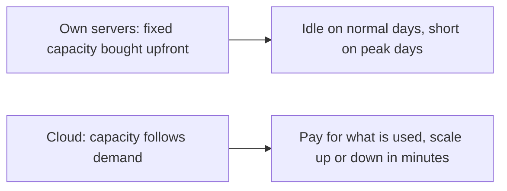
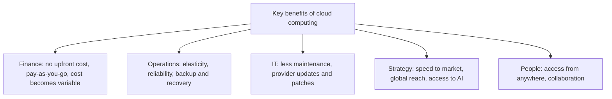

**In one line:** <mark>The key benefits of cloud computing are lower upfront cost, pay-as-you-go, scalability and elasticity, speed and agility, global reach, reliability and recovery, access from anywhere, and less IT burden</mark>. <Cite id="note-cloud-computing-aws-cloud" /> <Cite id="note-cloud-computing-gfg-cloud" />

<Box kind="key">

**Key points to write (benefits of cloud computing):**

- <mark>Lower upfront cost</mark>: capital cost becomes operating cost; no servers to buy.
- <mark>Pay-as-you-go</mark>: pay only for what you use.
- <mark>Scalability and elasticity</mark>: grow or shrink capacity with demand.
- <mark>Speed and agility</mark>: new resources in minutes, faster time to market.
- <mark>Reliability, backup and disaster recovery</mark> and **access from anywhere**.
- Less IT burden, access to AI and analytics, better collaboration.
- **Analysis:** benefits are largest for uneven demand, small or new firms; smaller for steady workloads and strictly regulated data. Mention risks briefly.

</Box>

## Core answer (5 marks, fits every question here)

<Box kind="definition">

**Cloud computing** is on-demand access over the network to a shared pool of computing resources that can be quickly provisioned and released with minimal management effort. You rent what you need and pay for what you use. <Cite id="note-cloud-computing-nist-800-145" />

</Box>

**Why the benefits arise:** a firm that owns servers pays upfront, guesses its capacity and keeps spare capacity that stays idle on normal days. Cloud removes this by letting the firm take capacity now and release it later. <Cite id="note-cloud-computing-aws-cloud" />

| Benefit | Why it matters | Example |
|---|---|---|
| Lower upfront cost | No need to buy servers | A start-up launches without a data center |
| Pay-as-you-go | Pay only for use, little waste | Paying per hour for a test server |
| Scalability and elasticity | Grow or shrink with demand | A shopping site adds capacity for a big sale |
| Speed and agility | New resources in minutes | A team tries an idea on a new server the same day |
| Global reach | Deploy near users in new regions | A streaming service serves many countries |
| Reliability and recovery | Cheaper backup and disaster recovery | Data copied to another region survives a failure |
| Access from anywhere | Work from any device with internet | Staff use Microsoft 365 from home |
| Less IT burden | Provider does maintenance and updates | A small firm without an IT team uses SaaS |

<Cite id="note-cloud-computing-gfg-cloud" /> <Cite id="note-cloud-computing-wiki-cloud" />

**Conclusion:** <mark>cloud computing turns computing into a utility, so a firm pays only for what it uses and can grow quickly</mark>.

## Extended answer (10 marks): add these

### 1. Two more benefits

- **Access to advanced services:** AI, analytics and machine learning offered as ready services. *Example:* a firm uses a ready speech service instead of building one.
- **Better collaboration:** many people edit the same file at once. *Example:* a class group sharing a Google Doc. <Cite id="note-cloud-computing-gfg-models" />

### 2. Benefits by business area

### 3. Analysis: when the benefits are largest

| Situation | Benefit of cloud |
|---|---|
| Demand is uneven (sale days) | Very high: scale up and down |
| Firm is small or new | Very high: no capital needed |
| Speed matters | High: resources in minutes |
| Steady, predictable workload | Lower: owning hardware can be cheaper |
| Data under strict rules | Lower: compliance is harder |

The cost can also exceed the budget: one survey cited by Wikipedia found 69% of IT leaders went over their cloud budgets in 2023. <Cite id="note-cloud-computing-wiki-cloud" />

### 4. Risks to balance the answer

| Risk | Meaning |
|---|---|
| Security and privacy | Data sits with a provider; security is shared |
| Internet dependence | If the link or provider is down, you cannot work |
| Vendor lock-in | Switching provider is costly |
| Cost overruns | Pay-per-use bills can grow unnoticed |

<Cite id="note-cloud-computing-wiki-lockin" />

**Conclusion:** <mark>the benefits are largest for variable demand and small firms; a manager must still manage security, cost and lock-in</mark>.

## Fit it to each question

- **"Analyze the key benefits of cloud computing."** (10 marks) <PYQ id="2024-05-ce/q6a" />: definition, the benefits table with reason and example (core), sections 1 and 2 (two more benefits and the grouped diagram), then **section 3 (analysis)** and the short risks table. "Analyze" needs the analysis section.

## Exam tips

- **Give each benefit three parts:** name, why it matters, one example.
- "Analyze" means do not just list: say when benefits are largest and add the risks briefly.
- Use the word **elasticity** and **pay-as-you-go**; they are key terms.
