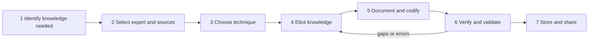

**Ek line mein:** <mark>Knowledge capture experts ke andar ka knowledge bahar nikalta hai, khaaskar jo unke dimaag mein hai, aur use likhit, checked aur shared form mein badalta hai jo doosre use kar sakein</mark>. <Cite id="knowledge-management-wiki-acquisition" />

<Box kind="key">

**Ye points likho:**

- <mark>Knowledge capture = experts, documents aur past work se knowledge nikalkar explicit, usable form mein badalna</mark>.
- Expert systems mein ise **knowledge acquisition** kehte hain, jo **knowledge engineer** karta hai.
- <mark>Steps: identify, experts select, technique choose, elicit, document aur codify, verify aur validate, store aur share</mark>.
- <mark>Techniques: interviews, observation, protocol analysis, brainstorming, Delphi, concept mapping</mark>.
- Sabse mushkil step: **elicitation**, kyunki experts ko bas "pata hota hai".
- Books steps alag number karti hain, lekin logic wahi hai.

</Box>

## Core answer (5 marks, yahan ke har question ke liye)

<Box kind="definition">

**Knowledge capture** is the process of drawing out knowledge from experts, documents and past work and turning it into an explicit, usable form that can be stored and shared. <Cite id="knowledge-management-wiki-acquisition" /> <Cite id="knowledge-management-wiki-engineering" />

</Box>

Jaise ek journalist ek chef ka interview le jo kuch napta nahi: dekho, kyun poochho, likho, phir chef se check karwao.

**Kyun zaroori:** expert retire ho to knowledge unke saath na chala jaye.

**Steps**

1. **Identify:** kaun sa knowledge capture karna hai: critical ya risk wala process.
2. **Select:** experts aur sources: asli experts plus documents aur past projects.
3. **Technique choose karo** jo fit ho.
4. **Elicit:** sawaal poochho, expert ko kaam karte dekho, permission se record karo.
5. **Document aur codify:** rules, procedures, decision trees, cases, FAQs.
6. **Verify aur validate:** expert check karta hai; real cases pe test.
7. **Store aur share:** tags ke saath repository mein rakho aur regularly review karo. <Cite id="knowledge-management-gfg-intro" />

**Conclusion:** <mark>capture knowledge ko insaan ke dimaag se checked, shared form mein le jaata hai</mark>.

## Extended answer (10 marks): ye add karo

### 1. Capture ki techniques

| Technique | Kaise kaam karta hai | Kis ke liye best |
|---|---|---|
| Interviews | Expert se sawaal | Zyadatar situations |
| Observation | Expert ko asli kaam pe dekhna | Hands-on skills |
| Protocol analysis | Expert problem solve karte hue zor se sochta hai <Cite id="knowledge-management-wiki-protocol" /> | Reasoning steps |
| Brainstorming | Group freely ideas list karta hai <Cite id="knowledge-management-wiki-brainstorming" /> | Kai experts ke ideas |
| Delphi method | Experts rounds mein questionnaires bharte hain jab tak opinions mil na jayein <Cite id="knowledge-management-wiki-delphi" /> | Forecasts |
| Concept mapping | Ideas ko linked nodes ki tarah draw karna <Cite id="knowledge-management-wiki-concept-map" /> | Ideas ka connection |

### 2. Tacit aur explicit knowledge

### 3. Capture ke challenges

Experts jo "bas jaante hain" wo explain nahi kar paate, share nahi karna chahte, aur recorded knowledge purana ho jaata hai.

### 4. Example

IT firm retiring senior engineer ka interview leti hai, fixes ko troubleshooting guide mein likhti hai, doosre engineers check karte hain aur support knowledge base mein add hota hai.

## Har question mein kaise fit karein

- **"Explain the steps involved in knowledge capturing."** (10 marks) <PYQ id="2023-12-ce/q6a" /> <PYQ id="2024-12-ce/q4b" />: definition, saat-step diagram aur list (core), techniques table, iceberg image, example, ek-line conclusion.

## Exam tips

- **Saat-step flow draw karo, verify loop ke saath**.
- **Elicit, codify, validate** keywords likho.
- **Techniques table** jodo; 5-mark list 10 marks ban jaati hai.

Exam mein English mein likho.
