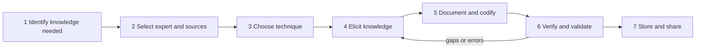

**In one line:** <mark>Knowledge capture draws out what experts know, especially what is in their heads, and turns it into a written, checked and shared form others can use</mark>. <Cite id="knowledge-management-wiki-acquisition" />

<Box kind="key">

**Key points to write:**

- <mark>Knowledge capture = drawing knowledge out of experts, documents and past work into an explicit, usable form</mark>.
- In expert systems it is called **knowledge acquisition**, done by a **knowledge engineer**.
- <mark>Steps: identify, select experts, choose technique, elicit, document and codify, verify and validate, store and share</mark>.
- <mark>Techniques: interviews, observation, protocol analysis, brainstorming, Delphi, concept mapping</mark>.
- Hardest step: **elicitation**, because experts "just know".
- Books number the steps differently, but the logic is the same.

</Box>

## Core answer (5 marks, fits every question here)

<Box kind="definition">

**Knowledge capture** is the process of drawing out knowledge from experts, documents and past work and turning it into an explicit, usable form that can be stored and shared. <Cite id="knowledge-management-wiki-acquisition" /> <Cite id="knowledge-management-wiki-engineering" />

</Box>

Like a journalist interviewing a chef who never measures anything: watch, ask why, write it down, then ask the chef to check.

**Why it matters:** it saves knowledge from walking out of the door when an expert retires.

**Steps**

1. **Identify** the knowledge to capture: the critical or at-risk process.
2. **Select** experts and sources: real experts plus documents and past projects.
3. **Choose the technique** that fits.
4. **Elicit:** ask questions, watch the expert work, record with permission.
5. **Document and codify:** rules, procedures, decision trees, cases, FAQs.
6. **Verify and validate:** the expert checks it; test on real cases.
7. **Store and share:** put it in a repository with tags and review it regularly. <Cite id="knowledge-management-gfg-intro" />

**Conclusion:** <mark>capture moves knowledge from a person's head into a checked, shared form</mark>.

## Extended answer (10 marks): add these

### 1. Techniques of capture

| Technique | How it works | Best for |
|---|---|---|
| Interviews | Ask the expert questions | Most situations |
| Observation | Watch the expert at the real job | Hands-on skills |
| Protocol analysis | Expert thinks aloud while solving a problem <Cite id="knowledge-management-wiki-protocol" /> | Reasoning steps |
| Brainstorming | A group lists ideas freely <Cite id="knowledge-management-wiki-brainstorming" /> | Ideas from several experts |
| Delphi method | Experts answer questionnaires in rounds until opinions converge <Cite id="knowledge-management-wiki-delphi" /> | Forecasts |
| Concept mapping | Draw ideas as linked nodes <Cite id="knowledge-management-wiki-concept-map" /> | How ideas connect |

### 2. Tacit and explicit knowledge

### 3. Challenges in capture

Experts cannot explain what they "just know", they may not want to share, and recorded knowledge becomes outdated.

### 4. Example

An IT firm interviews a retiring senior engineer, records fixes as a troubleshooting guide, has other engineers check it and adds it to the support knowledge base.

## Fit it to each question

- **"Explain the steps involved in knowledge capturing."** (10 marks) <PYQ id="2023-12-ce/q6a" /> <PYQ id="2024-12-ce/q4b" />: definition, seven-step diagram and list (core), techniques table, iceberg image, example, one-line conclusion.

## Exam tips

- **Draw** the seven-step flow with the **verify loop**.
- Write **elicit, codify, validate** as keywords.
- Add the **techniques table**; it turns a 5-mark list into 10 marks.
