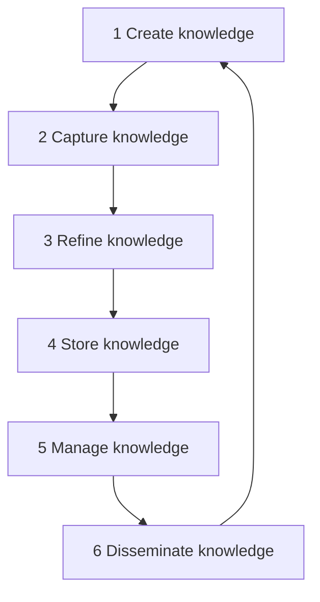

**Ek line mein:** <mark>KM life cycle wo loop hai jisme knowledge create hone se use hone tak jaata hai: create, capture, refine, store, manage, disseminate</mark>. <Cite id="knowledge-management-rainer-mis" />

<Box kind="key">

**Ye points likho:**

- <mark>KM = organization ke knowledge ko create, capture, store, share aur use karne ke processes aur tools</mark>, taaki sahi knowledge sahi insaan ko sahi time pe mile.
- <mark>Chhe steps (Rainer): create, capture, refine, store, manage, disseminate</mark>.
- Ye ek **cycle** hai: knowledge use karne se **naya** knowledge banta hai.
- Analogy: **library** (likhna, chunna, catalogue, shelve, replace, udhaar dena).
- Aur models: Wiig (4 steps), Meyer aur Zack (5), Laudon (acquire, store, disseminate, apply).
- Example: Infosys project lessons shared knowledge base mein rakhta hai.

</Box>

## Core answer (5 marks, yahan ke har question ke liye)

<Box kind="definition">

**Knowledge management (KM)** is the set of processes and tools an organization uses to create, capture, store, share and use what its people know. The **KM life cycle** is the sequence of steps through which knowledge moves, from being created to being used. <Cite id="knowledge-management-gfg-intro" /> <Cite id="knowledge-management-ibm" />

</Box>

**Kyun zaroori:** experienced employee jaye to saalon ka know-how saath chala jaata hai, aur teams wahi problem phir zero se solve karti hain.

1. **Create:** naya knowledge tab aata hai jab log kaam ke naye tareeke dhoondhte hain ya bahar se laate hain.
2. **Capture:** valuable naya knowledge pehchana aur record kiya jaata hai.
3. **Refine:** use context mein rakha jaata hai taaki actionable ho.
4. **Store:** repository mein, jahan doosre pahunch sakein.
5. **Manage:** regularly review, purana ho to update ya remove.
6. **Disseminate:** kisi ko bhi, kahin bhi, kabhi bhi available. <Cite id="knowledge-management-rainer-mis" />

**Conclusion:** <mark>KM life cycle create, capture, refine, store, manage aur disseminate ka loop hai, aur ye repeat hota hai kyunki knowledge badalta rehta hai</mark>.

## Extended answer (10 marks): ye add karo

### 1. Har step ka example

| Step | Example (support team) |
|---|---|
| Create | Engineer ek common fault ka faster fix dhoondhta hai |
| Capture | Engineer ka interview hota hai, fix likha jaata hai |
| Refine | Notes batate hain fix kab chalta hai aur kab nahi |
| Store | Article tags ke saath knowledge base mein |
| Manage | Har quarter review; purane fixes remove |
| Disseminate | Search aur alerts se poori support team tak |

### 2. Library analogy

Books likhi jaati hain (create), chuni jaati hain (capture), catalogue hoti hain (refine), shelf pe rakhi jaati hain (store), purani hone pe badli jaati hain (manage) aur udhaar di jaati hain (disseminate). Readers phir nayi books likhte hain.

### 3. Doosre models

Wiig: build, hold, pool, apply. Meyer aur Zack: acquisition, refinement, storage, distribution, presentation. Laudon: acquire, store, disseminate, apply. <Cite id="knowledge-management-tp-cycle" /> <Cite id="knowledge-management-laudon-mis" />

## Har question mein kaise fit karein

- **"Illustrate Knowledge Management life cycle"** (10 marks) <PYQ id="2023-05-ce/q5a" />: definition, kyun zaroori, cycle diagram, chhe steps examples table ke saath, library analogy, doosre models, conclusion. "Illustrate" matlab diagram zaroori.

## Exam tips

- **Gol diagram draw karo, Create tak wapas arrow ke saath**.
- **Chhe step ke naam** Rainer ke exact likho.
- **Har step ka ek example** do; 10 marks isi se aate hain.

Exam mein English mein likho.
