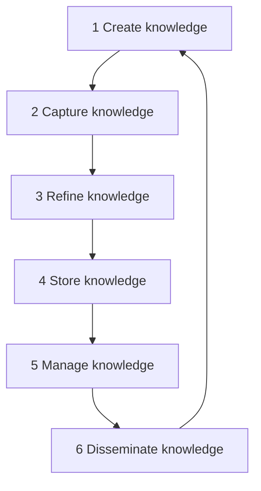

**In one line:** <mark>The KM life cycle is the loop through which knowledge moves from being created to being used: create, capture, refine, store, manage, disseminate</mark>. <Cite id="knowledge-management-rainer-mis" />

<Box kind="key">

**Key points to write:**

- <mark>KM = processes and tools to create, capture, store, share and use an organization's knowledge</mark>, so the right knowledge reaches the right person at the right time.
- <mark>Six steps (Rainer): create, capture, refine, store, manage, disseminate</mark>.
- It is a **cycle**: using knowledge produces **new** knowledge.
- Analogy: a **library** (write, select, catalogue, shelve, replace, lend).
- Other models: Wiig (4 steps), Meyer and Zack (5), Laudon (acquire, store, disseminate, apply).
- Example: Infosys keeps project lessons in a shared knowledge base.

</Box>

## Core answer (5 marks, fits every question here)

<Box kind="definition">

**Knowledge management (KM)** is the set of processes and tools an organization uses to create, capture, store, share and use what its people know. The **KM life cycle** is the sequence of steps through which knowledge moves, from being created to being used. <Cite id="knowledge-management-gfg-intro" /> <Cite id="knowledge-management-ibm" />

</Box>

**Why needed:** when an experienced employee leaves, years of know-how leave with them, and teams solve the same problem again from zero.

1. **Create:** new knowledge appears when people find new ways of working or bring it from outside.
2. **Capture:** valuable new knowledge is recognised and recorded.
3. **Refine:** it is placed in context so it is actionable.
4. **Store:** put in a repository others can reach.
5. **Manage:** reviewed regularly, updated or removed when outdated.
6. **Disseminate:** made available to anyone, anywhere, any time. <Cite id="knowledge-management-rainer-mis" />

**Conclusion:** <mark>the KM life cycle is a loop of create, capture, refine, store, manage and disseminate, and it repeats because knowledge keeps changing</mark>.

## Extended answer (10 marks): add these

### 1. Example at each step

| Step | Example (support team) |
|---|---|
| Create | An engineer finds a faster fix for a common fault |
| Capture | The engineer is interviewed and the fix is written up |
| Refine | Notes say when the fix works and when it does not |
| Store | The article goes into the knowledge base with tags |
| Manage | Reviewed each quarter; old fixes removed |
| Disseminate | Search and alerts reach the whole support team |

### 2. The library analogy

Books are written (create), selected (capture), catalogued (refine), shelved (store), replaced when outdated (manage) and lent out (disseminate). Readers then write new books.

### 3. Other models

Wiig: build, hold, pool, apply. Meyer and Zack: acquisition, refinement, storage, distribution, presentation. Laudon: acquire, store, disseminate, apply. <Cite id="knowledge-management-tp-cycle" /> <Cite id="knowledge-management-laudon-mis" />

## Fit it to each question

- **"Illustrate Knowledge Management life cycle"** (10 marks) <PYQ id="2023-05-ce/q5a" />: definition, why needed, the cycle diagram, six steps with the table of examples, library analogy, other models, conclusion. "Illustrate" means the diagram is compulsory.

## Exam tips

- **Draw** the circular diagram with the arrow back to Create.
- Write the **six step names** exactly as Rainer gives them.
- Add **one example per step**; it separates 10 marks from 5.
