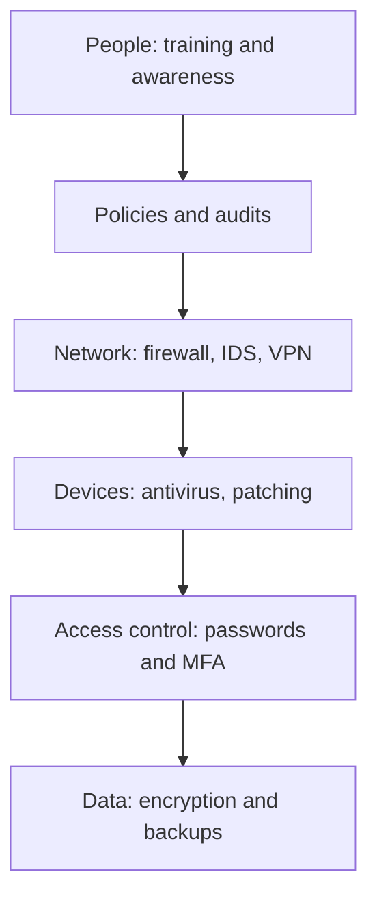
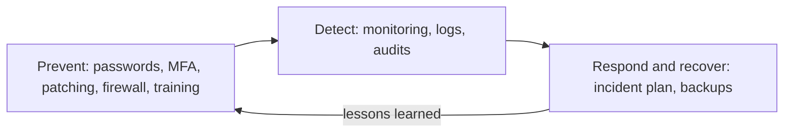

**Ek line mein:** <mark>Cyber security ka matlab hai computers, networks aur data ko attack, damage ya theft se bachana, aur ye technology, people aur process ko layer karke behtar hota hai: strong passwords aur MFA, updates, antivirus, firewall, encryption, backups, access control, training, audits aur incident plan</mark>. <Cite id="note-information-security-nist-csf" /> <Cite id="note-information-security-ibm-infosec" />

<Box kind="key">

**Ye points likho:**

- <mark>Cyber security = technology + people + process, lagatar repeat</mark>, kyunki attackers tareeke badalte rehte hain.
- <mark>Defence in depth: ek layer fail ho to agli layer data bachati hai</mark>.
- <mark>Measures: strong passwords aur MFA, patching, antivirus, firewall, encryption, backups, least privilege, training, policy aur audits, monitoring aur incident response</mark>.
- **Har measure ke saath ek example** (MFA: bank OTP; patching: WannaCry; backups: ransomware).
- Limits: cost aur inconvenience; **koi measure 100 percent safety nahi deta**.
- Incidents **CERT-In** aur cyber crime helpline ko report karo.

</Box>

## Core answer (5 marks, yahan ke har question ke liye)

<Box kind="definition">

**Cyber security** is the protection of computers, networks and data from attack, damage or theft. It is not one tool; it is technology, people and process working together. <Cite id="note-information-security-nist-csf" /> <Cite id="note-information-security-ibm-infosec" />

</Box>

**Kyun chahiye:** malware, phishing, ransomware aur denial of service business rok sakte hain, customer data leak kar sakte hain aur legal trouble la sakte hain. <Cite id="note-information-security-gfg-cyber-attacks" />

**Top measures examples ke saath**

| # | Measure | Example |
|---|---|---|
| 1 | Strong passwords aur multi-factor authentication (MFA) | Banking apps password ke saath OTP ya fingerprint maangti hain |
| 2 | Software updates (patching) | 2017 ka Windows patch WannaCry ko rok sakta tha <Cite id="note-information-security-wiki-wannacry" /> |
| 3 | Antivirus aur anti-malware | Endpoint protection download mein trojan rokta hai |
| 4 | Firewall aur network security | Company firewall known bad addresses ka traffic rokta hai |
| 5 | Encryption | Flipkart checkout pe HTTPS; encrypted laptop disks |
| 6 | Regular, tested backups | Firm ransomware ke baad bina paisa diye files restore karti hai |

<Cite id="note-information-security-cisa-practices" />

**Conclusion:** <mark>achhi cyber security strong technology, trained people aur clear rules ko milati hai, aur use lagatar review karna padta hai</mark>.

## Extended answer (10 marks): ye add karo

### 1. Aur measures examples ke saath

| # | Measure | Example |
|---|---|---|
| 7 | Access control aur least privilege | Clerk payroll database nahi khol sakta |
| 8 | Training aur awareness | Bank staff ke liye mock phishing drills karta hai |
| 9 | Security policy aur audits | Saalana audit attackers se pehle open server dhoondh leta hai |
| 10 | Monitoring aur incident response plan | Security team infected laptop ko minutes mein isolate karti hai |
| 11 | Secure development aur testing | Input checks login form pe SQL injection rokte hain |
| 12 | Legal compliance aur reporting | Fraud cyber crime helpline aur CERT-In ko report |

### 2. Practical checklist: CISA ke six essentials

CISA ki Cyber Essentials kaam ko chhe elements mein baantti hai: **yourself** (leaders strategy aur investment chalate hain), **your staff** (awareness aur vigilance), **your systems** (critical assets protect, patch, inventory), **your surroundings** (sirf jo belong karte hain unhe access), **your data** (backups aur protection) aur **your crisis response** (damage limit karo aur jaldi recover). <Cite id="web-mis-1-cisa-cyber-essentials" />

### 3. Security control kya hai

Control ek safeguard hai jo system aur uski information ki confidentiality, integrity aur availability protect karne ke liye lagaya jaata hai. <Cite id="web-mis-1-nist-security-control" />

### 4. Advantages aur limits

| Advantages | Limits |
|---|---|
| Kam breaches | Tools aur staff ka cost |
| Customer trust | User ko inconvenience (extra login steps) |
| Legal compliance | Koi measure 100 percent safety nahi deta, isliye layers |

## Har question mein kaise fit karein

- **"Identify the measures to improve cyber security with example."** (10 marks) <PYQ id="2023-05-ce/q3a" /> <PYQ id="2023-12-ce/q5a" /> <PYQ id="2024-12-ce/q3a" /> <PYQ id="2024-12-ce/q4a" />: definition, kyun chahiye, defence-in-depth diagram, baarah-measure table (core ke chhe plus section 1 ke chhe), har ek ka real example, phir advantages, limits aur conclusion. Ye question baar baar aata hai; table yaad karo.

## Exam tips

- **Baarah measures** apne one-line examples ke saath yaad karo; exam mein kam se kam aath likho.
- **Defence-in-depth diagram draw karo**.
- Conclusion mein **"layers"** aur **"no 100 percent safety"** likho.

Exam mein English mein likho.
