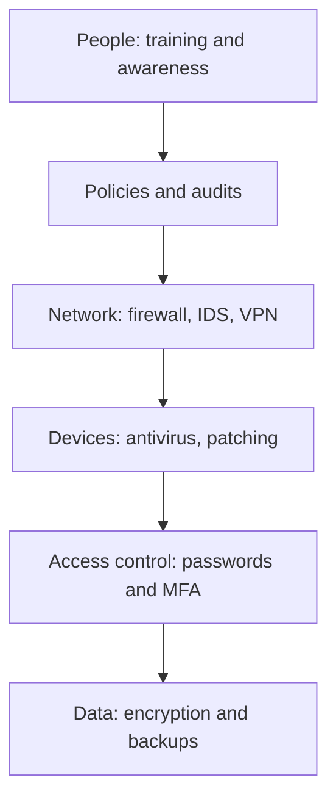
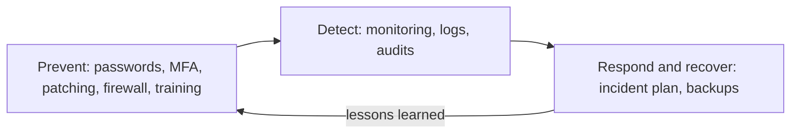

**In one line:** <mark>Cyber security means protecting computers, networks and data from attack, damage or theft, and it is improved by layering technology, people and process: strong passwords with MFA, updates, antivirus, firewall, encryption, backups, access control, training, audits and an incident plan</mark>. <Cite id="note-information-security-nist-csf" /> <Cite id="note-information-security-ibm-infosec" />

<Box kind="key">

**Key points to write:**

- <mark>Cyber security = technology + people + process, repeated all the time</mark>, because attackers keep changing methods.
- <mark>Defence in depth: if one layer fails, the next still protects the data</mark>.
- <mark>Measures: strong passwords and MFA, patching, antivirus, firewall, encryption, backups, least privilege, training, policy and audits, monitoring and incident response</mark>.
- **Every measure needs one example** (MFA: bank OTP; patching: WannaCry; backups: ransomware).
- Limits: cost and inconvenience; **no measure gives 100 percent safety**.
- Report incidents to **CERT-In** and the cyber crime helpline.

</Box>

## Core answer (5 marks, fits every question here)

<Box kind="definition">

**Cyber security** is the protection of computers, networks and data from attack, damage or theft. It is not one tool; it is technology, people and process working together. <Cite id="note-information-security-nist-csf" /> <Cite id="note-information-security-ibm-infosec" />

</Box>

**Why needed:** malware, phishing, ransomware and denial of service can stop a business, leak customer data and cause legal trouble. <Cite id="note-information-security-gfg-cyber-attacks" />

**Top measures with examples**

| # | Measure | Example |
|---|---|---|
| 1 | Strong passwords and multi-factor authentication (MFA) | Banking apps ask for password plus OTP or fingerprint |
| 2 | Software updates (patching) | The 2017 Windows patch would have blocked WannaCry <Cite id="note-information-security-wiki-wannacry" /> |
| 3 | Antivirus and anti-malware | Endpoint protection blocks a trojan in a download |
| 4 | Firewall and network security | A company firewall blocks traffic from known bad addresses |
| 5 | Encryption | HTTPS on Flipkart checkout; encrypted laptop disks |
| 6 | Regular, tested backups | A firm restores files after ransomware without paying |

<Cite id="note-information-security-cisa-practices" />

**Conclusion:** <mark>good cyber security combines strong technology, trained people and clear rules, and it must be reviewed continuously</mark>.

## Extended answer (10 marks): add these

### 1. More measures with examples

| # | Measure | Example |
|---|---|---|
| 7 | Access control and least privilege | A clerk cannot open the payroll database |
| 8 | Training and awareness | A bank runs mock phishing drills for staff |
| 9 | Security policy and audits | An annual audit finds an open server before attackers do |
| 10 | Monitoring and incident response plan | A security team isolates an infected laptop within minutes |
| 11 | Secure development and testing | Input checks stop SQL injection on a login form |
| 12 | Legal compliance and reporting | Reporting fraud to the cyber crime helpline and CERT-In |

### 2. A practical checklist: CISA's six essentials

CISA's Cyber Essentials groups the work into six elements: **yourself** (leaders drive strategy and investment), **your staff** (awareness and vigilance), **your systems** (protect critical assets, patch, inventory), **your surroundings** (only those who belong have access), **your data** (backups and protection) and **your crisis response** (limit damage and recover quickly). <Cite id="web-mis-1-cisa-cyber-essentials" />

### 3. What a security control is

A control is a safeguard prescribed to protect the confidentiality, integrity and availability of a system and its information. <Cite id="web-mis-1-nist-security-control" />

### 4. Advantages and limits

| Advantages | Limits |
|---|---|
| Fewer breaches | Cost of tools and staff |
| Customer trust | User inconvenience (extra login steps) |
| Legal compliance | No measure gives 100 percent safety, so layers are used |

## Fit it to each question

- **"Identify the measures to improve cyber security with example."** (10 marks) <PYQ id="2023-05-ce/q3a" /> <PYQ id="2023-12-ce/q5a" /> <PYQ id="2024-12-ce/q3a" /> <PYQ id="2024-12-ce/q4a" />: definition, why needed, defence-in-depth diagram, the twelve-measure table (six from core plus six from section 1), one real example each, then advantages and limits and conclusion. This question repeats often; learn the table.

## Exam tips

- **Learn all twelve measures** with their one-line examples; pick at least eight in the exam.
- **Draw** the defence-in-depth diagram.
- Say **"layers"** and **"no 100 percent safety"** in the conclusion.
