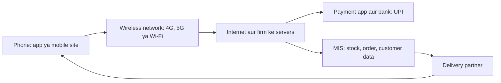
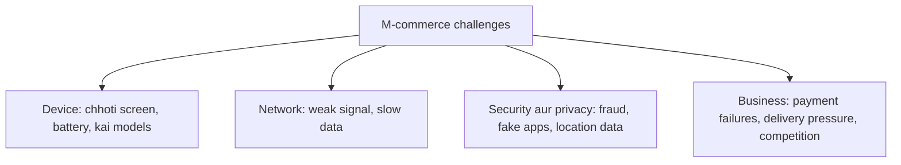

**Ek line mein:** <mark>Mobile commerce (m-commerce) matlab smartphones aur tablets jaise wireless handheld devices se buying, selling aur paying</mark>. Ye e-commerce hai jo customer ke saath chalta hai, aur isne security, chhoti screen, network aur privacy ki nayi challenges laayi hain. <Cite id="e-commerce-wiki-mcommerce" /> <Cite id="e-commerce-gfg-ecom-vs-mcom" />

<Box kind="key">

**M-commerce ke har question mein ye points likho:**

- <mark>M-commerce = wireless handheld devices pe kiya gaya e-commerce</mark> (apps, mobile websites, SMS, QR codes).
- Kyun: phone personal hai, hamesha saath hai aur hamari **location** jaanta hai.
- Applications: <mark>mobile shopping, mobile payments aur banking (UPI), food aur quick commerce, ticketing, location-based services</mark>.
- Advantages: kabhi bhi kahin bhi, location-aware offers, quick UPI payment, push notifications.
- Challenges: <mark>security aur fraud, chhoti screen, weak network, privacy, kai devices, payment failures, delivery pressure</mark>.
- Har challenge ka answer do (OTP, light apps, responsive design).

</Box>

## Core answer (5 marks, yahan ke har question ke liye)

<Box kind="definition">

**Mobile commerce (m-commerce)** is buying, selling and paying through wireless handheld devices such as smartphones and tablets, using apps, mobile websites, SMS or QR codes. <Cite id="e-commerce-wiki-mcommerce" /> <Cite id="e-commerce-rainer-intro-is" />

</Box>

**Kyun chahiye:** India mein zyada log computer se zyada phone se internet use karte hain. Phone personal hai aur hamesha saath, isliye business customer tak kahin bhi aur sahi moment pe pahunch sakta hai. <Cite id="e-commerce-wiki-mcommerce" />

**Analogy:** e-commerce wo shop hai jahan computer pe baithke jaate ho. M-commerce wo shopkeeper hai jo aapke saath jeb mein chalta hai.

**M-commerce purchase ka raasta:**

**Main applications:** <Cite id="e-commerce-wiki-mobile-payment" /> <Cite id="e-commerce-wiki-qcommerce" />

- Mobile shopping: Amazon, Flipkart, Myntra apps.
- Mobile payments aur banking: Google Pay, PhonePe, SBI YONO.
- Food aur quick commerce: Zomato, Swiggy, Blinkit.
- Ticketing aur travel: IRCTC, BookMyShow, Ola aur Uber.
- Location-based services: nearby offers, maps, cab finding.

**Main challenges (short list):** security aur fraud, chhoti screen, weak network, privacy, kai devices aur systems, payment failure, delivery pressure.

**Conclusion:** <mark>m-commerce e-commerce ko har jeb tak le jaata hai; jo firm chhoti screen pe security, speed aur simplicity solve kare wo jeetti hai</mark>.

## Extended answer (10 marks): ye add karo

### 1. E-commerce versus m-commerce

| Point | E-commerce | M-commerce |
|---|---|---|
| Device | Computer, laptop | Smartphone, tablet, wearable |
| Network | Wired ya Wi-Fi, fixed jagah | Wireless, chalte hue use |
| Screen | Badi | Chhoti |
| Location | Zyadatar use nahi hoti | Use hoti hai (GPS offers, tracking) |
| Payment | Card, net banking | UPI, wallet, QR code, tap-to-pay |
| Security risk | Phishing, malware | Wahi, plus khoya phone, fake apps, public Wi-Fi |
| Example | Laptop pe flight book karna | Raaste se Zomato pe khana order karna |

<Cite id="e-commerce-gfg-ecom-vs-mcom" />

### 2. M-commerce ki nayi challenges

| # | Challenge | Problem kyun | Answer |
|---|---|---|---|
| 1 | Chhoti screen | Kam jagah, lambe forms mushkil | Simple design, kam steps, one-tap pay |
| 2 | Weak ya slow network | Pages aur payments fail | Light apps, offline cart, safe retry |
| 3 | Security aur fraud | Khoye phone, fake apps, public Wi-Fi | App lock, OTP, biometric login, encryption, official app stores |
| 4 | Privacy | Location aur contacts bahut personal | Permission maango, kam collect karo |
| 5 | Kai devices aur systems | Android, iOS, kai screen sizes | Responsive design, kai devices pe testing |
| 6 | Payment trust | Paisa kata par order fail | Reliable gateway, quick refund rules |
| 7 | Battery, memory, data cost | Heavy apps phone drain karte hain | Lean apps |
| 8 | Delivery aur logistics | Fast-delivery promise partners pe pressure | Local hubs, route planning |
| 9 | Language aur digital skill | Kai users ko local language chahiye | Voice, icons, local languages |
| 10 | Law aur standards | Data aur payment rules badalte rehte hain | Data-protection aur payment rules follow karo |

<Cite id="e-commerce-wiki-mobile-payment" /> <Cite id="e-commerce-wiki-last-mile" />

### 3. Advantages aur disadvantages

**Advantages:** kabhi bhi kahin bhi use, personal aur location-aware offers, quick UPI payment, push notifications, chhote towns tak reach. <Cite id="e-commerce-wiki-upi" /> **Disadvantages:** upar ki challenges, mainly security, chhoti screen, network dependence aur privacy worries.

## Har question mein kaise fit karein

- **"What is Mobile Commerce? What are the new challenges that it has introduced in business?"** (10 marks) <PYQ id="2022-12-ce/q2b" />: definition, why needed, flow diagram, phir **section 2 poora** (8 se 10 challenges, har ek ka answer) aur e-commerce versus m-commerce table; advantages pe ek line.
- **"Write note on mobile-commerce."** (10 marks) <PYQ id="2025-05-ce/q4b" />: definition, why needed, flow diagram, applications, comparison table (section 1), advantages aur disadvantages (section 3) aur **chhoti** challenges list (chhe points); conclusion.

## Exam tips

- **Purchase-path diagram** aur e-commerce versus m-commerce table draw karo.
- "Challenges" mein kam se kam **chhe** likho aur har ke saath solution do; isse analysis dikhta hai.
- **UPI aur location-based service** ke examples do: inse hi m-commerce alag banta hai.

Exam mein English mein likho.
