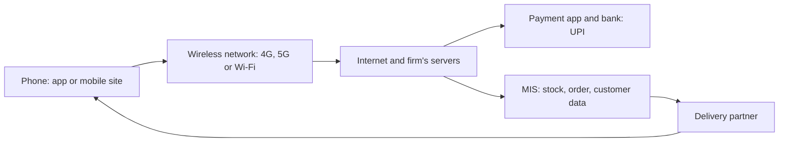
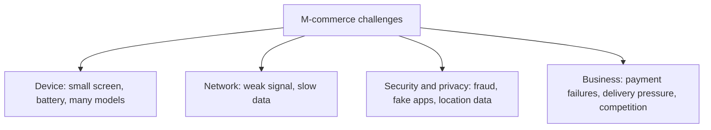

**In one line:** <mark>Mobile commerce (m-commerce) is buying, selling and paying through wireless handheld devices such as smartphones and tablets</mark>. It is e-commerce that moves with the customer, and it brings new challenges of security, small screens, networks and privacy. <Cite id="e-commerce-wiki-mcommerce" /> <Cite id="e-commerce-gfg-ecom-vs-mcom" />

<Box kind="key">

**Key points to write (any m-commerce question):**

- <mark>M-commerce = e-commerce done on wireless handheld devices</mark> (apps, mobile websites, SMS, QR codes).
- Why: a phone is personal, always with us and knows our **location**.
- Applications: <mark>mobile shopping, mobile payments and banking (UPI), food and quick commerce, ticketing, location-based services</mark>.
- Advantages: anytime and anywhere, location-aware offers, quick UPI payment, push notifications.
- Challenges: <mark>security and fraud, small screen, weak network, privacy, many devices, payment failures, delivery pressure</mark>.
- Give an answer for each challenge (OTP, light apps, responsive design).

</Box>

## Core answer (5 marks, fits every question here)

<Box kind="definition">

**Mobile commerce (m-commerce)** is buying, selling and paying through wireless handheld devices such as smartphones and tablets, using apps, mobile websites, SMS or QR codes. <Cite id="e-commerce-wiki-mcommerce" /> <Cite id="e-commerce-rainer-intro-is" />

</Box>

**Why it is needed:** more people in India reach the internet through a phone than through a computer. A phone is personal and always with us, so a business can reach the customer anywhere and at the right moment. <Cite id="e-commerce-wiki-mcommerce" />

**Analogy:** e-commerce is a shop you visit by sitting at a computer. M-commerce is a shopkeeper who walks with you in your pocket.

**How an m-commerce purchase travels:**

**Main applications:** <Cite id="e-commerce-wiki-mobile-payment" /> <Cite id="e-commerce-wiki-qcommerce" />

- Mobile shopping: Amazon, Flipkart, Myntra apps.
- Mobile payments and banking: Google Pay, PhonePe, SBI YONO.
- Food and quick commerce: Zomato, Swiggy, Blinkit.
- Ticketing and travel: IRCTC, BookMyShow, Ola and Uber.
- Location-based services: nearby offers, maps, cab finding.

**Main challenges (short list):** security and fraud, small screen, weak network, privacy, many devices and systems, payment failure, delivery pressure.

**Conclusion:** <mark>m-commerce widens e-commerce to every pocket; the firm that solves security, speed and simplicity on a small screen wins</mark>.

## Extended answer (10 marks): add these

### 1. E-commerce versus m-commerce

| Point | E-commerce | M-commerce |
|---|---|---|
| Device | Computer, laptop | Smartphone, tablet, wearable |
| Network | Wired or Wi-Fi, fixed place | Wireless, usable while moving |
| Screen | Large | Small |
| Location | Mostly not used | Used (GPS offers, tracking) |
| Payment | Card, net banking | UPI, wallet, QR code, tap-to-pay |
| Security risk | Phishing, malware | Same, plus lost phone, fake apps, public Wi-Fi |
| Example | Booking a flight on a laptop | Ordering a meal on Zomato from the road |

<Cite id="e-commerce-gfg-ecom-vs-mcom" />

### 2. New challenges that m-commerce has introduced

| # | Challenge | Why it is a problem | Answer |
|---|---|---|---|
| 1 | Small screen | Little space, long forms are hard | Simple design, fewer steps, one-tap pay |
| 2 | Weak or slow network | Pages and payments fail | Light apps, offline cart, safe retry |
| 3 | Security and fraud | Lost phones, fake apps, public Wi-Fi | App lock, OTP, biometric login, encryption, official app stores |
| 4 | Privacy | Location and contacts are very personal | Ask permission, collect little |
| 5 | Many devices and systems | Android, iOS, many screen sizes | Responsive design, testing on many devices |
| 6 | Payment trust | Money deducted but order failed | Reliable gateway, quick refund rules |
| 7 | Battery, memory, data cost | Heavy apps drain the phone | Lean apps |
| 8 | Delivery and logistics | Fast-delivery promises pressure partners | Local hubs, route planning |
| 9 | Language and digital skill | Many users need local language | Voice, icons, local languages |
| 10 | Law and standards | Rules on data and payments keep changing | Follow data-protection and payment rules |

<Cite id="e-commerce-wiki-mobile-payment" /> <Cite id="e-commerce-wiki-last-mile" />

### 3. Advantages and disadvantages

**Advantages:** anytime and anywhere use, personal and location-aware offers, quick UPI payment, push notifications, reach to small towns. <Cite id="e-commerce-wiki-upi" /> **Disadvantages:** the challenges above, mainly security, small screen, network dependence and privacy worries.

## Fit it to each question

- **"What is Mobile Commerce? What are the new challenges that it has introduced in business?"** (10 marks) <PYQ id="2022-12-ce/q2b" />: definition, why needed, flow diagram, then **section 2 in full** (8 to 10 challenges, each with its answer) and the e-commerce versus m-commerce table; one line on advantages.
- **"Write note on mobile-commerce."** (10 marks) <PYQ id="2025-05-ce/q4b" />: definition, why needed, flow diagram, applications, the comparison table (section 1), advantages and disadvantages (section 3) and a **short** challenges list (six points); conclusion.

## Exam tips

- **Draw the purchase-path diagram** and the e-commerce versus m-commerce table.
- For "challenges", write at least **six**, and give a solution beside each; this shows analysis.
- Include **UPI and location-based service** examples: they are what makes m-commerce different.
