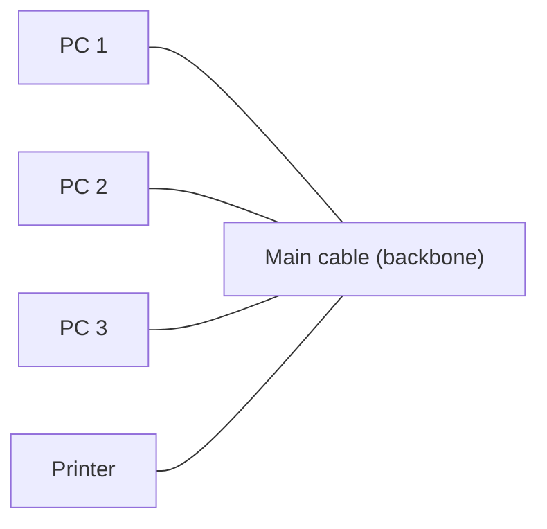
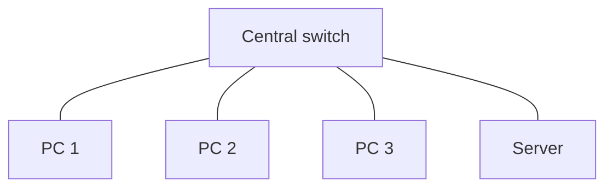
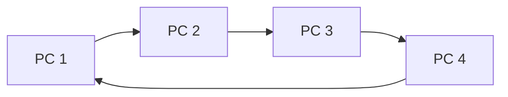
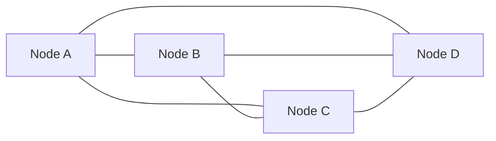
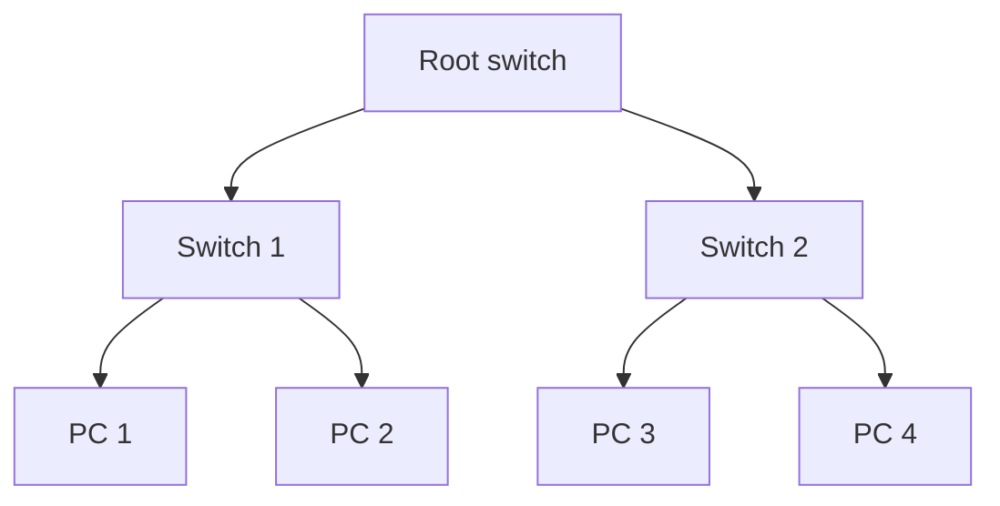
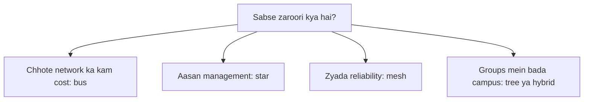

**Ek line mein:** <mark>Topology matlab network ke devices (nodes) kaise arrange aur connect hain</mark>. Main types hain **bus, star, ring, mesh, tree aur hybrid**, har ke apne advantages aur disadvantages. <Cite id="networks-wireless-wiki-topology" /> <Cite id="networks-wireless-gfg-topology" />

<Box kind="key">

**Topology ke question mein ye points likho:**

- <mark>Topology = network mein devices aur links ki arrangement</mark>, physical (cable layout) ya logical (data flow).
- <mark>Bus: saare devices ek shared main cable pe. Star: har device central switch se juda. Ring: devices closed loop mein. Mesh: har device kai doosron se juda. Tree: levels mein jude stars. Hybrid: do ya zyada mix</mark>.
- Jitne types likho unka **chhota labelled diagram** draw karo (kam se kam star, bus, ring, mesh).
- Har type ke **kam se kam do advantages aur do disadvantages**.
- Weak points: bus = ek cable break; star = central switch fail; ring = ek break se ring ruk jaati hai; mesh = bahut mehnga.
- Real use: offices aur labs mein **star**; Internet backbone mein **partial mesh**.

</Box>

## Core answer (5 marks, yahan ke har question ke liye)

<Box kind="definition">

**Network topology** is the way the devices (nodes) of a network are arranged and connected. It can be shown as a physical layout (how the cables run) or a logical layout (how data flows). <Cite id="networks-wireless-wiki-topology" /> <Cite id="networks-wireless-ibm-topology" />

</Box>

<Cite id="networks-wireless-gfg-topology" loc="diagram" />

| Topology | Kaise juda | Advantages | Disadvantages |
|---|---|---|---|
| Bus | Saare devices ek shared main cable pe | Sasta, kam cable, chhota network badhana aasan | Ek cable break se sab band; zyada users pe slow; fault dhoondhna mushkil |
| Star | Har device central switch ya hub se juda | Device add karna aasan; kharab cable sirf ek device ko affect; fault finding aasan | Central device fail to sab band; bus se zyada cable |
| Ring | Devices closed loop mein, har ke do padosi | Orderly data flow; equal access | Ek break ring rok sakta hai (double ring ke bina); device add karna slow |
| Mesh | Har device kai ya sab doosron se juda | Bahut reliable; kai paths; fault alag karna aasan | Bahut mehnga; kai cables aur ports; set up mushkil |

<Cite id="networks-wireless-gfg-topology" /> <Cite id="networks-wireless-tp-topologies" /> <Cite id="networks-wireless-ibm-topology" />

**Conclusion:** <mark>topology ka choice cost, speed, reliability aur growth ki aasani decide karta hai</mark>; offices mein star sabse common hai.

## Extended answer (10 marks): ye add karo

### 1. Tree aur hybrid

| Topology | Kaise juda | Advantages | Disadvantages |
|---|---|---|---|
| Tree | Stars levels mein parent device se jude | Groups mein badhana aur manage karna aasan; bade campus ke liye achha | Root pe depend; zyada cable; root fail to network bant jaata hai |
| Hybrid | Do ya zyada topologies mili hui (jaise ek building mein star, doosri mein ring) | Flexible, asli need ke hisaab se, badh sakta hai | Design complex, maintenance mehnga |

### 2. Mesh: kitne links?

$n$ devices ke full mesh ko $\frac{n(n-1)}{2}$ links chahiye. 4 devices: $\frac{4 \times 3}{2} = 6$ links, jo mesh diagram ki chhe lines se match karta hai. 10 devices: $\frac{10 \times 9}{2} = 45$ links, isliye full mesh kam use hota hai, mainly core links ke liye. <Cite id="web-mis-2-wiki-mesh" />

### 3. Kahan use hota hai

| Topology | Typical use |
|---|---|
| Star | College lab ya office (har room mein ek switch) <Cite id="web-mis-2-wiki-star" /> |
| Bus | Purane Ethernet LANs |
| Ring | Kuch purane systems <Cite id="web-mis-2-wiki-ring" /> |
| Partial mesh | Internet backbone aur kai WANs |
| Tree ya hybrid | Bade campus networks |

### 4. Topology kaise chunein

<Box kind="pitfall">

Physical aur logical topology mat milao. Wi-Fi network physically star hai (saare devices ek access point se baat karte hain), bhale hi radio waves har direction mein failti hain.

</Box>

## Har question mein kaise fit karein

- **"Define topology and its types with advantages and disadvantages."** (5 marks) <PYQ id="2025-05-ce/q1c" />: **core answer**: definition, chaar chhote diagrams (bus, star, ring, mesh) aur advantages-disadvantages table. 5 marks mein tree aur hybrid ek-ek line mein naam do.

## Exam tips

- **Har topology ka chhota labelled diagram** draw karo; marks yahin hain.
- Har type ke **do advantages aur do disadvantages** table mein likho.
- Har ka **weak point** likho (bus cable, star switch, ring break); examiners yahi dekhte hain.

Exam mein English mein likho.
