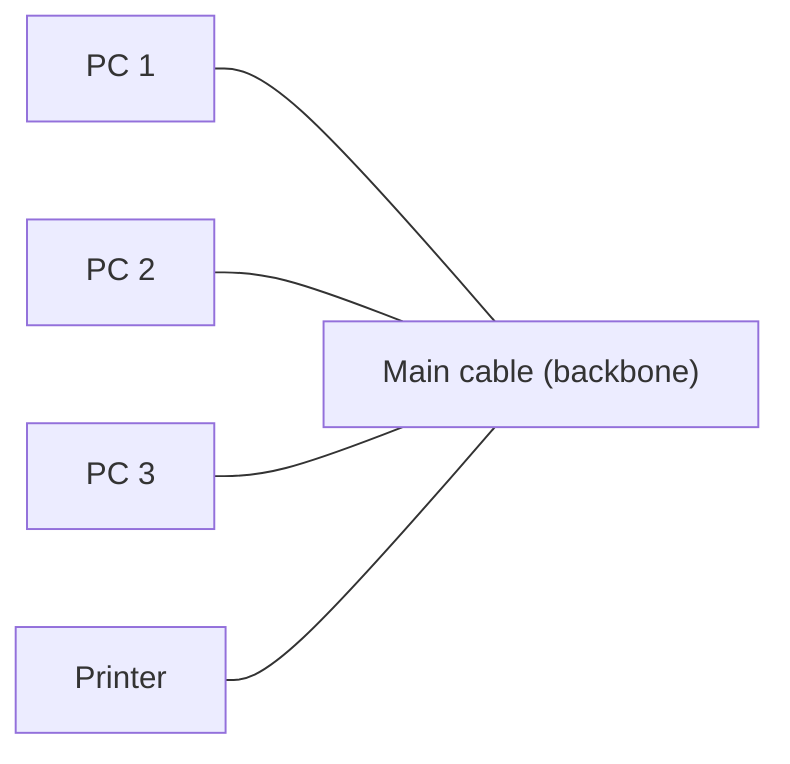
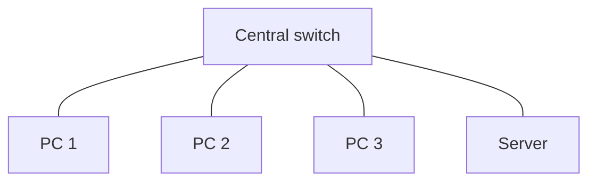
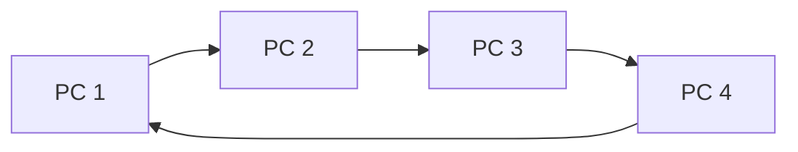
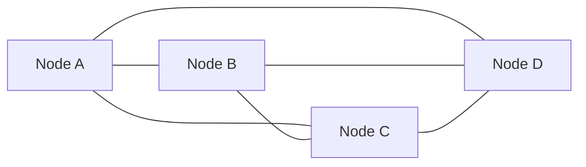
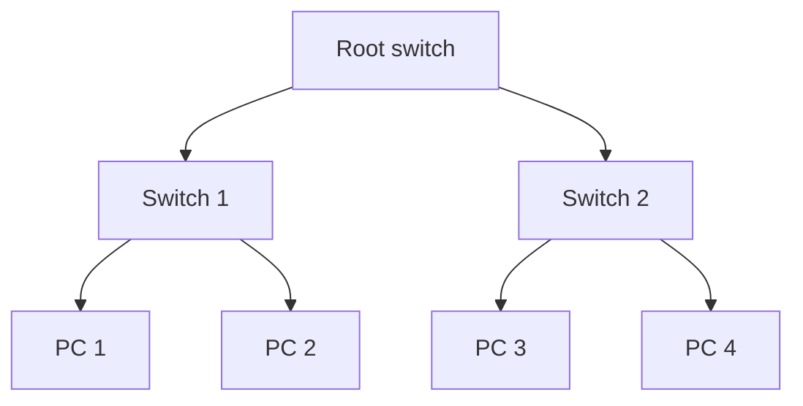
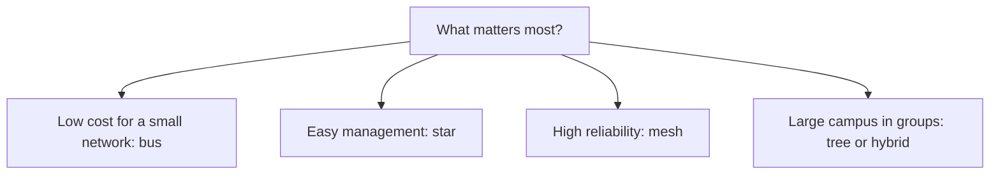

**In one line:** <mark>Topology is the way the devices (nodes) of a network are arranged and connected</mark>. The main types are **bus, star, ring, mesh, tree and hybrid**, each with its own advantages and disadvantages. <Cite id="networks-wireless-wiki-topology" /> <Cite id="networks-wireless-gfg-topology" />

<Box kind="key">

**Key points to write (topology and its types):**

- <mark>Topology = the arrangement of devices and links in a network</mark>, physical (cable layout) or logical (data flow).
- <mark>Bus: all devices on one shared main cable. Star: every device linked to a central switch. Ring: devices in a closed loop. Mesh: every device linked to many others. Tree: stars joined in levels. Hybrid: two or more mixed</mark>.
- Draw a **small labelled diagram** for each type you write (at least star, bus, ring, mesh).
- Give **at least two advantages and two disadvantages** per type.
- Weak points: bus = one cable break; star = central switch fails; ring = one break stops the ring; mesh = very costly.
- Real use: **star** in offices and labs; **partial mesh** in the Internet backbone.

</Box>

## Core answer (5 marks, fits every question here)

<Box kind="definition">

**Network topology** is the way the devices (nodes) of a network are arranged and connected. It can be shown as a physical layout (how the cables run) or a logical layout (how data flows). <Cite id="networks-wireless-wiki-topology" /> <Cite id="networks-wireless-ibm-topology" />

</Box>

<Cite id="networks-wireless-gfg-topology" loc="diagram" />

| Topology | How connected | Advantages | Disadvantages |
|---|---|---|---|
| Bus | All devices on one shared main cable | Cheap, little cable, easy to extend a small network | One cable break stops all; slow with many users; hard to find faults |
| Star | Every device linked to a central switch or hub | Easy to add devices; a faulty cable affects one device; easy fault finding | Central device failure stops everything; more cable than bus |
| Ring | Devices in a closed loop, two neighbours each | Orderly data flow; equal access | One break can stop the ring (unless double ring); slow to add devices |
| Mesh | Every device linked to many or all others | Very reliable; many paths; easy to isolate a fault | Very costly; many cables and ports; hard to set up |

<Cite id="networks-wireless-gfg-topology" /> <Cite id="networks-wireless-tp-topologies" /> <Cite id="networks-wireless-ibm-topology" />

**Conclusion:** <mark>the choice of topology decides cost, speed, reliability and ease of growth</mark>; star is the most common in offices.

## Extended answer (10 marks): add these

### 1. Tree and hybrid

| Topology | How connected | Advantages | Disadvantages |
|---|---|---|---|
| Tree | Stars joined to a parent device in levels | Easy to grow and manage in groups; good for large campuses | Depends on the root; more cable; root failure splits the network |
| Hybrid | Two or more topologies combined (for example star in one building, ring in another) | Flexible, fits the real need, can grow | Complex to design, costly to maintain |

### 2. Mesh: how many links?

A full mesh of $n$ devices needs $\frac{n(n-1)}{2}$ links. With 4 devices: $\frac{4 \times 3}{2} = 6$ links, which matches the six lines in the mesh diagram. With 10 devices: $\frac{10 \times 9}{2} = 45$ links, so full mesh is rare and used mainly for core links. <Cite id="web-mis-2-wiki-mesh" />

### 3. Where each is used

| Topology | Typical use |
|---|---|
| Star | College lab or office (one switch per room) <Cite id="web-mis-2-wiki-star" /> |
| Bus | Old Ethernet LANs |
| Ring | Some older systems <Cite id="web-mis-2-wiki-ring" /> |
| Partial mesh | Internet backbone and many WANs |
| Tree or hybrid | Large campus networks |

### 4. Choosing a topology

<Box kind="pitfall">

Do not mix physical and logical topology. A Wi-Fi network is physically a star (all devices talk to one access point), even though radio waves spread in all directions.

</Box>

## Fit it to each question

- **"Define topology and its types with advantages and disadvantages."** (5 marks) <PYQ id="2025-05-ce/q1c" />: the **core answer**: definition, four small diagrams (bus, star, ring, mesh) and the advantages and disadvantages table. For 5 marks, tree and hybrid can be named in one line each.

## Exam tips

- **Draw each topology** as a tiny labelled diagram; this is where the marks are.
- Write **two advantages and two disadvantages** for every type in table form.
- Name the **weak point** of each (bus cable, star switch, ring break); examiners look for it.
