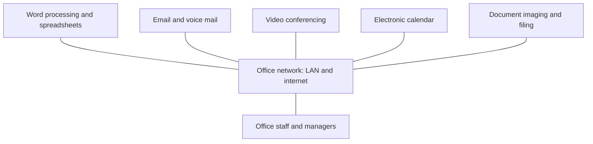

**Ek line mein:** <mark>Office automation system (OAS) computers, software aur networks use karta hai roz ke office kaam ke liye zaroori information create, store, manipulate aur send karne mein</mark>. <Cite id="is-fundamentals-gfg-types" />

<Box kind="key">

**OAS mein ye points likho:**

- <mark>OAS = computers + software + communication networks, routine office kaam ke liye</mark>.
- Pyramid ke **knowledge level** pe hai, KWS ke saath, TPS ke upar.
- <mark>Main functions: document creation, communication, meetings, scheduling, document management, data sharing</mark>.
- Tools: word processor, spreadsheet, email, video conferencing, electronic calendar, scanner.
- <mark>Advantages: fast kaam, kam paper, sasta aur quick communication, better coordination</mark>.
- Disadvantages: cost, training, virus aur data loss, network pe dependence, clerical jobs kam.

</Box>

## Core answer (5 marks, yahan ke har question ke liye)

<Box kind="definition">

An **office automation system (OAS)** is the use of computers, software and communication networks to create, collect, store, manipulate and send the information needed for everyday office work. <Cite id="is-fundamentals-wiki-oa" />

</Box>

Office ke liye ye ghar ki washing machine jaisa hai: repetitive kaam machine karti hai.

**Kyun chahiye:** manual office kaam slow hai, bahut paper lagta hai aur information dhoondhna mushkil. OAS productivity badhata hai aur communication behtar karta hai.

| Function | Tools | Example |
|---|---|---|
| Document creation | Word processor, spreadsheet | Circular banana |
| Communication | Email, voice mail | Sabhi staff ko notice |
| Meetings | Video conferencing | Mumbai aur Pune office online meet |
| Scheduling | Electronic calendar | Meeting room book karna |
| Document management | Scanning, filing | Scanned forms store karna |

**Conclusion:** <mark>OAS office ka kaam fast karta hai aur information system pyramid ke base pe TPS ke saath baithta hai</mark>.

## Extended answer (10 marks): ye add karo

### 1. Ek din mein ye kaise chalta hai

Clerk letter type karke shared drive pe save karta hai; manager email se approve karta hai; letter bheja jaata hai aur reply scan karke file hota hai; follow-up meeting shared calendar pe book hoti hai.

### 2. Kaun si office activities support hoti hain

- **Document management:** documents banana, store karna, nikalna.
- **Message handling:** email, voice mail, fax.
- **Teleconferencing:** audio aur video meetings.
- **Scheduling:** calendars, appointments, reminders.
- **Data handling:** spreadsheets, databases, presentations. <Cite id="is-fundamentals-wiley-rainer" />

### 3. Advantages aur disadvantages

| Advantages | Disadvantages |
|---|---|
| Fast kaam, zyada productivity | Setup aur training cost |
| Kam paper aur jagah | Virus aur data loss ka risk |
| Sasta, quick communication | Network aur power pe dependence |
| Documents ka easy search | Staff ka resistance |
| Better coordination | Clerical jobs kam |

### 4. Applications

College offices, banks, government e-offices, hospital front desks aur corporate offices.

## Har question mein kaise fit karein

- **"What do you mean by office automation system."** (10 marks) <PYQ id="2025-05-ce/q3a" />: definition, kyun chahiye, diagram, function table, ek din ka working, advantages, disadvantages, applications.

## Exam tips

- **Network diagram draw karo**, paanch tools ke saath.
- Pyramid mein kahan fit hota hai pucha jaye to **OAS aur KWS knowledge level** pe likho.
- Office ke examples do: email, calendar, shared drive.

Exam mein English mein likho.
