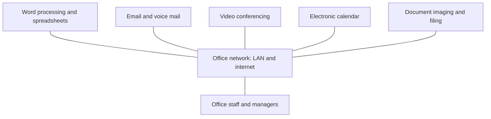

**In one line:** <mark>An office automation system (OAS) uses computers, software and networks to create, store, manipulate and send the information needed for everyday office work</mark>. <Cite id="is-fundamentals-gfg-types" />

<Box kind="key">

**Key points to write (OAS):**

- <mark>OAS = computers + software + communication networks for routine office work</mark>.
- Sits at the **knowledge level** of the pyramid, with KWS, next to TPS.
- <mark>Main functions: document creation, communication, meetings, scheduling, document management, data sharing</mark>.
- Tools: word processor, spreadsheet, email, video conferencing, electronic calendar, scanner.
- <mark>Advantages: faster work, less paper, cheap quick communication, better coordination</mark>.
- Disadvantages: cost, training, virus and data loss, network dependence, fewer clerical jobs.

</Box>

## Core answer (5 marks, fits every question here)

<Box kind="definition">

An **office automation system (OAS)** is the use of computers, software and communication networks to create, collect, store, manipulate and send the information needed for everyday office work. It is to an office what a washing machine is to a home: the machine does the repetitive part. <Cite id="is-fundamentals-wiki-oa" />

</Box>

**Why it is needed:** manual office work is slow, uses a lot of paper and makes information hard to find. OAS raises productivity and improves communication.

| Function | Tools | Example |
|---|---|---|
| Document creation | Word processor, spreadsheet | Preparing a circular |
| Communication | Email, voice mail | Notice to all staff |
| Meetings | Video conferencing | Mumbai and Pune offices meet online |
| Scheduling | Electronic calendar | Booking a meeting room |
| Document management | Scanning, filing | Storing scanned forms |

**Conclusion:** <mark>OAS speeds up office work and sits at the base of the information system pyramid with TPS</mark>.

## Extended answer (10 marks): add these

### 1. How it works in a day

A clerk types a letter and saves it on the shared drive; the manager approves it by email; it is sent and the reply is scanned and filed; a follow-up meeting is booked on the shared calendar.

### 2. Types of office activity supported

- **Document management:** creating, storing and retrieving documents.
- **Message handling:** email, voice mail, fax.
- **Teleconferencing:** audio and video meetings.
- **Scheduling:** calendars, appointments, reminders.
- **Data handling:** spreadsheets, databases, presentations. <Cite id="is-fundamentals-wiley-rainer" />

### 3. Advantages and disadvantages

| Advantages | Disadvantages |
|---|---|
| Faster work, higher productivity | Setup and training cost |
| Less paper and space | Risk of virus and data loss |
| Cheap, quick communication | Depends on network and power |
| Easy search of documents | Staff resistance |
| Better coordination | Fewer clerical jobs |

### 4. Applications

College offices, banks, government e-offices, hospital front desks and corporate offices.

## Fit it to each question

- **"What do you mean by office automation system."** (10 marks) <PYQ id="2025-05-ce/q3a" />: definition, why needed, diagram, function table, working in a day, advantages, disadvantages, applications.

## Exam tips

- **Draw** the network diagram with the five tools around it.
- Name **OAS with KWS** at the knowledge level when asked where it fits.
- Use office examples: email, calendar, shared drive.
