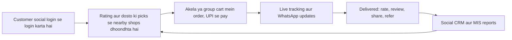
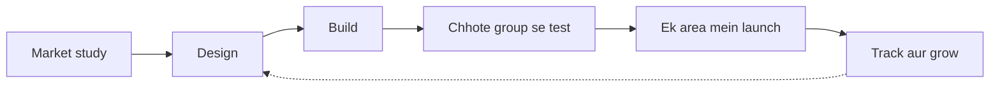

**Ek line mein:** <mark>Social delivery app ek m-commerce app hai jo paas ki shops se food ya groceries deliver karti hai aur social features (reviews, referrals, group orders, sharing) se trust aur repeat orders banati hai</mark>. Plan mein aim, users, features, MIS, phases, revenue, measures aur risks aate hain. <Cite id="e-commerce-wiki-social-commerce" />

<Box kind="key">

**Har "develop the plan" question mein ye points likho:**

- <mark>Aim: mobile app jo paas ki shops se deliver kare aur social features se customers laaye aur marketing cost kam kare</mark>.
- Users: customers, shops ya restaurants, delivery partners, admin.
- <mark>M-commerce features: GPS aur nearby search, UPI payment, push notifications, live tracking</mark>.
- <mark>Social features: social login, photos ke saath ratings aur reviews, referral codes, group orders aur bill splitting, WhatsApp aur Instagram sharing, polls, social CRM</mark>.
- Phases: study, design, build, chhote group se test, ek area mein launch, track aur grow.
- Revenue: commission, delivery fee, paid promotion, subscription. Risks aur controls.

</Box>

## Core answer (5 marks, yahan ke har question ke liye)

<Box kind="definition">

A **delivery application in m-commerce** is a phone app through which customers order food or groceries from nearby shops and get them delivered. **Social computing** adds features where users create content, share and talk (reviews, referrals, groups), which builds trust. <Cite id="e-commerce-wiki-mcommerce" /> <Cite id="e-commerce-wiki-social-commerce" />

</Box>

**Plan short mein:**

1. **Aim:** paas ki shops se tez delivery aur social features se trust aur repeat orders.
2. **Users:** customers, shops, delivery partners, admin.
3. **M-commerce parts:** nearby shops ke liye GPS, UPI payment, push notifications, chhoti screen ka design. <Cite id="e-commerce-wiki-lbs" /> <Cite id="e-commerce-wiki-upi" />
4. **Social parts:** ratings aur reviews, referral codes, group cart, WhatsApp aur Instagram pe sharing.
5. **MIS andar:** order, menu aur stock database, rider allocation, payment aur review data, dashboards.

**Conclusion:** <mark>social features ek normal delivery app ko trusted aur self-promoting banate hain</mark>, aur MIS use controllable banata hai.

## Extended answer (10 marks): ye add karo

### 1. Social computing features detail mein

- **Easy sign-up** social login (Google, Facebook) aur phone number se.
- **Photos ke saath ratings aur reviews** shops, dishes aur delivery partners ke liye; sirf verified buyers review kar sakte hain.
- **Share aur refer:** dish WhatsApp aur Instagram pe share; referral code dono ko discount deta hai.
- **Group ordering aur bill splitting:** dost ek cart mein add karte hain aur apna hissa pay karte hain.
- **WhatsApp pe support** aur app mein chatbot help.
- **Community:** food blog, short video feed, Q&A.
- **Crowdsourced ideas aur polls:** users naye cuisines ya areas pe vote karte hain. <Cite id="social-computing-wiki-crowdsourcing" />
- **Live location sharing** dost ke saath ("mera order 5 minute door hai").
- **Loyalty points aur badges** reviewers ke liye.
- **Social CRM:** X aur Instagram pe mentions dekho aur jaldi reply do. <Cite id="social-computing-wiki-social-crm" />

### 2. Plan ke phases

| Phase | Kaam |
|---|---|
| 1. Study | Market aur competitors, social media listening |
| 2. Design | Screens aur social features |
| 3. Build | Customer app, shop side, rider side, secure payment |
| 4. Test | Chhota beta group, feedback |
| 5. Launch | Ek area, influencers, referral offers |
| 6. Grow | Results track karo, areas badhao |

### 3. MIS, revenue aur measures

- **MIS:** order, stock aur menu database; rider allocation; payment records; customer aur review data; delivery time, ratings aur repeat orders ke dashboards.
- **Revenue:** shops se commission, delivery fee, paid promotion, free delivery ke liye subscription.
- **Success measures:** downloads, orders per user, repeat orders, ratings, referrals, complaint response time.

### 4. Risks aur controls

| Risk | Control |
|---|---|
| Fake reviews | Sirf verified-buyer reviews |
| Location ki privacy | Consent lo, data protect karo |
| Payment fraud | Secure payment gateway |
| Late delivery | Fair rider allocation |
| Viral food-safety complaint | Quick refund aur public reply |

<Cite id="social-computing-wiki-smm" /> <Cite id="e-commerce-rainer-intro-is" />

## Har question mein kaise fit karein

- **"Develop the plan for delivery application in M-commerce using social computing."** (10 marks) <PYQ id="2023-12-ce/q2a" />: plan is order mein likho: aim, users, m-commerce aur social features (core), journey diagram, phir sections 2 se 4 (phases, MIS, revenue, measures, risks). Parts ko number do.

## Exam tips

- **Journey diagram draw karo** jisme har step pe ek social feature ho; isse question ka "using social computing" part dikhta hai.
- Plan ke headings number karo (aim, users, features, phases, revenue, risks), kyunki "develop the plan" structured plan maangta hai.
- Model ke liye familiar app ka naam lo (Zomato, Swiggy).

Exam mein English mein likho.
