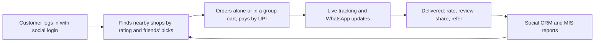
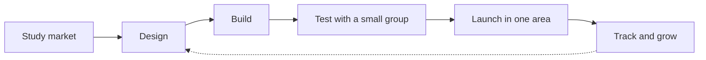

**In one line:** <mark>A social delivery app is an m-commerce app that delivers food or groceries from nearby shops and uses social features (reviews, referrals, group orders, sharing) to build trust and repeat orders</mark>. The plan has aim, users, features, MIS, phases, revenue, measures and risks. <Cite id="e-commerce-wiki-social-commerce" />

<Box kind="key">

**Key points to write (any "develop the plan" question):**

- <mark>Aim: a mobile app that delivers from nearby shops and uses social features to attract customers and cut marketing cost</mark>.
- Users: customers, shops or restaurants, delivery partners, admin.
- <mark>M-commerce features: GPS and nearby search, UPI payment, push notifications, live tracking</mark>.
- <mark>Social features: social login, ratings and reviews with photos, referral codes, group orders and bill splitting, WhatsApp and Instagram sharing, polls, social CRM</mark>.
- Phases: study, design, build, test with a small group, launch in one area, track and grow.
- Revenue: commission, delivery fee, paid promotion, subscription. Risks with controls.

</Box>

## Core answer (5 marks, fits every question here)

<Box kind="definition">

A **delivery application in m-commerce** is a phone app through which customers order food or groceries from nearby shops and get them delivered. **Social computing** adds features where users create content, share and talk (reviews, referrals, groups), which builds trust. <Cite id="e-commerce-wiki-mcommerce" /> <Cite id="e-commerce-wiki-social-commerce" />

</Box>

**Plan in short:**

1. **Aim:** deliver quickly from nearby shops and use social features to win trust and repeat orders.
2. **Users:** customers, shops, delivery partners, admin.
3. **M-commerce parts:** GPS for nearby shops, UPI payment, push notifications, small-screen design. <Cite id="e-commerce-wiki-lbs" /> <Cite id="e-commerce-wiki-upi" />
4. **Social parts:** ratings and reviews, referral codes, group cart, sharing on WhatsApp and Instagram.
5. **MIS inside:** order, menu and stock database, rider allocation, payment and review data, dashboards.

**Conclusion:** <mark>social features make an ordinary delivery app trusted and self-promoting</mark>, and the MIS makes it controllable.

## Extended answer (10 marks): add these

### 1. Social computing features in detail

- **Easy sign-up** with social login (Google, Facebook) and phone number.
- **Ratings and reviews with photos** for shops, dishes and delivery partners; only verified buyers can review.
- **Share and refer:** share a dish to WhatsApp and Instagram; a referral code gives a discount to both people.
- **Group ordering and bill splitting:** friends add to one cart and pay their share.
- **Support on WhatsApp** and chatbot help in the app.
- **Community:** food blog, short video feed, Q&A.
- **Crowdsourced ideas and polls:** users vote on new cuisines or areas. <Cite id="social-computing-wiki-crowdsourcing" />
- **Live location sharing** with a friend ("my order is 5 minutes away").
- **Loyalty points and badges** for reviewers.
- **Social CRM:** monitor mentions on X and Instagram and reply fast. <Cite id="social-computing-wiki-social-crm" />

### 2. Phases of the plan

| Phase | Work |
|---|---|
| 1. Study | Market and competitors, social media listening |
| 2. Design | Screens and social features |
| 3. Build | Customer app, shop side, rider side, secure payment |
| 4. Test | Small beta group, collect feedback |
| 5. Launch | One area, influencers, referral offers |
| 6. Grow | Track results, add areas |

### 3. MIS, revenue and measures

- **MIS:** order, stock and menu database; rider allocation; payment records; customer and review data; dashboards for delivery time, ratings and repeat orders.
- **Revenue:** commission from shops, delivery fee, paid promotion, subscription for free delivery.
- **Measures of success:** downloads, orders per user, repeat orders, ratings, referrals, complaint response time.

### 4. Risks and controls

| Risk | Control |
|---|---|
| Fake reviews | Verified-buyer reviews only |
| Privacy of location | Ask consent, protect data |
| Payment fraud | Secure payment gateway |
| Late delivery | Fair rider allocation |
| Viral food-safety complaint | Quick refund and public reply |

<Cite id="social-computing-wiki-smm" /> <Cite id="e-commerce-rainer-intro-is" />

## Fit it to each question

- **"Develop the plan for delivery application in M-commerce using social computing."** (10 marks) <PYQ id="2023-12-ce/q2a" />: write the plan in this order: aim, users, m-commerce and social features (core), the journey diagram, then sections 2 to 4 (phases, MIS, revenue, measures, risks). Number the parts.

## Exam tips

- **Draw the journey diagram** with a social feature at every step; it shows the "using social computing" part of the question.
- Number the plan headings (aim, users, features, phases, revenue, risks), because "develop the plan" asks for a structured plan.
- Name a familiar app (Zomato, Swiggy) as the model.
