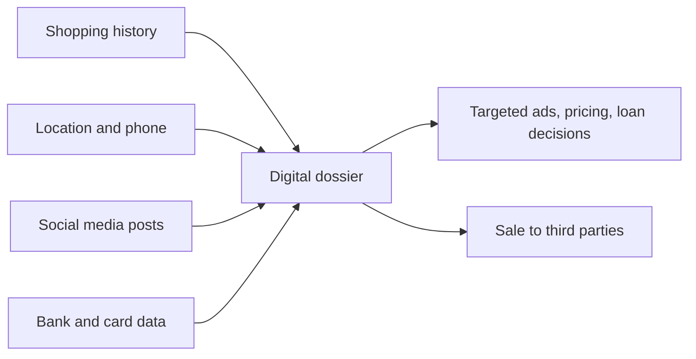
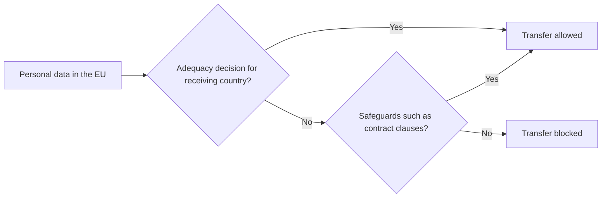

**Ek line mein:** <mark>Privacy ka matlab hai ye decide karne ka right ki aapke baare mein kaun kya jaane; IT personal data collect, join, copy aur send karna aasaan bana deta hai, isliye privacy dabav mein hai, aur jab data border cross karta hai to har country ke privacy laws decide karte hain ki wo ja sakta hai ya nahi</mark>. <Cite id="ethics-privacy-wiki-info-privacy" />

<Box kind="key">

**Ye points likho:**

- <mark>Privacy = akela chhodne ka right aur unreasonable personal intrusion se azaadi</mark>; **information privacy** = kab, kaise aur kitni information share ho, uspe control.
- <mark>IT issues: electronic surveillance, data aggregation (digital dossiers), profiling, internet pe information, breaches aur misuse, inaccurate data, easy copying aur selling</mark>.
- <mark>Transborder data flow (TDF) = personal data ka national borders ke paar jaana</mark>.
- <mark>TDF pe impact: transfer pe restrictions, legal uncertainty, data localization, zyada compliance cost, outsourcing pe asar, jurisdiction conflict</mark>.
- Laws: **GDPR** (adequacy decision ya safeguards), **India ka DPDP Act 2023**, **IT Act 2000**, Puttaswamy (2017).
- Cases: **Cambridge Analytica**, **Schrems** judgments.

</Box>

## Core answer (5 marks, yahan ke har question ke liye)

<Box kind="definition">

**Privacy** is the right to be left alone and free of unreasonable personal intrusion. **Information privacy** is the right to decide when, how and how much of your personal information is shared with others. In India the Supreme Court held in the Puttaswamy judgment (2017) that privacy is a fundamental right. <Cite id="ethics-privacy-sep-it-privacy" /> <Cite id="ethics-privacy-wiki-puttaswamy" />

</Box>

IT ka matlab hai kaanch ki deewaron wale ghar mein rehna: logon ke baare mein facts collect, join aur copy karna sasta ho jaata hai.

**IT se affect hone wale main privacy issues** <Cite id="ethics-privacy-gfg-ethical-issues" />

1. **Electronic surveillance:** CCTV, face recognition, phone tracking, workplace monitoring.
2. **Data aggregation:** kai databases ke chhote facts ek detailed profile ban jaate hain.
3. **Profiling:** firms ads, prices ya loans target karti hain, kabhi unfairly. <Cite id="ethics-privacy-ibm-data-privacy" />
4. **Breaches aur misuse:** data leak ya aise purpose mein use jo aapne maana nahi tha.

**Conclusion:** <mark>IT convenience deta hai lekin privacy ko khatra hai, isliye firms ko sirf zaroori data lena aur use protect karna chahiye</mark>.

## Extended answer (10 marks): ye add karo

### 1. Aur privacy issues

5. **Internet pe information:** posts aur photos online rehti hain; cookies browsing record karti hain; location data routine dikhata hai.
6. **Inaccurate data:** galat record har jagah copy hota hai aur theek karna mushkil.
7. **Easy copying aur selling:** data brokers data third parties ko bechte hain.

**Case:** Facebook aur Cambridge Analytica mein lagbhag 87 million users ka data political profiling ke liye use hua. <Cite id="ethics-privacy-wiki-cambridge-analytica" />

| IT ka benefit | Privacy risk |
|---|---|
| Personalised service | Profiling aur tracking |
| CCTV se safety | Lagatar surveillance |
| Data ka easy sharing | Easy leaks aur copying |

**Protection:** privacy policies, consent, data laws (India ka DPDP Act 2023, IT Act 2000), encryption aur access control.

### 2. Transborder data flow (TDF)

**Matlab:** personal data ka country border cross karna, jaise Indian bank ka records abroad server pe rakhna. Global business, cloud, outsourcing, e-commerce aur social media har second data border ke paar bhejte hain, lekin data strong se weak protection wali jagah ja sakta hai.

### 3. Privacy issues TDF ko kaise affect karte hain

1. **Restrictions:** GDPR mein transfer ke liye adequacy decision ya standard contractual clauses jaise safeguards chahiye. <Cite id="ethics-privacy-gdpr-ch5" /> <Cite id="ethics-privacy-ec-adequacy" />
2. **Legal uncertainty:** Max Schrems ke cases ke baad EU Court of Justice ne EU-US Safe Harbour (2015) aur Privacy Shield (2020) ko khatam kar diya. <Cite id="ethics-privacy-wiki-schrems" />
3. **Data localization:** kuch countries data ko andar rakhne ko kehti hain; privacy aur control bachta hai lekin cost badhta hai. <Cite id="ethics-privacy-wiki-data-localization" />
4. **Compliance cost aur delay:** contracts, audits, legal advice; GDPR fine EUR 20 million ya worldwide turnover ka 4 percent, jo bhi zyada ho.
5. **Outsourcing pe asar:** strong law wali countries clients khinchti hain; weak law wale business kho sakte hain.
6. **Jurisdiction conflict:** kis country ka law lagega saaf nahi.

India ka DPDP Act abroad transfer allow karta hai jab tak government kisi country pe restriction na lagaye. <Cite id="ethics-privacy-wiki-dpdp" />

| Free flow | Restricted flow |
|---|---|
| Kam cost, global business, cloud | Citizens ki privacy bachti hai |
| Tez innovation | State ke liye law enforce karna aasaan |
| India jaise outsourcing countries ko help | Cost badhta hai, services block ho sakti hain |

## Har question mein kaise fit karein

- **"Describe the privacy issues affected by IT."** (10 marks) <PYQ id="2025-05-ce/q5a" />: definition, dossier diagram, saaton issues (core plus section 1), Cambridge Analytica, benefit-risk table, protection laws. Section 2 aur 3 chhod do, TDF ki sirf ek line.
- **"Discuss how privacy issue can impact transborder data flows?"** (10 marks) <PYQ id="2024-05-ce/q3b" />: privacy ki ek-line definition, section 2 (TDF meaning aur adequacy diagram), section 3 main part, free vs restricted table.

## Exam tips

- Question ke hisaab se **dossier diagram ya adequacy flowchart** draw karo.
- **GDPR, DPDP Act, Puttaswamy** naam se likho.
- End mein **balance** likho: free flow business ko help karta hai, restrictions logon ko protect karte hain.

Exam mein English mein likho.
