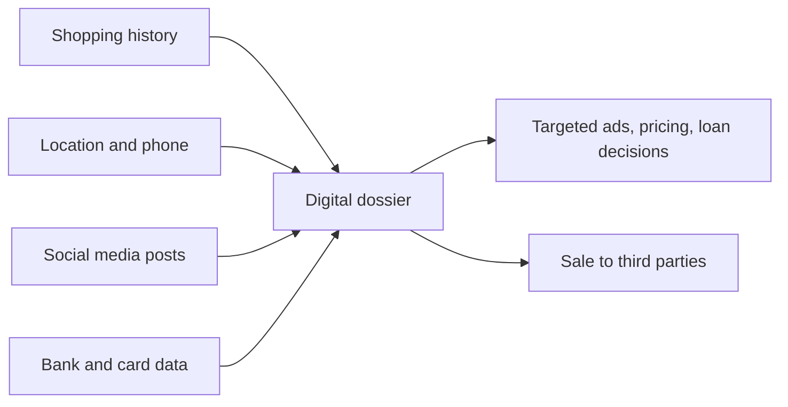
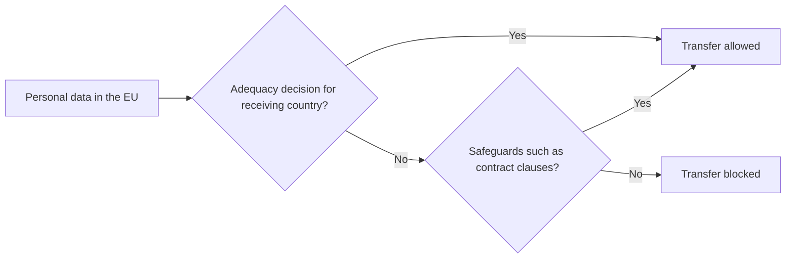

**In one line:** <mark>Privacy is the right to decide who knows what about you; IT makes it easy to collect, join, copy and send personal data, so privacy is under pressure, and when that data crosses a border the privacy laws of each country decide whether it may move</mark>. <Cite id="ethics-privacy-wiki-info-privacy" />

<Box kind="key">

**Key points to write:**

- <mark>Privacy = the right to be left alone and free of unreasonable personal intrusion</mark>; **information privacy** = control over when, how and how much of your information is shared.
- <mark>IT issues: electronic surveillance, data aggregation (digital dossiers), profiling, information on the internet, breaches and misuse, inaccurate data, easy copying and selling</mark>.
- <mark>Transborder data flow (TDF) = movement of personal data across national borders</mark>.
- <mark>Impact on TDF: restrictions on transfer, legal uncertainty, data localization, higher compliance cost, effect on outsourcing, jurisdiction conflict</mark>.
- Laws: **GDPR** (adequacy decision or safeguards), **India's DPDP Act 2023**, **IT Act 2000**, Puttaswamy (2017).
- Cases: **Cambridge Analytica**, **Schrems** judgments.

</Box>

## Core answer (5 marks, fits every question here)

<Box kind="definition">

**Privacy** is the right to be left alone and free of unreasonable personal intrusion. **Information privacy** is the right to decide when, how and how much of your personal information is shared with others. In India the Supreme Court held in the Puttaswamy judgment (2017) that privacy is a fundamental right. <Cite id="ethics-privacy-sep-it-privacy" /> <Cite id="ethics-privacy-wiki-puttaswamy" />

</Box>

IT is like living in a house with glass walls: it makes collecting, joining and copying facts about people cheap.

**Main privacy issues affected by IT** <Cite id="ethics-privacy-gfg-ethical-issues" />

1. **Electronic surveillance:** CCTV, face recognition, phone tracking, workplace monitoring.
2. **Data aggregation:** small facts from many databases become one detailed profile.
3. **Profiling:** firms target ads, prices or loans, sometimes unfairly. <Cite id="ethics-privacy-ibm-data-privacy" />
4. **Breaches and misuse:** data exposed or used for a purpose you never agreed to.

**Conclusion:** <mark>IT gives convenience but threatens privacy, so firms must collect only what they need and protect it</mark>.

## Extended answer (10 marks): add these

### 1. More privacy issues

5. **Information on the internet:** posts and photos stay online; cookies record browsing; location data shows routines.
6. **Inaccurate data:** a wrong record is copied everywhere and is hard to correct.
7. **Easy copying and selling:** data brokers sell data to third parties.

**Case:** in the Facebook and Cambridge Analytica case, data of about 87 million users was used for political profiling. <Cite id="ethics-privacy-wiki-cambridge-analytica" />

| Benefit of IT | Privacy risk |
|---|---|
| Personalised service | Profiling and tracking |
| Safety through CCTV | Constant surveillance |
| Easy sharing of data | Easy leaks and copying |

**Protection:** privacy policies, consent, data laws (India's DPDP Act 2023, IT Act 2000), encryption and access control.

### 2. Transborder data flow (TDF)

**Meaning:** personal data crossing a country border, for example an Indian bank keeping records on a server abroad. Global business, cloud, outsourcing, e-commerce and social media send data across borders every second, but the data may move from strong to weak protection.

### 3. How privacy issues impact TDF

1. **Restrictions:** under GDPR a transfer needs an adequacy decision or safeguards such as standard contractual clauses. <Cite id="ethics-privacy-gdpr-ch5" /> <Cite id="ethics-privacy-ec-adequacy" />
2. **Legal uncertainty:** the EU Court of Justice struck down the EU-US Safe Harbour (2015) and Privacy Shield (2020) after cases brought by Max Schrems. <Cite id="ethics-privacy-wiki-schrems" />
3. **Data localization:** some countries require data to stay inside; this protects privacy and control but raises cost. <Cite id="ethics-privacy-wiki-data-localization" />
4. **Compliance cost and delay:** contracts, audits, legal advice; GDPR fines can reach EUR 20 million or 4 percent of worldwide turnover, whichever is higher.
5. **Effect on outsourcing:** countries with strong law attract clients; weak law may lose business.
6. **Jurisdiction conflict:** unclear which country's law applies.

India's DPDP Act allows transfer abroad unless the government restricts a country. <Cite id="ethics-privacy-wiki-dpdp" />

| Free flow | Restricted flow |
|---|---|
| Lower cost, global business, cloud | Protects citizens' privacy |
| Faster innovation | Easier for the state to enforce law |
| Helps outsourcing countries like India | Raises cost, may block services |

## Fit it to each question

- **"Describe the privacy issues affected by IT."** (10 marks) <PYQ id="2025-05-ce/q5a" />: definition, dossier diagram, all seven issues (core plus section 1), Cambridge Analytica, benefit and risk table, protection laws. Skip section 2 and 3 except one line on TDF.
- **"Discuss how privacy issue can impact transborder data flows?"** (10 marks) <PYQ id="2024-05-ce/q3b" />: one-line privacy definition, section 2 (TDF meaning and the adequacy diagram), section 3 as the main part, the free versus restricted table.

## Exam tips

- **Draw** the dossier diagram or the adequacy flowchart, as the question needs.
- Write **GDPR, DPDP Act, Puttaswamy** by name.
- Always end with the **balance**: free flow helps business, restrictions protect people.
