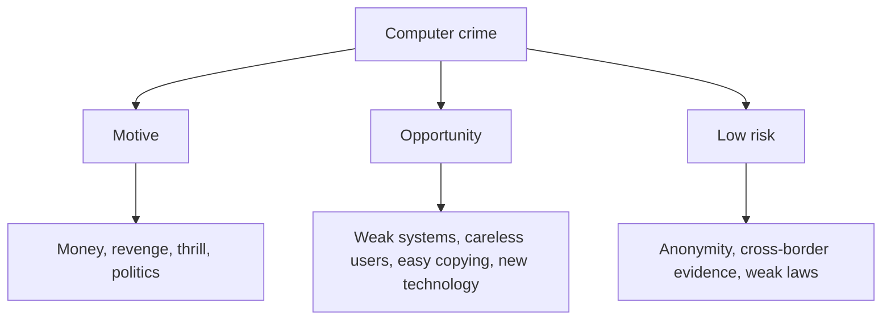
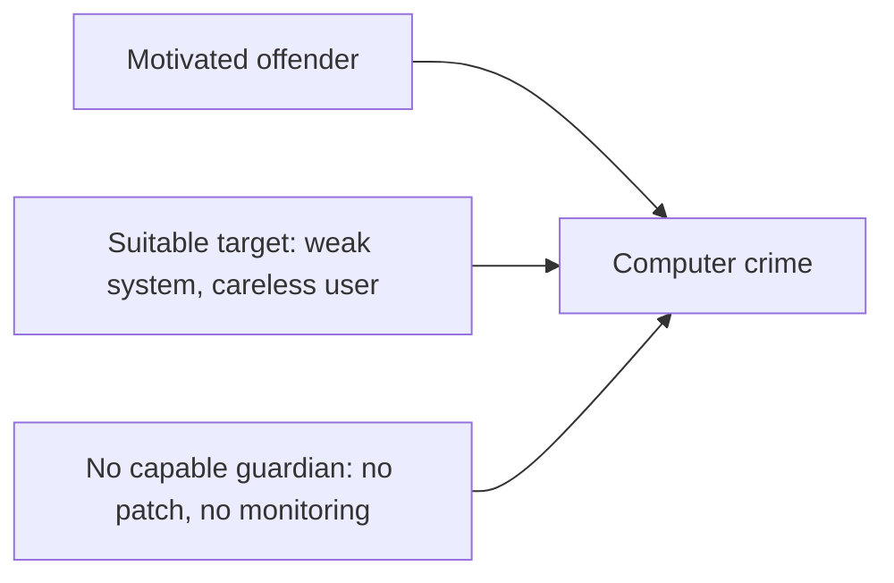

**Ek line mein:** <mark>Computer crimes wahan hote hain jahan motive, opportunity aur pakde jaane ka kam risk milte hain</mark>, isliye main reasons paisa, weak systems, careless users, easy copying aur anonymity hain. <Cite id="ethics-privacy-gfg-cybercrime-causes" />

<Box kind="key">

**Ye points likho:**

- <mark>Computer crime (cybercrime) = illegal act jisme computer ya network crime ka tool, target ya jagah ho</mark>.
- <mark>Reasons: financial gain, weak systems, awareness ki kami, data ki easy copying, anonymity, pakde jaane ka kam chance, insiders, revenge ya thrill, tezi se badalti technology, online personal data</mark>.
- Inhe **motive, opportunity, low risk** mein group karo.
- Examples: hacking, phishing, identity theft, ransomware, online fraud.
- Prevention: **patch, train, access control, backup, IT Act 2000 ke tahat report**.

</Box>

## Core answer (5 marks, yahan ke har question ke liye)

<Box kind="definition">

A **computer crime (cybercrime)** is any illegal act in which a computer or network is the tool, the target or the place of the crime. Criminals attack because it is cheap, it pays well, and they are rarely caught. <Cite id="ethics-privacy-wiki-cybercrime" /> <Cite id="note-information-security-gfg-cybercrime" />

</Box>

**Examples:** hacking, phishing, identity theft, online fraud, ransomware, viruses phailana.

**Main reasons** <Cite id="ethics-privacy-gfg-cyber-criminals" />

1. **Financial gain:** fraud, ransomware aur chori ka data bechna achha paisa deta hai.
2. **Weak systems:** unpatched software, weak passwords, kharab access control.
3. **Awareness ki kami:** users phishing links click karte hain aur OTP share karte hain.
4. **Anonymity aur pakde jaane ka kam chance:** attacker door aur chhupa hota hai.
5. **Insiders:** access wale staff uska misuse karte hain.

**Conclusion:** <mark>computer crimes wahan hote hain jahan motive, opportunity aur kam risk milte hain; opportunity kam karna aur pakde jaane ka chance badhana sabse achhi defence hai</mark>.

## Extended answer (10 marks): ye add karo

### 1. Dus reasons examples ke saath

| # | Reason | Short example |
|---|---|---|
| 1 | **Weak systems:** unpatched software, weak passwords | Attackers purane unpatched server ka use karte hain |
| 2 | **Awareness ki kami** | Fake bank SMS card number chura leta hai |
| 3 | **Financial gain** | Ransomware cryptocurrency mein payment maangta hai |
| 4 | **Data ki easy copying:** second mein copy, kam trace | Employee customer list pen drive mein copy karta hai |
| 5 | **Anonymity** | Fraudster doosre country se call karta hai |
| 6 | **Pakde jaane ka kam chance:** border ke paar evidence mushkil | Cases saalon unsolved |
| 7 | **Insiders** | Clerk customer data bechta hai |
| 8 | **Revenge, thrill ya political motives** | Purana employee files delete karta hai |
| 9 | **Technology tezi se badalti hai:** defences se pehle naye tools | Deepfake voice scams |
| 10 | **Online exposed personal data** | Stalking aur identity theft |

### 2. Ye grouping kyun kaam karti hai

Criminology ki routine activity theory kehti hai ki zyadatar crime ke liye teen cheezein saath chahiye: ek likely offender, ek suitable target aur capable guardian ki absence. Cyber space mein target weak system ya careless user hai, aur missing guardian unpatched software, monitoring ki kami ya weak law hai. <Cite id="web-mis-1-wiki-routine-activity" />

### 3. Prevention

Systems patch karo, users ko train karo, access control, data backup, monitoring, aur crimes IT Act, 2000 ke tahat report karo. <Cite id="note-information-security-wiki-itact" />

## Har question mein kaise fit karein

- **"Analyse the main reasons of Computer Crimes."** (10 marks) <PYQ id="2024-12-ce/q5b" /> <PYQ id="2025-05-ce/q2b" />: definition, motive-opportunity-risk diagram, dus-reason table examples ke saath, routine activity theory do lines mein, prevention ek line mein.

## Exam tips

- **Motive, opportunity, low risk ka tree draw karo**.
- "Analyse" matlab **reasons plus har ek ka chhota example**; table use karo.
- Aakhri line mein **IT Act, 2000** likho.

Exam mein English mein likho.
