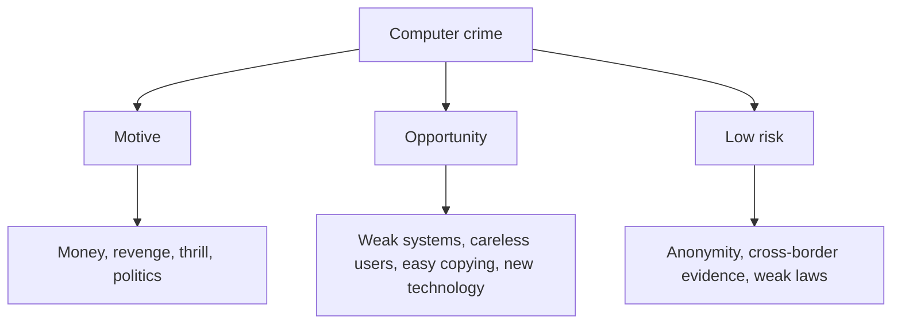
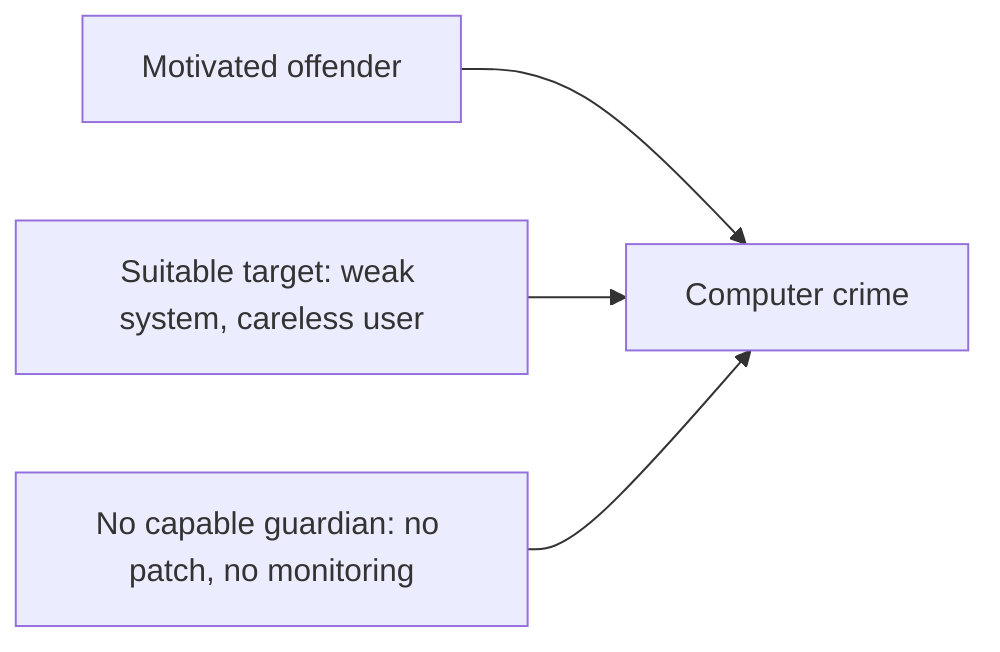

**In one line:** <mark>Computer crimes happen where motive, opportunity and low risk of being caught meet</mark>, so the main reasons are money, weak systems, careless users, easy copying and anonymity. <Cite id="ethics-privacy-gfg-cybercrime-causes" />

<Box kind="key">

**Key points to write:**

- <mark>Computer crime (cybercrime) = illegal act in which a computer or network is the tool, the target or the place of the crime</mark>.
- <mark>Reasons: financial gain, weak systems, lack of awareness, easy copying of data, anonymity, low chance of being caught, insiders, revenge or thrill, fast-changing technology, personal data online</mark>.
- Group them as **motive, opportunity, low risk**.
- Examples: hacking, phishing, identity theft, ransomware, online fraud.
- Prevention: **patch, train, control access, back up, report under the IT Act 2000**.

</Box>

## Core answer (5 marks, fits every question here)

<Box kind="definition">

A **computer crime (cybercrime)** is any illegal act in which a computer or network is the tool, the target or the place of the crime. Criminals attack because it is cheap, it pays well, and they are rarely caught. <Cite id="ethics-privacy-wiki-cybercrime" /> <Cite id="note-information-security-gfg-cybercrime" />

</Box>

**Examples:** hacking, phishing, identity theft, online fraud, ransomware, spreading viruses.

**Main reasons** <Cite id="ethics-privacy-gfg-cyber-criminals" />

1. **Financial gain:** fraud, ransomware and selling stolen data pay well.
2. **Weak systems:** unpatched software, weak passwords, poor access control.
3. **Lack of awareness:** users click phishing links and share OTPs.
4. **Anonymity and low chance of being caught:** the attacker is far away and hidden.
5. **Insiders:** staff with access misuse it.

**Conclusion:** <mark>computer crimes happen where motive, opportunity and low risk meet; reducing opportunity and raising the chance of being caught are the best defences</mark>.

## Extended answer (10 marks): add these

### 1. All ten reasons with examples

| # | Reason | Short example |
|---|---|---|
| 1 | **Weak systems:** unpatched software, weak passwords | Attackers use an old unpatched server |
| 2 | **Lack of awareness** | A fake bank SMS steals a card number |
| 3 | **Financial gain** | Ransomware demands payment in cryptocurrency |
| 4 | **Easy copying of data:** copied in seconds, little trace | An employee copies a customer list to a pen drive |
| 5 | **Anonymity** | A fraudster calls from another country |
| 6 | **Low chance of being caught:** evidence is hard to collect across borders | Cases remain unsolved for years |
| 7 | **Insiders** | A clerk sells customer data |
| 8 | **Revenge, thrill or political motives** | A former employee deletes files |
| 9 | **Fast change in technology:** new tools before defences | Deepfake voice scams |
| 10 | **Personal data exposed online** | Stalking and identity theft |

### 2. Why this grouping works

Criminology's routine activity theory says most crime needs three things together: a likely offender, a suitable target and the absence of a capable guardian. In cyber space the target is the weak system or careless user, and the missing guardian is the unpatched software, absent monitoring or weak law. <Cite id="web-mis-1-wiki-routine-activity" />

### 3. Prevention

Patch systems, train users, control access, back up data, monitor, and report crimes under the IT Act, 2000. <Cite id="note-information-security-wiki-itact" />

## Fit it to each question

- **"Analyse the main reasons of Computer Crimes."** (10 marks) <PYQ id="2024-12-ce/q5b" /> <PYQ id="2025-05-ce/q2b" />: definition, motive-opportunity-risk diagram, the ten-reason table with examples, routine activity theory in two lines, prevention in one line.

## Exam tips

- **Draw** the motive, opportunity, low risk tree.
- "Analyse" asks for **reasons plus a short example each**; use the table.
- Mention the **IT Act, 2000** in the last line.
