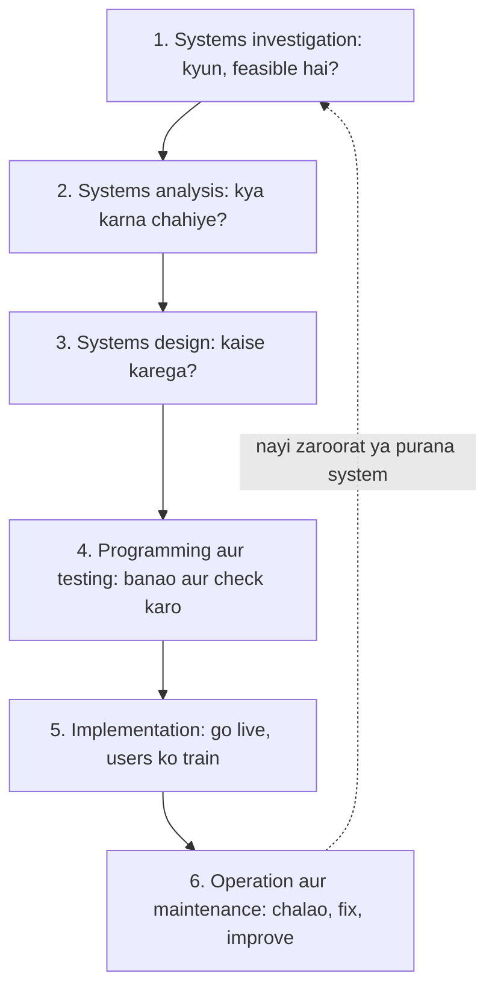

**Ek line mein:** <mark>System development naya information system banane ya purane ko business needs ke hisaab se badalne ka process hai, aur SDLC uska chhe phases ka step-by-step structure hai</mark>: investigation, analysis, design, programming aur testing, implementation, aur operation aur maintenance. <Cite id="note-sdlc-wiki-sdlc" /> <Cite id="it-impact-society-rainer-iis7" />

<Box kind="key">

**System development / SDLC phases mein ye points likho:**

- <mark>System development life cycle (SDLC): information system banane aur maintain karne ka traditional, step-by-step process</mark>.
- Plan kyun: iske bina projects late, mehnge ya aisa system jo kisi ko nahi chahiye.
- <mark>Chhe phases: 1 Systems investigation, 2 Systems analysis, 3 Systems design, 4 Programming aur testing, 5 Implementation, 6 Operation aur maintenance</mark>.
- Har ka output: feasibility study, requirements document, design specification, tested code, running system, maintained system.
- <mark>Feasibility: technical, economic, behavioural</mark>.
- <mark>Conversion: parallel, direct, pilot, phased</mark>.
- Ek example do (hospital appointment app).

</Box>

## Core answer (5 marks, yahan ke har question ke liye)

<Box kind="definition">

**System development** is the process of building a new information system or changing an existing one so that it meets the needs of the business. The **system development life cycle (SDLC)** is the traditional structure for it: a set of phases, each with its own tasks and outputs, that take a project from the first idea to a running and maintained system. <Cite id="note-sdlc-wiki-sdlc" /> <Cite id="note-sdlc-gfg-sdlc" />

</Box>

**Planned approach kyun:** naya system paisa leta hai, mahine lagte hain aur kai logon ko chhoota hai. Plan se sahi problem solve hoti hai, cost justify hota hai, kaam clear order mein hota hai aur live hone se pehle test hota hai. <Cite id="it-impact-society-rainer-iis7" />

**Kaun hissa leta hai:** users aur managers, **systems analysts** (business aur technical logon ke beech ka pul), programmers, testers, database aur network staff, aur project manager. <Cite id="note-sdlc-tpt-sdlc" />

| Phase | Kya hota hai | Output |
|---|---|---|
| 1. Investigation | Asli problem dhoondho, feasibility check | Feasibility study, go ya no-go |
| 2. Analysis | Purana system study, requirements collect | Requirements document, DFDs |
| 3. Design | Screens, database, logic, hardware plan | Design specification |
| 4. Programming aur testing | Code likho, test karo | Tested system |
| 5. Implementation | Staff train, data move, go live | Use mein system |
| 6. Operation aur maintenance | Chalao, bugs fix, features jodo | Working, improved system |

**System kaise acquire hota hai:** ready package kharido (Tally, SAP), SaaS rent (Salesforce), in-house banao (Flipkart), outsource (Infosys, TCS) ya end-user development. <Cite id="note-sdlc-wiki-cots" /> <Cite id="note-sdlc-wiki-outsourcing" />

**Conclusion:** <mark>SDLC firm ko aisa system paane ka planned, step-by-step tareeka deta hai jo uski need se fit ho</mark>.

## Extended answer (10 marks): ye add karo

### 1. Phases detail mein

- **Systems investigation.** Aage badhna hai ya nahi, decide karo. **Feasibility study:** *technical* (bana sakte hain?), *economic* (benefits cost se zyada?), *behavioural* (log accept karenge?). Legal aur schedule feasibility bhi aksar jodte hain. <Cite id="note-sdlc-wiki-feasibility" />
- **Systems analysis.** Analyst users ke interviews leta hai, kaam observe karta hai aur **requirements** collect karta hai. Tools: **data flow diagrams** (processes, stores aur logon ke beech data kaise chalta hai) aur **entity-relationship diagrams** (kaunsa data rakha jaata hai). <Cite id="note-sdlc-wiki-dfd" /> <Cite id="note-sdlc-wiki-erd" />
- **Systems design.** Blueprint: screens aur reports, database, processing logic, hardware, network, security. *Logical design* batata hai system kya karta hai; *physical design* kaunsa hardware aur software. Object-oriented design ke liye UML. <Cite id="note-sdlc-wiki-uml" />
- **Programming aur testing.** Unit testing (har piece), integration testing (pieces saath), system testing (poora system) aur **user acceptance testing** (users confirm karte hain).
- **Implementation.** Staff train, data move aur conversion method chuna jaata hai (neeche).
- **Operation aur maintenance.** Corrective (bugs fix), adaptive (naye rules ya platforms), perfective (naye features) aur preventive maintenance; post-implementation review goals check karta hai.

### 2. Conversion methods

| Method | Kaise kaam karta hai | Achha | Bura |
|---|---|---|---|
| Parallel | Purana aur naya kuch der saath chalte hain | Sabse safe | Double kaam aur cost |
| Direct (cut-over) | Purana band, naya ek saath chalu | Sabse sasta aur tez | Sabse risky |
| Pilot | Naya system pehle ek branch mein | Problems chhote scale pe milti hain | Overall slow |
| Phased | Naya system module by module | Risk bant jaata hai | Zyada time |

### 3. Example: hospital appointment app

| Phase | Kya hota hai |
|---|---|
| Investigation | Patients ghanton line mein. Feasibility: technically haan, cost Rs 20 lakh jabki staff time bachta hai, doctors taiyaar. Approved |
| Analysis | Receptionists aur doctors ke interviews. Requirements: slot book, cancel, SMS reminder, doctor ki daily list. DFD banta hai |
| Design | Screens, appointment database, rule ki ek patient double book nahi kar sakta |
| Programming aur testing | App code; unit, integration aur user acceptance tests |
| Implementation | Staff train; ek department mein pilot, phir sab mein phased |
| Maintenance | SMS timing ka bug fix; agle saal video-consult feature |

### 4. Traditional SDLC ki limits

Ye slow aur rigid hai: users ko system sirf end mein dikhta hai aur late changes mehnge hote hain. Isse nipatne ke liye prototyping, RAD, CASE aur agile methods jaise tools jodte hain.

## Har question mein kaise fit karein

- **"Explain the phases of the system development lifecycle with example."** (10 marks) <PYQ id="2023-12-ce/q5b" />: definition, six-phase diagram, **section 1** (har phase ki do-teen lines output ke saath), conversion table, **section 3 hospital example**, limits aur conclusion.
- **"Give an Overview of System Development?"** (5 marks) <PYQ id="2025-05-ce/q1d" />: **core answer** likho: system development aur SDLC ki definition, plan kyun, kaun hissa leta hai, phases table (har ek line), system kaise acquire hota hai, aur conclusion.

## Exam tips

- **Chhe-phase diagram draw karo** maintenance se investigation tak loop ke saath.
- **Har phase ka output** likho; examiners feasibility study, requirements document aur design specification dhoondhte hain.
- "With example" ke liye ek running example (hospital app) chhe phases mein use karo.

Exam mein English mein likho.
