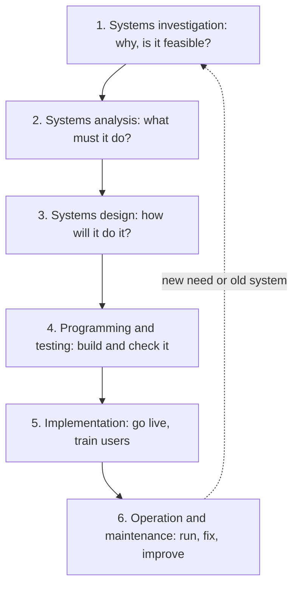

**In one line:** <mark>System development is the process of building a new information system or changing an existing one to meet business needs, and the SDLC is its step-by-step structure of six phases</mark>: investigation, analysis, design, programming and testing, implementation, and operation and maintenance. <Cite id="note-sdlc-wiki-sdlc" /> <Cite id="it-impact-society-rainer-iis7" />

<Box kind="key">

**Key points to write (system development / SDLC phases):**

- <mark>System development life cycle (SDLC): the traditional, step-by-step process for building and maintaining an information system</mark>.
- Why a plan: without it projects run late, cost more or build what nobody wanted.
- <mark>Six phases: 1 Systems investigation, 2 Systems analysis, 3 Systems design, 4 Programming and testing, 5 Implementation, 6 Operation and maintenance</mark>.
- Output of each: feasibility study, requirements document, design specification, tested code, running system, maintained system.
- <mark>Feasibility: technical, economic, behavioural</mark>.
- <mark>Conversion: parallel, direct, pilot, phased</mark>.
- Give one example (hospital appointment app).

</Box>

## Core answer (5 marks, fits every question here)

<Box kind="definition">

**System development** is the process of building a new information system or changing an existing one so that it meets the needs of the business. The **system development life cycle (SDLC)** is the traditional structure for it: a set of phases, each with its own tasks and outputs, that take a project from the first idea to a running and maintained system. <Cite id="note-sdlc-wiki-sdlc" /> <Cite id="note-sdlc-gfg-sdlc" />

</Box>

**Why a planned approach:** a new system costs money, takes months and touches many people. A plan makes sure the right problem is solved, the cost is justified, work is done in a clear order and the result is tested before it goes live. <Cite id="it-impact-society-rainer-iis7" />

**Who takes part:** users and managers, **systems analysts** (the bridge between business and technical people), programmers, testers, database and network staff, and a project manager. <Cite id="note-sdlc-tpt-sdlc" />

| Phase | What happens | Output |
|---|---|---|
| 1. Investigation | Find the real problem, check feasibility | Feasibility study, go or no-go |
| 2. Analysis | Study the old system, collect requirements | Requirements document, DFDs |
| 3. Design | Plan screens, database, logic, hardware | Design specification |
| 4. Programming and testing | Write code, test it | Tested system |
| 5. Implementation | Train staff, move data, go live | System in use |
| 6. Operation and maintenance | Run, fix bugs, add features | Working, improved system |

**How the system is acquired:** buy a ready package (Tally, SAP), rent as SaaS (Salesforce), build in-house (Flipkart), outsource (Infosys, TCS) or end-user development. <Cite id="note-sdlc-wiki-cots" /> <Cite id="note-sdlc-wiki-outsourcing" />

**Conclusion:** <mark>the SDLC gives a firm a planned, step-by-step way to get a system that fits its need</mark>.

## Extended answer (10 marks): add these

### 1. Phases in detail

- **Systems investigation.** Decide whether to go ahead. **Feasibility study:** *technical* (can we build it?), *economic* (benefits more than costs?), *behavioural* (will people accept it?). Legal and schedule feasibility are often added. <Cite id="note-sdlc-wiki-feasibility" />
- **Systems analysis.** The analyst interviews users, observes work and collects **requirements**. Tools: **data flow diagrams** (how data moves between processes, stores and people) and **entity-relationship diagrams** (what data is kept). <Cite id="note-sdlc-wiki-dfd" /> <Cite id="note-sdlc-wiki-erd" />
- **Systems design.** The blueprint: screens and reports, database, processing logic, hardware, network, security. *Logical design* says what the system does; *physical design* says which hardware and software. UML is used for object-oriented design. <Cite id="note-sdlc-wiki-uml" />
- **Programming and testing.** Unit testing (each piece), integration testing (pieces together), system testing (whole system) and **user acceptance testing** (users confirm).
- **Implementation.** Staff are trained, data is moved and a conversion method is chosen (below).
- **Operation and maintenance.** Corrective (fix bugs), adaptive (new rules or platforms), perfective (new features) and preventive maintenance; a post-implementation review checks the goals.

### 2. Conversion methods

| Method | How it works | Good | Bad |
|---|---|---|---|
| Parallel | Old and new run together for a while | Safest | Double work and cost |
| Direct (cut-over) | Switch off old, switch on new at once | Cheapest and fastest | Most risky |
| Pilot | New system first at one branch | Problems found on a small scale | Slower overall |
| Phased | New system introduced module by module | Risk spread out | Takes long |

### 3. Example: hospital appointment app

| Phase | What happens |
|---|---|
| Investigation | Patients queue for hours. Feasibility: technically yes, cost Rs 20 lakh against saved staff time, doctors are willing. Approved |
| Analysis | Interviews with receptionists and doctors. Requirements: book slot, cancel, SMS reminder, doctor's daily list. DFD drawn |
| Design | Screens, appointment database, rule that one patient cannot double book |
| Programming and testing | App coded; unit, integration and user acceptance tests run |
| Implementation | Staff trained; pilot in one department, then phased to all |
| Maintenance | A bug in SMS timing fixed; video-consult feature added next year |

### 4. Limits of the traditional SDLC

It is slow and rigid: users see the system only at the end and late changes are expensive. Tools such as prototyping, RAD, CASE and agile methods are added to overcome this.

## Fit it to each question

- **"Explain the phases of the system development lifecycle with example."** (10 marks) <PYQ id="2023-12-ce/q5b" />: definition, six-phase diagram, **section 1** (two to three lines per phase with its output), the conversion table, the **section 3 hospital example**, limits and conclusion.
- **"Give an Overview of System Development?"** (5 marks) <PYQ id="2025-05-ce/q1d" />: write the **core answer**: definition of system development and SDLC, why a plan, who takes part, the phases table (one line each), how the system is acquired, and the conclusion.

## Exam tips

- **Draw the six-phase diagram with the loop** from maintenance back to investigation.
- Write the **output of each phase**; examiners look for feasibility study, requirements document and design specification.
- For "with example", use one running example (hospital app) through all six phases.
