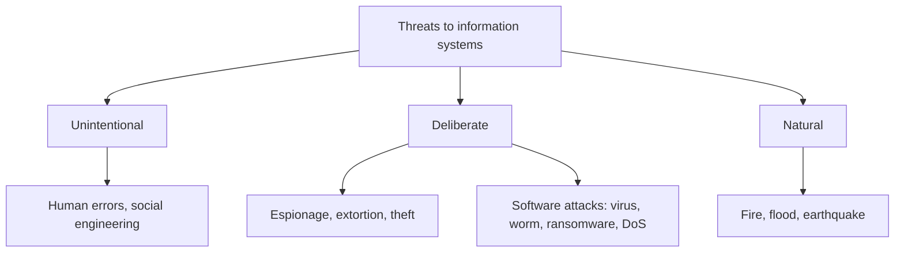
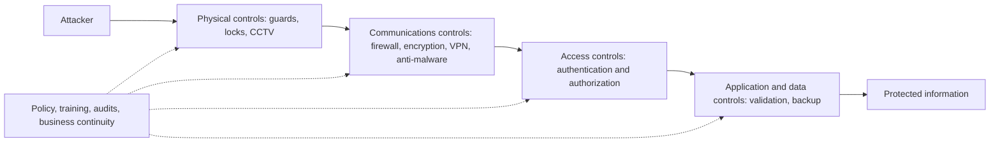

**Ek line mein:** <mark>Threat wo hai jo kisi information resource ko nuksaan pahuncha sakta hai, aur control ek safeguard hai jo threat ko rokta, pakadta ya uska asar kam karta hai; koi ek control kaafi nahi, isliye firms kai layers lagati hain</mark>. <Cite id="note-information-security-wiki-controls" />

<Box kind="key">

**Ye points likho:**

- <mark>Threat = asset ko harm pahunchane wala khatra; control = safeguard jo uska asar rokta, pakadta ya kam karta hai</mark>.
- <mark>Threat groups: unintentional (human error, social engineering), deliberate (espionage, extortion, malware, DoS), natural (fire, flood)</mark>.
- <mark>Function ke hisaab se controls: preventive, deterrent, detective, corrective</mark>.
- <mark>Nature ke hisaab se controls: physical, technical (logical), administrative, legal</mark>.
- Rainer ki layers: **physical, access, communications, business continuity, audit** controls.
- **Defence in depth** aur risk, cost, ease of use ka balance.

</Box>

## Core answer (5 marks, yahan ke har question ke liye)

<Box kind="definition">

A **threat** is a danger that can harm an information resource. A **security control** is a safeguard, rule or tool used to prevent, detect or reduce the effect of a threat to information and information systems. <Cite id="note-information-security-wiki-controls" /> <Cite id="note-information-security-nist-800-53" />

</Box>

**Kyun chahiye:** hackers, malware, theft, human error aur fire jaise threats confidentiality, integrity aur availability ko harm kar sakte hain, aur controls us risk ko kam karte hain.

**Function ke hisaab se control types** <Cite id="note-information-security-tp-ism" />

| Type | Kaam | Examples |
|---|---|---|
| Preventive | Incident hone se pehle rokta hai | Locks, firewall, passwords, encryption, patching |
| Deterrent | Logon ko koshish karne se rokta hai | Warning signs, CCTV, penalties, policy |
| Detective | Ho raha ya ho chuka incident pakadta hai | Intrusion detection, log monitoring, audits |
| Corrective | Damage theek karke normal kaam wapas | Backup se restore, malware hatana, recovery plan |

**Conclusion:** <mark>achhi security physical, technical aur administrative layers mein preventive, detective aur corrective controls ko milati hai</mark>.

## Extended answer (10 marks): ye add karo

### 1. Major threats

| Threat | Matlab | Example |
|---|---|---|
| Human error | Staff ki galtiyan | Weak password, galat email, lost laptop |
| Social engineering | Insaan ko bahkakar access lena | Fake bank call jo OTP maange; phishing |
| Espionage | Secrets ka unauthorized access | Rival product plans copy karta hai |
| Information extortion | Paise ke liye data lock ya chori | Ransomware |
| Identity theft | Kisi ki details se uska roop lena | Victim ke naam pe loan |
| Virus aur worm | Virus ko host file chahiye; worm khud phailta hai | WannaCry (2017) |
| Trojan | Useful dikhta hai, harmful code chhupa | Fake free software |
| Denial of service | Server ko flood karta hai, users ghus nahi paate | Sale ke din shopping site down |
| Natural | Fire, flood, power failure | Data centre mein paani |

<Cite id="is-fundamentals-wiley-rainer" /> <Cite id="note-information-security-tp-threats" /> <Cite id="note-information-security-gfg-cyber-attacks" />

### 2. Nature ke hisaab se controls (kis cheez se bane)

| Type | Kya hai | Examples |
|---|---|---|
| Physical | Buildings aur equipment ki protection | Guards, ID cards, door locks, fire safety |
| Technical (logical) | Software aur hardware | Authentication, firewall, antivirus, encryption, VPN |
| Administrative | Rules, log aur process | Security policy, training, separation of duties, incident plan |
| Legal | Laws aur contracts | IT Act 2000, data protection rules |

### 3. Controls ki layers (defence in depth)

1. **Physical:** locks, guards, ID badges, CCTV, UPS, fire protection.
2. **Access:** authentication (password, OTP, fingerprint, MFA) aur authorization (least privilege).
3. **Communications:** firewall, anti-malware, encryption, VPN, intrusion detection.
4. **Business continuity:** backups, disaster recovery plan, hot, warm ya cold sites.
5. **Audit aur policy:** IT audits, logs, security policy, staff training. <Cite id="note-information-security-ibm-infosec" />

### 4. Risk strategies aur limits

Risk accept karo, controls se limit karo, ya transfer karo (cyber insurance). Koi control perfect nahi, aur strong controls costly hote hain aur kaam slow kar sakte hain, isliye firm risk, cost aur ease of use ka balance karti hai. NIST ke words mein control confidentiality, integrity aur availability ko protect karta hai. <Cite id="web-mis-1-nist-security-control" />

**Example:** SBI net banking password plus OTP, HTTPS encryption, firewalls aur backup server saath use karta hai.

## Har question mein kaise fit karein

- **"Give an understanding on types of Control to achieve Security."** (10 marks) <PYQ id="2022-12-ce/q2a" />: definition, kyun chahiye, function table (core), nature table (section 2), layers diagram (section 3), example aur limits. Threats sirf ek line mein.
- **"Explain the major security threats to information security and discuss the measures for controlling the same."** (10 marks) <PYQ id="2023-12-ce/q3a" />: definitions, threat diagram aur threat table (section 1), phir controls: function table aur paanch layers (section 3), risk strategies, SBI example.

## Exam tips

- Threats question ke liye **threat tree** aur controls question ke liye **layers diagram** draw karo.
- **Chaar functions (preventive, deterrent, detective, corrective)** aur **chaar natures (physical, technical, administrative, legal)** yaad karo.
- **Har control ka ek example** do aur threats ke liye **WannaCry** ya **phishing** naam likho.

Exam mein English mein likho.
