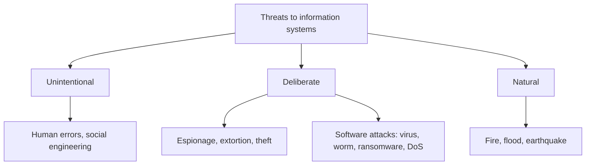
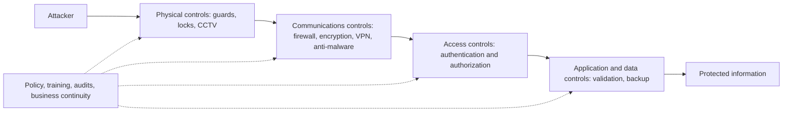

**In one line:** <mark>A threat is anything that can harm an information resource, and a control is a safeguard that prevents, detects or reduces the effect of a threat; because no single control is enough, firms stack several layers</mark>. <Cite id="note-information-security-wiki-controls" />

<Box kind="key">

**Key points to write:**

- <mark>Threat = a danger that can harm an asset; control = a safeguard that prevents, detects or reduces its effect</mark>.
- <mark>Threat groups: unintentional (human error, social engineering), deliberate (espionage, extortion, malware, DoS), natural (fire, flood)</mark>.
- <mark>Controls by function: preventive, deterrent, detective, corrective</mark>.
- <mark>Controls by nature: physical, technical (logical), administrative, legal</mark>.
- Rainer's layers: **physical, access, communications, business continuity, audit** controls.
- **Defence in depth** and balance of risk, cost and ease of use.

</Box>

## Core answer (5 marks, fits every question here)

<Box kind="definition">

A **threat** is a danger that can harm an information resource. A **security control** is a safeguard, rule or tool used to prevent, detect or reduce the effect of a threat to information and information systems. <Cite id="note-information-security-wiki-controls" /> <Cite id="note-information-security-nist-800-53" />

</Box>

**Why needed:** threats such as hackers, malware, theft, human error and fire can harm confidentiality, integrity and availability, and controls reduce that risk.

**Types of control by function** <Cite id="note-information-security-tp-ism" />

| Type | Job | Examples |
|---|---|---|
| Preventive | Stop an incident before it happens | Locks, firewall, passwords, encryption, patching |
| Deterrent | Discourage people from trying | Warning signs, CCTV, penalties, policy |
| Detective | Find an incident that is happening or happened | Intrusion detection, log monitoring, audits |
| Corrective | Fix damage and restore normal work | Restore from backup, remove malware, recovery plan |

**Conclusion:** <mark>good security combines preventive, detective and corrective controls across physical, technical and administrative layers</mark>.

## Extended answer (10 marks): add these

### 1. Major threats

| Threat | Meaning | Example |
|---|---|---|
| Human error | Mistakes by staff | Weak password, wrong email, lost laptop |
| Social engineering | Tricking a person to get access | Fake bank call asking for an OTP; phishing |
| Espionage | Unauthorized access to secrets | Rival copies product plans |
| Information extortion | Locking or stealing data for money | Ransomware |
| Identity theft | Using someone's details to pose as them | Loan in a victim's name |
| Virus and worm | Virus needs a host file; worm spreads alone | WannaCry (2017) |
| Trojan | Looks useful, hides harmful code | Fake free software |
| Denial of service | Floods a server so users cannot enter | Shopping site down on sale day |
| Natural | Fire, flood, power failure | Data centre flooded |

<Cite id="is-fundamentals-wiley-rainer" /> <Cite id="note-information-security-tp-threats" /> <Cite id="note-information-security-gfg-cyber-attacks" />

### 2. Controls by nature (what they are made of)

| Type | What it is | Examples |
|---|---|---|
| Physical | Protects buildings and equipment | Guards, ID cards, door locks, fire safety |
| Technical (logical) | Software and hardware | Authentication, firewall, antivirus, encryption, VPN |
| Administrative | Rules, people and process | Security policy, training, separation of duties, incident plan |
| Legal | Laws and contracts | IT Act 2000, data protection rules |

### 3. Layers of control (defence in depth)

1. **Physical:** locks, guards, ID badges, CCTV, UPS, fire protection.
2. **Access:** authentication (password, OTP, fingerprint, MFA) and authorization (least privilege).
3. **Communications:** firewall, anti-malware, encryption, VPN, intrusion detection.
4. **Business continuity:** backups, disaster recovery plan, hot, warm or cold sites.
5. **Audit and policy:** IT audits, logs, security policy, staff training. <Cite id="note-information-security-ibm-infosec" />

### 4. Risk strategies and limits

Accept the risk, limit it with controls, or transfer it (cyber insurance). No control is perfect, and strong controls cost money and can slow work, so a firm balances risk, cost and ease of use. A control, in NIST's words, protects confidentiality, integrity and availability. <Cite id="web-mis-1-nist-security-control" />

**Example:** SBI net banking uses password plus OTP, HTTPS encryption, firewalls and a backup server together.

## Fit it to each question

- **"Give an understanding on types of Control to achieve Security."** (10 marks) <PYQ id="2022-12-ce/q2a" />: definition, why needed, the function table (core), nature table (section 2), layers diagram (section 3), example and limits. Threats in one line only.
- **"Explain the major security threats to information security and discuss the measures for controlling the same."** (10 marks) <PYQ id="2023-12-ce/q3a" />: definitions, threat diagram and threat table (section 1), then controls: function table and the five layers (section 3), risk strategies, SBI example.

## Exam tips

- **Draw** the threat tree for the threats question and the layers diagram for the controls question.
- Learn **four functions (preventive, deterrent, detective, corrective)** and **four natures (physical, technical, administrative, legal)**.
- Give **one example per control** and name **WannaCry** or **phishing** for threats.
