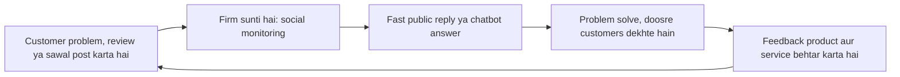

**Ek line mein:** <mark>Social computing customer service ko badal raha hai, social media pe fast, public, two-way support dekar</mark>: customer problem post karta hai, firm sunti hai aur minutes mein reply karti hai, aur doosre customers ek doosre ki madad karte hain. <Cite id="social-computing-wiki-social-crm" /> <Cite id="crm-techtarget-social" />

<Box kind="key">

**Social computing customer service ko kaise inspire karta hai, ye points likho:**

- <mark>Fast, public support</mark>: X ya Instagram pe complaint ka jawab minutes mein (Indian Railways, airlines, banks).
- <mark>Chatbots se 24 x 7 help</mark> WhatsApp aur Messenger pe (SBI WhatsApp banking).
- <mark>Customer communities aur forums</mark>: customers ek doosre ko jawab dete hain, support cost kam.
- <mark>Listening (social monitoring)</mark>: firm complaints tab bhi dhoondhti hai jab koi tag na kare.
- **Self-help content** (FAQs, videos) aur **feedback loop** jo batata hai kya fix karna hai.
- Ek **example** aur ek **drawback** (kharab jawab public hota hai).

</Box>

## Core answer (5 marks, yahan ke har question ke liye)

<Box kind="definition">

**Social computing in customer service** means using social media, chat apps, forums and reviews to answer customers, solve their problems and learn from their feedback. The social media account has become the "complaint desk" that the whole world can see. <Cite id="web-mis-2-wiki-customer-service" /> <Cite id="social-computing-wiki-social-crm" />

</Box>

**Social computing customer service ko kaise inspire karta hai:**

1. **Fast, public support.** Customer problem tweet karta hai aur firm reply karti hai, aksar direct message pe baat jaari rakhne ko kehti hai. *Example:* Indian Railways ke passengers train aur coach ki problems X pe likhte hain aur railway ke service accounts reply karte hain.
2. **Chatbots se 24 x 7 help** WhatsApp, Messenger aur websites pe simple sawalon ke liye jaise order status. *Example:* SBI WhatsApp banking, balance aur mini-statement ke liye.
3. **Communities aur forums** jahan customers ek doosre ko jawab dete hain, support team ka load kam hota hai. <Cite id="crm-wiki-crowdsourcing" />
4. **Listening (social monitoring):** firm apne naam ko search karti hai aur tag na hone pe bhi complaints dhoondh leti hai.
5. **Self-help content:** FAQs, how-to videos aur wikis.
6. **Feedback loop:** reviews aur complaints batate hain product mein kya fix karna hai.

**Drawback:** kharab jawab sabko dikhta hai, turant reply ki expectation badi hoti hai aur messages ka volume zyada hota hai.

**Conclusion:** <mark>social computing customer service ko tez, open aur zyada personal banata hai</mark>, lekin firm ko achhe aur time pe reply dena padta hai.

## Extended answer (10 marks): ye add karo

### 1. Traditional versus social customer service

| Point | Traditional service | Social customer service |
|---|---|---|
| Channel | Phone, email, shop | Social networks, chat apps, reviews |
| Direction | Ek customer, ek agent | Public, many-to-many |
| Speed | Ghante ya din | Minutes |
| Cost | Bada call-centre staff | Chatbots aur community help se cost kam |
| Visibility | Private | Public, isliye achha reply trust banata hai |

<Cite id="crm-gfg-ecrm" />

### 2. Tools aur examples

- **Chatbots:** common sawalon ke automatic jawab. <Cite id="crm-wiki-chatbot" />
- **Microblogs aur social networks:** public replies (Zomato, Swiggy, Amazon India handles).
- **Communities:** user groups aur forums.
- **Personal touch:** staff customer ki purani posts dekhke friendly tareeke se reply de sakta hai.

### 3. Benefits aur risks

| Benefits | Risks |
|---|---|
| Problems jaldi solve | Kharab replies public mein failte hain |
| Support cost kam | Public posts mein private data leak ho sakta hai |
| Zyada loyalty aur trust | Din bhar staff chahiye |
| Free feedback aur early warning | Fake complaints aur rumours |

## Har question mein kaise fit karein

- **"Analyze how social computing is inspiring customer service?"** (5 marks) <PYQ id="2023-05-ce/q1d" /> <PYQ id="2024-12-ce/q1d" />: **core answer** likho: chhe points ek-ek example ke saath, loop diagram, ek drawback aur conclusion. Zyada detail ke liye traditional-versus-social table jodo.

## Exam tips

- **Do real examples** do (X pe Indian Railways, SBI WhatsApp banking) aur ek drawback.
- "Analyze" matlab asar samjhao: har tool speed, cost ya trust ko kaise badalta hai.
- **Social monitoring** (listening) word zaroor likho; ye key term hai.

Exam mein English mein likho.
