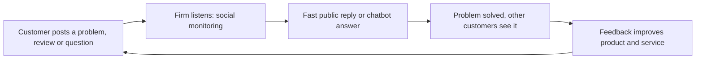

**In one line:** <mark>Social computing is changing customer service by giving fast, public, two-way support on social media</mark>: customers post a problem, the firm listens and replies in minutes, and other customers help each other. <Cite id="social-computing-wiki-social-crm" /> <Cite id="crm-techtarget-social" />

<Box kind="key">

**Key points to write (how social computing inspires customer service):**

- <mark>Fast, public support</mark>: a complaint on X or Instagram is answered in minutes (Indian Railways, airlines, banks).
- <mark>24 x 7 help with chatbots</mark> on WhatsApp and Messenger (SBI WhatsApp banking).
- <mark>Customer communities and forums</mark>: customers answer each other, which lowers support cost.
- <mark>Listening (social monitoring)</mark>: the firm finds complaints even when nobody tags it.
- **Self-help content** (FAQs, videos) and a **feedback loop** that shows what to fix.
- One **example** and one **drawback** (a bad answer is public).

</Box>

## Core answer (5 marks, fits every question here)

<Box kind="definition">

**Social computing in customer service** means using social media, chat apps, forums and reviews to answer customers, solve their problems and learn from their feedback. The social media account has become the "complaint desk" that the whole world can see. <Cite id="web-mis-2-wiki-customer-service" /> <Cite id="social-computing-wiki-social-crm" />

</Box>

**How social computing inspires customer service:**

1. **Fast, public support.** A customer tweets a problem and the firm replies, often asking to continue by direct message. *Example:* Indian Railways passengers raise train and coach problems on X and the railway's service accounts reply.
2. **24 x 7 help with chatbots** on WhatsApp, Messenger and websites for simple questions such as order status. *Example:* SBI WhatsApp banking for balance and mini-statement.
3. **Communities and forums** where customers answer each other, which reduces the load on the support team. <Cite id="crm-wiki-crowdsourcing" />
4. **Listening (social monitoring):** the firm searches for its name and finds complaints even when it is not tagged.
5. **Self-help content:** FAQs, how-to videos and wikis.
6. **Feedback loop:** reviews and complaints show what to fix in the product.

**Drawback:** a bad answer is seen by everyone, expectations of instant reply are high and the volume of messages is large.

**Conclusion:** <mark>social computing makes customer service faster, more open and more personal</mark>, but the firm must reply well and in time.

## Extended answer (10 marks): add these

### 1. Traditional versus social customer service

| Point | Traditional service | Social customer service |
|---|---|---|
| Channel | Phone, email, shop | Social networks, chat apps, reviews |
| Direction | One customer, one agent | Public, many-to-many |
| Speed | Hours or days | Minutes |
| Cost | Large call-centre staff | Chatbots and community help reduce cost |
| Visibility | Private | Public, so a good reply builds trust |

<Cite id="crm-gfg-ecrm" />

### 2. Tools and examples

- **Chatbots:** automatic answers for common questions. <Cite id="crm-wiki-chatbot" />
- **Microblogs and social networks:** public replies (Zomato, Swiggy, Amazon India handles).
- **Communities:** user groups and forums.
- **Personal touch:** staff can see a customer's earlier posts and reply in a friendly way.

### 3. Benefits and risks

| Benefits | Risks |
|---|---|
| Faster problem solving | Bad replies spread publicly |
| Lower support cost | Private data can leak in public posts |
| Higher loyalty and trust | Staff needed all day |
| Free feedback and early warning | Fake complaints and rumours |

## Fit it to each question

- **"Analyze how social computing is inspiring customer service?"** (5 marks) <PYQ id="2023-05-ce/q1d" /> <PYQ id="2024-12-ce/q1d" />: write the **core answer**: the six points with one example each, the loop diagram, one drawback and the conclusion. For a fuller version, add the traditional-versus-social table.

## Exam tips

- **Give two real examples** (Indian Railways on X, SBI WhatsApp banking) and one drawback.
- "Analyze" means explain the effect: say how each tool changes speed, cost or trust.
- Use the word **social monitoring** (listening); it is a key term.
