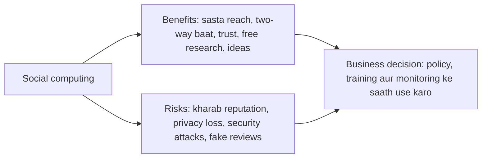
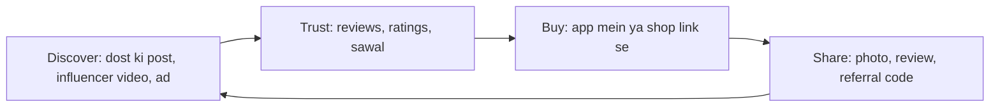

**Ek line mein:** <mark>Social computing matlab computers aur internet se social behaviour ko support karna: log jude, share karein aur milke content banayein</mark>. Business ko iski zaroorat hai customers tak sasta reach aur unki baat sunne ke liye, lekin isse reputation, privacy aur security ke risks bhi aate hain. <Cite id="social-computing-wiki-social-computing" /> <Cite id="it-impact-society-rainer-iis7" /> <Cite id="web-mis-2-wiki-social-media" />

<Box kind="key">

**Need, benefits ya risks ke question mein ye points likho:**

- <mark>Social computing: users sirf padhte nahi; wo content banate, rate, edit aur share karte hain</mark> (Facebook, YouTube, Wikipedia, reviews).
- <mark>Need: customers pehle se wahan hain, sasta reach, two-way conversation, word of mouth se trust, free market research, naye ideas (crowdsourcing)</mark>.
- Aur: behtar customer service aur loyalty, hiring, internal teamwork, speed.
- <mark>Customers ko social commerce ke benefits: reviews se trust, behtar discovery, kam price, convenience, two-way help, personal offers</mark>.
- <mark>Risks: reputation damage, hacked ya fake accounts, privacy aur data loss, security threats, leaks, legal problems, fake reviews</mark>.
- Har point ka **real example** do, aur risks ke **controls** (social media policy, training, monitoring).

</Box>

## Core answer (5 marks, yahan ke har question ke liye)

<Box kind="definition">

**Social computing** is the use of computers, the internet and software to support social behaviour: people connecting, sharing, working together and making content as a group. For a business it means using social tools to reach customers, listen to them, involve them and work better inside the firm. <Cite id="social-computing-wiki-social-computing" /> <Cite id="it-impact-society-rainer-iis7" />

</Box>

**Kaunsi problem solve karta hai:** purane web pe company page publish karti thi aur visitor sirf padh sakta tha. Sawal poochna, raay share karna ya doosron ki raay sunna aasan nahi tha. Social computing logon ko awaaz deta hai aur business ko **sunne** ka tareeka.

**Analogy:** purana web college gate ka notice board hai; social computing canteen hai jahan sab baat aur recommend karte hain. Smart business canteen mein baithke sunta hai.

| Side | Short points |
|---|---|
| Need aur benefits | Customers social media pe hain, kam cost, two-way baat, trust, free research, naye ideas |
| Risks | Reputation damage, hacked accounts, privacy loss, leaks, fake reviews |

**Conclusion:** <mark>social computing business ko customers tak sasta reach aur unhe samajhne mein madad karta hai, lekin risks control karne ke liye social media policy chahiye</mark>.

## Extended answer (10 marks): ye add karo

### 1. Business ke liye social computing ki need

1. **Customers pehle se wahan hain:** zyadatar ghante social media pe bitate hain, isliye absent firm invisible hai.
2. **Sasta reach:** print ya TV ke muqable ek post ya video kam cost mein hazaron tak pahunchti hai. <Cite id="social-computing-wiki-smm" />
3. **Two-way conversation:** firm complaint aur tareef turant sunti hai aur reply de sakti hai.
4. **Word of mouth se trust:** log advertisements se zyada doosre customers pe bharosa karte hain.
5. **Free market research:** posts, polls aur comments batate hain customers kya chahte hain.
6. **Naye ideas (crowdsourcing):** customers products suggest aur vote karte hain. *Example:* Lego Ideas. <Cite id="social-computing-wiki-crowdsourcing" />
7. **Customer service aur loyalty:** fast public replies aur communities customers ko rokte hain (X pe Indian Railways).
8. **Hiring aur teamwork:** hiring ke liye LinkedIn; andar ke wikis aur chat know-how share karne ke liye.

### 2. Customers ko social commerce ke benefits

<Box kind="definition">

**Social commerce** is e-commerce that uses social media and the opinions and actions of people (sharing, recommending, rating, group buying) to help customers find, choose and buy products. <Cite id="social-computing-wiki-social-commerce" /> <Cite id="social-computing-wiki-social-shopping" />

</Box>

| # | Customer ko benefit | Example |
|---|---|---|
| 1 | Asli reviews aur ratings se trust | Amazon, Flipkart ratings |
| 2 | Products ki behtar discovery | Dosto ki posts, trending lists |
| 3 | Kam price | Group deals, referral rewards |
| 4 | Convenience: ek hi app mein discover, poochho aur kharido | Instagram Shops |
| 5 | Two-way help: seller ya doosre buyers se poochho | Product Q&A |
| 6 | Personalised offers | Interests aur past activity ke hisaab se |
| 7 | Fun aur awaaz | Live shopping, polls |
| 8 | Kam risk | Users ki asli photos aur videos |

Limits: fake ya paid reviews, privacy worries, platform rules pe dependence.

### 3. Business ko social computing ke risks

| Risk | Kya hota hai | Example |
|---|---|---|
| Reputation damage | Ek kharab post lakhon tak failti hai | 2009 "United Breaks Guitars" video ne airline ko nuksaan pahunchaya |
| Hacked ya fake accounts | Firm ke naam se jhoothi khabar | 2013 Associated Press account hack se share price thodi der giri |
| Privacy aur data loss | Customer data misuse ya leak | Cambridge Analytica case |
| Security threats | Phishing links, malware, scams | Messaging apps pe fake "offer" links |
| Confidential information leak | Employee secret post kar deta hai | Unreleased design share |
| Legal aur IP problems | Copyright breach, false ads | Bina permission photo use |
| Fake aur paid reviews | Customers gumraah | Rivals ke jhoothe reviews |
| Productivity loss aur cost | Staff ka time barbad, monitoring chahiye | Office hours mein scrolling |

**Risks kaise kam karein:** **social media policy** likho, staff ko train karo, verified official accounts strong passwords aur two-factor login ke saath use karo, mentions monitor karo, jaldi aur imaandari se reply do, privacy laws follow karo, crisis plan rakho. <Cite id="social-computing-wiki-social-crm" /> <Cite id="it-impact-society-laudon-mis" />

## Har question mein kaise fit karein

- **"What is the need of Social Computing for Businesses?"** (10 marks) <PYQ id="2022-12-ce/q5a" />: definition, problem solved, diagram, phir **section 1** (chhe se aath reasons, har ek example ke saath), aur risks pe ek line ki policy chahiye.
- **"Briefly describe the risks of social computing to business giving suitable examples."** (10 marks) <PYQ id="2024-05-ce/q5a" />: one-line definition, phir **section 3** (kam se kam chhe risks real examples aur effect ke saath), phir control list. Sirf risks mat likho; controls bhi do.
- **"Briefly describe the benefits of social commerce to customers."** (10 marks) <PYQ id="2025-05-ce/q3b" />: social commerce definition, loop diagram, **section 2** (aath-nau benefits examples ke saath) aur limits line.

## Exam tips

- **Loop ya benefits-risks diagram draw karo**; har branch label karo.
- **Har point ka real example** do (Lego Ideas, Cambridge Analytica, AP hack); examples 10 marks aur 6 marks ka farq banate hain.
- Question padho: "need" matlab reasons, "risks" matlab problems plus controls, "benefits to customers" matlab buyer ki side, firm ki nahi.

Exam mein English mein likho.
