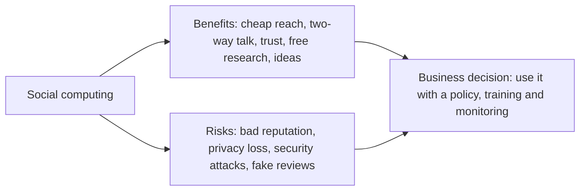
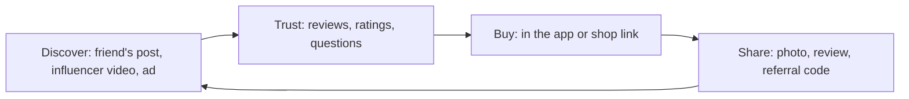

**In one line:** <mark>Social computing is the use of computers and the internet to support social behaviour: people connecting, sharing and creating content together</mark>. Businesses need it to reach and listen to customers cheaply, but it also brings risks to reputation, privacy and security. <Cite id="social-computing-wiki-social-computing" /> <Cite id="it-impact-society-rainer-iis7" /> <Cite id="web-mis-2-wiki-social-media" />

<Box kind="key">

**Key points to write (need, benefits or risks):**

- <mark>Social computing: users do not only read; they create, rate, edit and share content</mark> (Facebook, YouTube, Wikipedia, reviews).
- <mark>Need: customers are already there, cheaper reach, two-way conversation, trust through word of mouth, free market research, new ideas (crowdsourcing)</mark>.
- Also: better customer service and loyalty, hiring, internal teamwork, speed.
- <mark>Social commerce benefits to customers: trust from reviews, better discovery, lower price, convenience, two-way help, personal offers</mark>.
- <mark>Risks: reputation damage, hacked or fake accounts, privacy and data loss, security threats, leaks, legal problems, fake reviews</mark>.
- Always give a **real example** for each point, and **controls** for risks (social media policy, training, monitoring).

</Box>

## Core answer (5 marks, fits every question here)

<Box kind="definition">

**Social computing** is the use of computers, the internet and software to support social behaviour: people connecting, sharing, working together and making content as a group. For a business it means using social tools to reach customers, listen to them, involve them and work better inside the firm. <Cite id="social-computing-wiki-social-computing" /> <Cite id="it-impact-society-rainer-iis7" />

</Box>

**The problem it solves:** on the old web a company published a page and the visitor could only read it. There was no easy way to ask, share an opinion or hear what other people thought. Social computing gives people a voice and gives the business a way to **listen**.

**Analogy:** the old web is a notice board at a college gate; social computing is the canteen where everyone talks and recommends. A smart business sits in the canteen and listens.

| Side | Short points |
|---|---|
| Need and benefits | Customers are on social media, low cost, two-way talk, trust, free research, new ideas |
| Risks | Reputation damage, hacked accounts, privacy loss, leaks, fake reviews |

**Conclusion:** <mark>social computing helps a business reach and understand customers cheaply, but it needs a social media policy to control the risks</mark>.

## Extended answer (10 marks): add these

### 1. Need of social computing for business

1. **Customers are already there:** most spend hours on social media, so an absent firm is invisible.
2. **Cheaper reach:** a post or video reaches thousands at low cost compared with print or TV. <Cite id="social-computing-wiki-smm" />
3. **Two-way conversation:** the firm hears complaints and praise at once and can reply.
4. **Trust through word of mouth:** people believe other customers more than advertisements.
5. **Free market research:** posts, polls and comments show what customers want.
6. **New ideas (crowdsourcing):** customers suggest and vote on products. *Example:* Lego Ideas. <Cite id="social-computing-wiki-crowdsourcing" />
7. **Customer service and loyalty:** fast public replies and communities keep customers (Indian Railways on X).
8. **Hiring and teamwork:** LinkedIn for hiring; internal wikis and chat for sharing know-how.

### 2. Benefits of social commerce to customers

<Box kind="definition">

**Social commerce** is e-commerce that uses social media and the opinions and actions of people (sharing, recommending, rating, group buying) to help customers find, choose and buy products. <Cite id="social-computing-wiki-social-commerce" /> <Cite id="social-computing-wiki-social-shopping" />

</Box>

| # | Benefit to the customer | Example |
|---|---|---|
| 1 | Trust from real reviews and ratings | Amazon, Flipkart ratings |
| 2 | Better discovery of products | Friends' posts, trending lists |
| 3 | Lower price | Group deals, referral rewards |
| 4 | Convenience: discover, ask and buy in one app | Instagram Shops |
| 5 | Two-way help: ask the seller or other buyers | Product Q&A |
| 6 | Personalised offers | Based on interests and past activity |
| 7 | Fun and a voice | Live shopping, polls |
| 8 | Less risk | Real photos and videos from users |

Limits: fake or paid reviews, privacy worries, dependence on platform rules.

### 3. Risks of social computing to business

| Risk | What happens | Example |
|---|---|---|
| Damage to reputation | One bad post spreads to millions | 2009 "United Breaks Guitars" video hurt the airline |
| Hacked or fake accounts | False news posted in the firm's name | 2013 Associated Press account hack caused a brief share fall |
| Privacy and data loss | Customer data misused or leaked | Cambridge Analytica case |
| Security threats | Phishing links, malware, scams | Fake "offer" links on messaging apps |
| Leak of confidential information | Employee posts a secret | Unreleased design shared |
| Legal and IP problems | Copyright breach, false ads | Photo used without permission |
| Fake and paid reviews | Customers misled | Rivals posting false reviews |
| Lost productivity and cost | Staff time wasted, monitoring needed | Scrolling in office hours |

**How to reduce the risks:** write a **social media policy**, train staff, use verified official accounts with strong passwords and two-factor login, monitor mentions, reply quickly and honestly, follow privacy laws, keep a crisis plan. <Cite id="social-computing-wiki-social-crm" /> <Cite id="it-impact-society-laudon-mis" />

## Fit it to each question

- **"What is the need of Social Computing for Businesses?"** (10 marks) <PYQ id="2022-12-ce/q5a" />: definition, problem solved, the diagram, then **section 1** (six to eight reasons, each with an example), and one line on risks needing a policy.
- **"Briefly describe the risks of social computing to business giving suitable examples."** (10 marks) <PYQ id="2024-05-ce/q5a" />: one-line definition, then **section 3** (at least six risks with real examples and effect), then the control list. Do not write only risks; add controls.
- **"Briefly describe the benefits of social commerce to customers."** (10 marks) <PYQ id="2025-05-ce/q3b" />: social commerce definition, the loop diagram, **section 2** (eight to nine benefits with examples) and the limits line.

## Exam tips

- **Draw the loop or benefits-risks diagram**; label each branch.
- Give a **real example per point** (Lego Ideas, Cambridge Analytica, AP hack); examples are what separate 10 marks from 6.
- Read the question: "need" means reasons, "risks" means problems plus controls, "benefits to customers" means the buyer's side, not the firm's.
