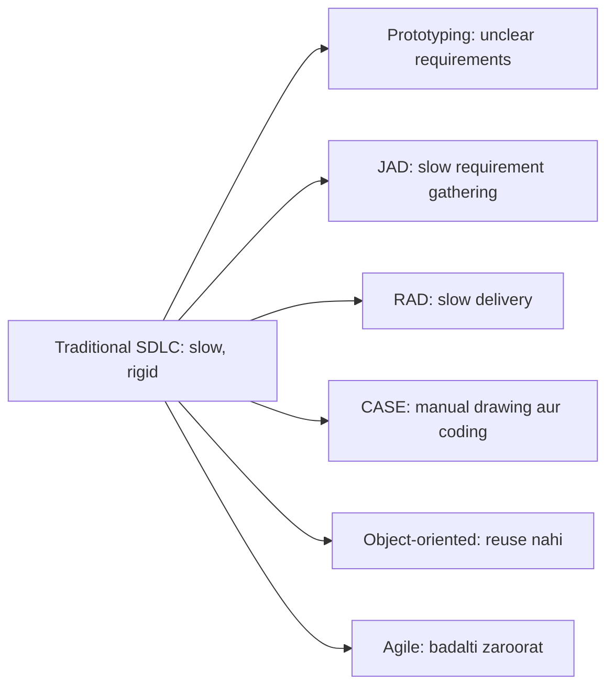
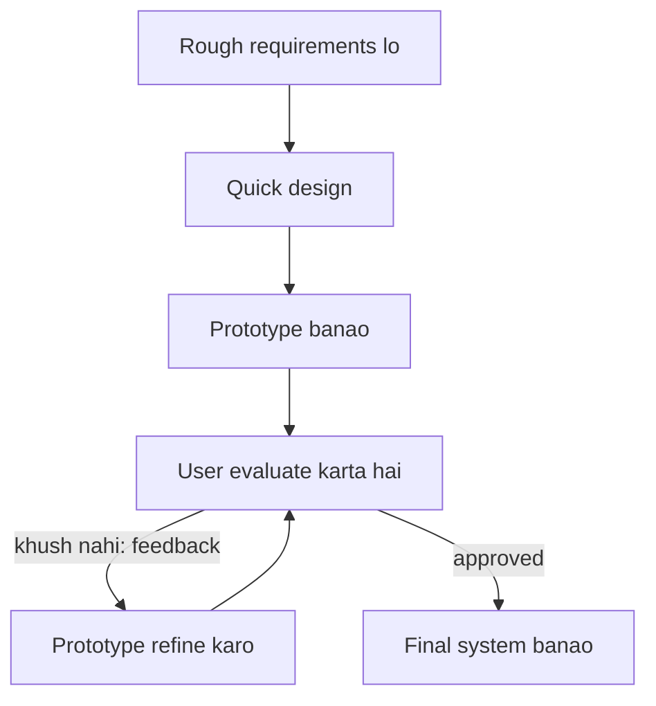

**Ek line mein:** Traditional SDLC slow aur rigid hai, isliye ye tools aur methods jodte hain taaki development tez, sasta ya users ki zaroorat ke kareeb ho: <mark>prototyping, joint application design (JAD), rapid application development (RAD), computer-aided software engineering (CASE) tools, object-oriented development, agile methods aur end-user development</mark>. <Cite id="it-impact-society-rainer-iis7" /> <Cite id="it-impact-society-laudon-mis" />

<Box kind="key">

**SDLC ke tools ke question mein ye points likho:**

- Kyun: <mark>traditional SDLC slow aur rigid hai; users ko system sirf end mein dikhta hai</mark>.
- <mark>Prototyping: ek quick working model banao, user feedback lo, improve karo</mark>.
- <mark>JAD: users, managers aur analysts ka group workshop requirements din mein tay karta hai</mark>.
- <mark>RAD: prototyping, JAD, CASE aur reusable parts short time-boxes mein weeks mein deliver karte hain</mark>.
- <mark>CASE tools: software jo diagrams banata, requirements store karta aur code aur documents generate karta hai</mark>.
- Aur: **object-oriented aur component-based development**, **agile methods**, **end-user development**.
- Har tool ka: one-line purpose aur ek **benefit aur limit**.

</Box>

## Core answer (5 marks, yahan ke har question ke liye)

<Box kind="definition">

The **system development life cycle (SDLC)** is the step-by-step structure (investigation, analysis, design, programming and testing, implementation, maintenance) for building an information system. **Tools that augment it** are methods and software added to it to overcome its slowness and rigidity. <Cite id="note-sdlc-wiki-sdlc" /> <Cite id="note-sdlc-gfg-sdlc" />

</Box>

| Tool | Kya hai | Benefit | Limit |
|---|---|---|---|
| **Prototyping** | Quick working model jo users ko dikhaya jaata hai, feedback se improve (building se pehle sample flat ki tarah) | Galatfehmi kam | Users model ko finished system samajh sakte hain |
| **JAD** | Users, managers, analysts ka group workshop, facilitator ke saath | Requirements pe tez agreement | Saare key log ek saath chahiye |
| **RAD** | Prototyping + JAD + CASE + reusable parts short time-boxes mein | Tez delivery | Skilled log chahiye; bahut bade systems ke liye nahi |
| **CASE tools** | Diagrams, central repository, code aur document generation ka software | Manual kaam kam, behtar documents | Mehnga, seekhna padta hai |
| **Object-oriented aur component-based** | Reusable objects aur components se system (UML) | Reuse, badlav aasan | Pehle achha design chahiye |
| **Agile** | Chhote sprints, har baar ek working part | Badlav handle karta hai | Price aur scope fix karna mushkil |

<Cite id="note-sdlc-wiki-prototyping" /> <Cite id="note-sdlc-wiki-jad" /> <Cite id="note-sdlc-wiki-rad" /> <Cite id="note-sdlc-wiki-case" />

**Conclusion:** <mark>ye tools SDLC ko tez aur zyada user-centred banate hain</mark>, lekin har ek alag situation ke liye fit hai.

## Extended answer (10 marks): ye add karo

### 1. Har tool thoda detail mein

1. **Prototyping.** Prototype phenk bhi sakte hain ya final system mein badal sakte hain. Example: naye mobile app screen ka mock-up users ko dikhana. <Cite id="note-sdlc-gfg-prototype" />
2. **JAD.** Kai alag interviews ki jagah ek workshop; disagreement kam. <Cite id="note-sdlc-wiki-jad" />
3. **RAD.** System modules mein baant ke chhoti teams parallel mein banati hain, users ka bahut involvement. <Cite id="note-sdlc-wiki-rad" />
4. **CASE.** *Upper CASE* analysis aur design support karta hai; *lower CASE* coding aur testing; *integrated CASE* dono. <Cite id="note-sdlc-wiki-case" />
5. **Object-oriented development.** Customer ya Order jaise objects data aur actions rakhte hain; UML drawing language hai. <Cite id="note-sdlc-wiki-uml" />
6. **Agile.** Agile Manifesto (2001) individuals aur interactions, working software, customer collaboration aur badlav ka jawab dene ko value deta hai. Scrum mein ek se chaar hafte ke sprints. <Cite id="note-sdlc-wiki-agile" />
7. **End-user development.** Users spreadsheets ya low-code platforms se chhote tools banate hain: tez aur sasta lekin errors aur "shadow IT" ka risk. <Cite id="note-sdlc-wiki-enduser" />

### 2. Prototype loop

### 3. Kaunsi problem ke liye kaunsa tool

| Problem | Tool |
|---|---|
| Users bata nahi paate unhe kya chahiye | Prototyping, RAD |
| Requirement meetings bahut lambi | JAD |
| Bahut manual drawing aur documentation | CASE |
| Zaroorat baar baar badalti hai | Agile |
| Chhote department ki need | End-user development |

## Har question mein kaise fit karein

- **"Describe the tools that augment the traditional SDLC."** (5 marks) <PYQ id="2023-05-ce/q1c" /> <PYQ id="2024-12-ce/q1c" /> <PYQ id="2025-05-ce/q1e" />: pehle ek line likho ki traditional SDLC slow aur rigid kyun hai, phir **core table**: pehle **paanch** tools (prototyping, JAD, RAD, CASE, agile ya object-oriented) one-line purpose, benefit aur limit ke saath, aur conclusion. Saare SDLC models mat likho.

## Exam tips

- **Kamzori se shuru karo**: "traditional SDLC slow aur rigid hai", phir dikhao har tool ise kaise theek karta hai.
- JAD, RAD aur CASE ka **full form** ek baar likho.
- 5 marks ke liye har tool ki one-line purpose aur ek benefit kaafi hai; SDLC phases dobara mat likho.

Exam mein English mein likho.
