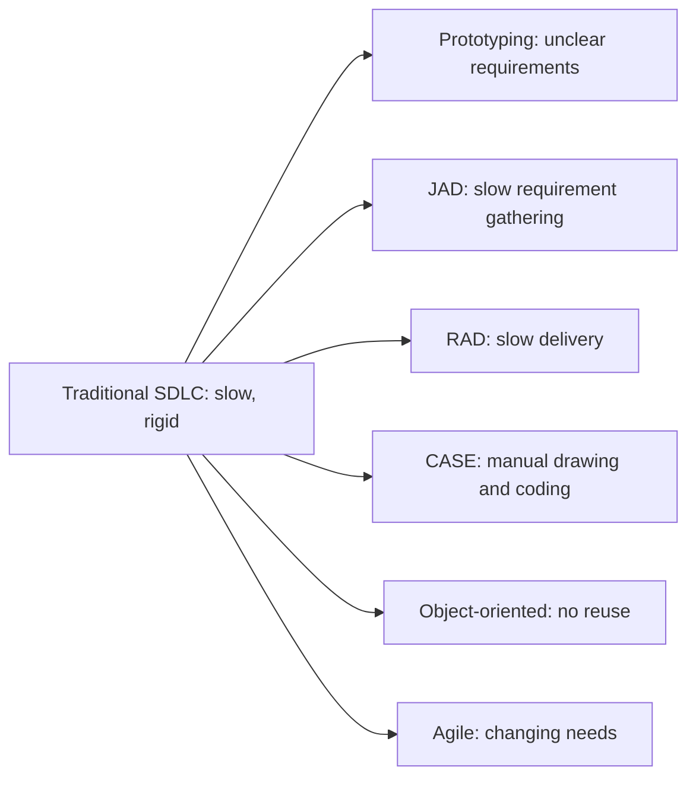
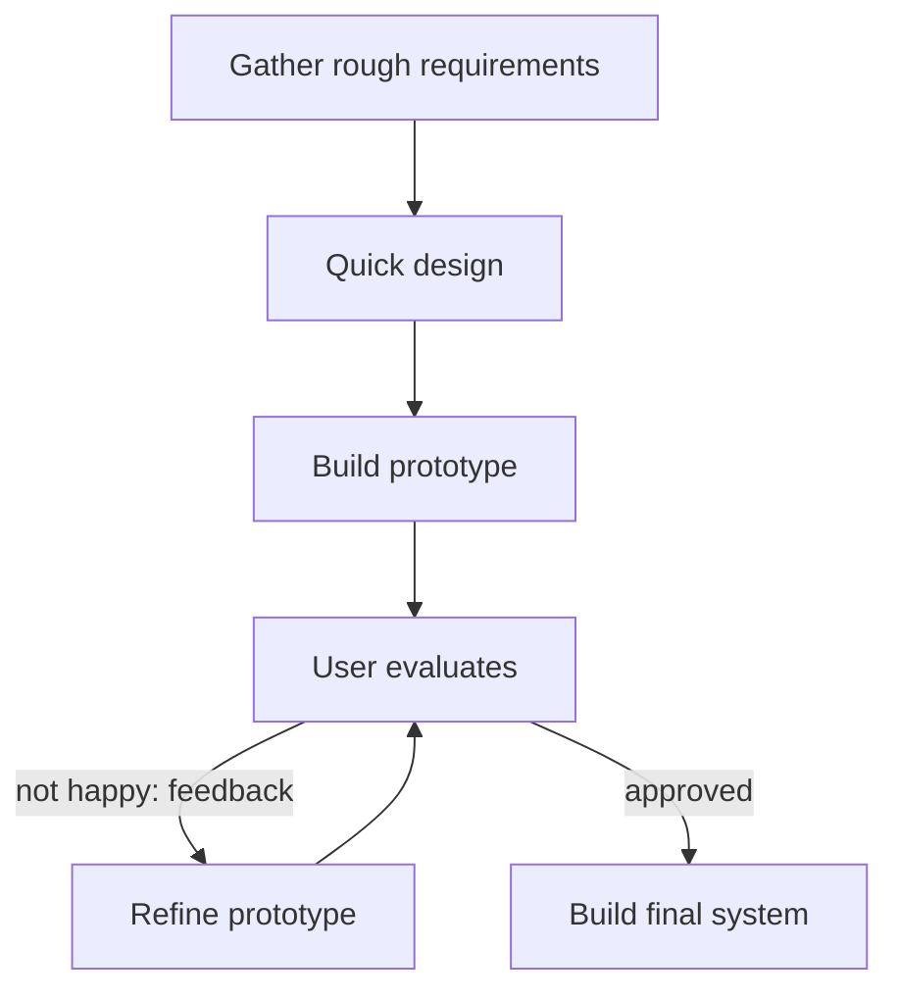

**In one line:** The traditional SDLC is slow and rigid, so these tools and methods are added to make development faster, cheaper or closer to what users want: <mark>prototyping, joint application design (JAD), rapid application development (RAD), computer-aided software engineering (CASE) tools, object-oriented development, agile methods and end-user development</mark>. <Cite id="it-impact-society-rainer-iis7" /> <Cite id="it-impact-society-laudon-mis" />

<Box kind="key">

**Key points to write (tools that augment the SDLC):**

- Why: <mark>the traditional SDLC is slow and rigid; users see the system only at the end</mark>.
- <mark>Prototyping: build a quick working model, get user feedback, improve</mark>.
- <mark>JAD: a group workshop of users, managers and analysts agrees requirements in days</mark>.
- <mark>RAD: prototyping, JAD, CASE and reusable parts in short time-boxes deliver in weeks</mark>.
- <mark>CASE tools: software that draws diagrams, stores requirements and generates code and documents</mark>.
- Also: **object-oriented and component-based development**, **agile methods**, **end-user development**.
- For each tool: one-line purpose and one **benefit and limit**.

</Box>

## Core answer (5 marks, fits every question here)

<Box kind="definition">

The **system development life cycle (SDLC)** is the step-by-step structure (investigation, analysis, design, programming and testing, implementation, maintenance) for building an information system. **Tools that augment it** are methods and software added to it to overcome its slowness and rigidity. <Cite id="note-sdlc-wiki-sdlc" /> <Cite id="note-sdlc-gfg-sdlc" />

</Box>

| Tool | What it is | Benefit | Limit |
|---|---|---|---|
| **Prototyping** | Quick working model shown to users, improved by feedback (like a sample flat before the building) | Fewer misunderstandings | Users may think the model is the finished system |
| **JAD** | Group workshop of users, managers, analysts led by a facilitator | Fast agreement on requirements | All key people needed together |
| **RAD** | Prototyping + JAD + CASE + reusable parts in short time-boxes | Fast delivery | Needs skilled people; not for very large systems |
| **CASE tools** | Software for diagrams, a central repository, code and document generation | Less manual work, better documents | Costly, learning curve |
| **Object-oriented and component-based** | System built from reusable objects and components (UML) | Reuse, easy change | Needs good design first |
| **Agile** | Short sprints, a working part each time | Handles change | Hard to fix price and scope |

<Cite id="note-sdlc-wiki-prototyping" /> <Cite id="note-sdlc-wiki-jad" /> <Cite id="note-sdlc-wiki-rad" /> <Cite id="note-sdlc-wiki-case" />

**Conclusion:** <mark>these tools make the SDLC faster and more user-centred</mark>, but each fits a different situation.

## Extended answer (10 marks): add these

### 1. Each tool in more detail

1. **Prototyping.** A prototype may be thrown away or grown into the final system. Example: a mock-up of a new mobile app screen shown to users. <Cite id="note-sdlc-gfg-prototype" />
2. **JAD.** Replaces many separate interviews by one workshop; cuts disagreement. <Cite id="note-sdlc-wiki-jad" />
3. **RAD.** The system is split into modules built in parallel by small teams with heavy user involvement. <Cite id="note-sdlc-wiki-rad" />
4. **CASE.** *Upper CASE* supports analysis and design; *lower CASE* supports coding and testing; *integrated CASE* covers both. <Cite id="note-sdlc-wiki-case" />
5. **Object-oriented development.** Objects such as Customer or Order hold data and actions; UML is the drawing language. <Cite id="note-sdlc-wiki-uml" />
6. **Agile.** The Agile Manifesto (2001) values individuals and interactions, working software, customer collaboration and responding to change. Scrum uses sprints of one to four weeks. <Cite id="note-sdlc-wiki-agile" />
7. **End-user development.** Users build small tools with spreadsheets or low-code platforms: fast and cheap but risks errors and "shadow IT". <Cite id="note-sdlc-wiki-enduser" />

### 2. The prototype loop

### 3. Which tool fits which problem

| Problem | Tool |
|---|---|
| Users cannot say what they want | Prototyping, RAD |
| Requirement meetings take too long | JAD |
| Too much manual drawing and documentation | CASE |
| Needs change often | Agile |
| Small department need | End-user development |

## Fit it to each question

- **"Describe the tools that augment the traditional SDLC."** (5 marks) <PYQ id="2023-05-ce/q1c" /> <PYQ id="2024-12-ce/q1c" /> <PYQ id="2025-05-ce/q1e" />: write one line on why the traditional SDLC is slow and rigid, then the **core table**: pick the first **five** tools (prototyping, JAD, RAD, CASE, agile or object-oriented) with a one-line purpose, benefit and limit each, and the conclusion. Do not write all the SDLC models.

## Exam tips

- **Start with the weakness**: "the traditional SDLC is slow and rigid", then show how each tool fixes it.
- Write the **full form** of JAD, RAD and CASE once.
- For 5 marks, one-line purpose plus one benefit per tool is enough; do not describe the SDLC phases again.
