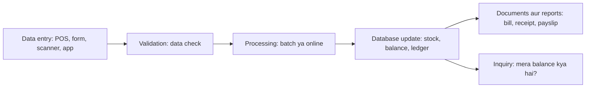
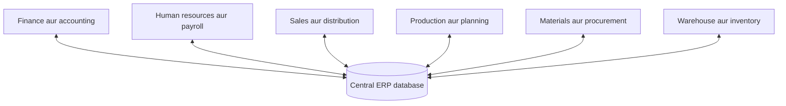
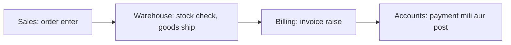

**Ek line mein:** <mark>TPS business ke routine transactions record karta hai; ERP ek integrated, real-time system hai jo ek shared database pe poore organisation ke core processes ko support karta hai</mark>. ERP ek version of the truth deta hai, lekin high cost aur mushkil implementation ke badle. <Cite id="note-tps-fais-erp-wiki-tps" /> <Cite id="note-tps-fais-erp-wiki-erp" />

<Box kind="key">

**TPS, ERP, advantages aur drawbacks mein ye points likho:**

- <mark>TPS routine transactions capture, process, store aur report karta hai</mark> (sales, payments, bookings, payroll).
- TPS activities: <mark>data entry, validation, processing, database update, documents aur reports</mark>; **batch** versus **online** processing.
- <mark>ERP poore organisation ke liye ek shared database pe integrated, real-time software system hai</mark>.
- ERP modules: finance, HR, sales, procurement, production, inventory.
- <mark>Advantages: one version of the truth, data ek baar enter, real-time reports, behtar coordination, inventory aur cost control</mark>.
- <mark>Drawbacks: bahut high cost, lambi complex implementation, process change, staff resistance, heavy customisation</mark>.
- Examples do: TPS ATM withdrawal; ERP SAP, Oracle.

</Box>

## Core answer (5 marks, yahan ke har question ke liye)

<Box kind="definition">

A **transaction processing system (TPS)** is an information system that captures, processes, stores and reports the routine transactions of a business, such as sales, payments, bookings and payroll, so that the firm's records are always up to date. <Cite id="note-tps-fais-erp-wiki-tps" /> <Cite id="crm-rainer-iis" />

**Enterprise resource planning (ERP)** is an integrated, real-time software system, built on one shared database, that supports the core business processes of a whole organisation (finance, HR, supply chain, manufacturing, sales) and lets every department see and use the same data. <Cite id="note-tps-fais-erp-wiki-erp" /> <Cite id="note-tps-fais-erp-oracle-erp" />

</Box>

| Point | TPS | ERP |
|---|---|---|
| Main job | Routine events record karna | Saare departments ke processes integrate karna |
| Scope | Ek event ya function | Poori firm |
| Database | Aksar har function ka alag | Ek shared database |
| Example | ATM withdrawal, ticket booking, supermarket bill | SAP, Oracle, Microsoft Dynamics |

**ERP ke advantages ek line mein:** one version of the truth, data ek baar enter, real-time reports. **Drawbacks:** high cost, complex implementation, process change. <Cite id="note-tps-fais-erp-tp-erp" />

**Conclusion:** <mark>TPS business ko record karta hai, aur ERP saare departments ko ek database pe jodke integrated, real-time information deta hai</mark>.

## Extended answer (10 marks): ye add karo

### 1. TPS detail mein

- **Kyun chahiye:** har doosra system sahi records pe depend karta hai; TPS FAIS, MIS, ERP aur decision support ka main data source hai. <Cite id="it-impact-society-tp-mis" />
- **Steps:** data entry, **validation** (errors reject), processing, database update, documents aur reports (aur inquiries). <Cite id="note-tps-fais-erp-includehelp-tps" />
- **Batch versus online processing:**

| Point | Batch | Online (real-time) |
|---|---|---|
| Timing | Collect karke baad mein group mein process | Har transaction turant process |
| Result | Turant nahi | Instant confirmation |
| Example | Monthly payroll, bank interest posting | ATM withdrawal, train ticket booking |

<Cite id="note-tps-fais-erp-wiki-batch" /> <Cite id="note-tps-fais-erp-wiki-oltp" />

- **Characteristics:** speed aur high volume; accuracy aur integrity (**ACID** rules: atomic, consistent, isolated, durable); high availability; security aur audit trail; structured inputs. <Cite id="note-tps-fais-erp-wiki-acid" />
- **Limits:** ye sirf record aur report karta hai; analyse ya predict nahi karta.

### 2. ERP detail mein

**Kyun chahiye:** jab har department apna system rakhta hai, wahi customer ya item kai baar store hota hai, numbers match nahi karte aur orders dobara type hote hain. ERP data ek jagah rakhta hai, ek baar enter aur sab use karte hain. <Cite id="note-tps-fais-erp-sap-india" />

**History:** factories mein MRP (material requirements planning), phir MRP II, phir 1990s mein ERP jisme finance aur HR jude, phir web-based aur cloud ERP. <Cite id="note-tps-fais-erp-wiki-mrp" />

**Main modules:** finance aur accounting, human resources, sales aur distribution, procurement, production aur planning, inventory aur warehouse, supply chain aur CRM. <Cite id="note-tps-fais-erp-ms-erp" />

**ERP process ko kaise support karta hai (order-to-cash):** sales order enter karta hai, warehouse stock check karke goods ship karta hai, billing invoice banata hai, accounts payment post karta hai, bina dobara type kiye.

### 3. ERP ke advantages aur drawbacks

| Advantages | Drawbacks |
|---|---|
| Ek shared database ek version of the truth deta hai | Bahut high cost: licences, hardware, consultants, training |
| Data ek baar enter: kam duplicate kaam aur errors | Lambi, complex implementation (mahine ya saal) |
| Real-time reports aur tez decisions | Firm ko aksar software ke hisaab se apne processes badalne padte hain |
| Behtar coordination, kam delivery aur cycle time | Staff resistance aur zyada training |
| Behtar inventory, cost aur cash control | Heavy customisation se delay aur bugs |
| Behtar customer service aur forecasting | Doosre systems se jodna mushkil; ek vendor pe dependence |
| Standard, secure, auditable processes | Fail ho to poori firm affect; benefits aane mein time |
| Firm ke saath scale hota hai | Kharab data quality sab jagah copy hoti hai |

<Cite id="note-tps-fais-erp-tpoint-erp-adv" /> <Cite id="note-tps-fais-erp-tp-erp" />

**Implementation approaches:** *big bang* (poori firm ek date pe, tez lekin risky), *phased* (module by module, safe lekin slow) aur *parallel* (purana aur naya saath, safe lekin double kaam). Key risks: kamzor planning, process change ko na samajhna aur zyada customisation.

**Real use:** SAP, Oracle aur Microsoft Dynamics bade aur mid-size firms ke leading products hain; Walmart jaise retailers stores, warehouses, suppliers aur finance ko ek planning system pe jodte hain.

## Har question mein kaise fit karein

- **"Write short notes on (1) TPS (2) ERP."** (10 marks) <PYQ id="2022-12-ce/q4a" />: do short notes likho: TPS (definition, paanch-step diagram, batch versus online, example) **section 1** se, phir ERP (definition, module diagram, modules, order-to-cash example aur kuch benefits) **section 2** se. Har ek lagbhag aadha page.
- **"Identify advantages and drawbacks of businesses implementation which uses an enterprise resource planning system."** (10 marks) <PYQ id="2024-05-ce/q4b" />: ERP ki one-line definition, ERP module diagram, phir **section 3 poora** (advantages aur drawbacks table firm example ke saath) aur implementation approaches aur risks ki line.

## Exam tips

- **Dono diagrams draw karo**: paanch TPS steps aur ERP shared-database hub.
- "Short notes" mein dono notes barabar lambe rakho: definition, diagram, key points, example.
- ERP table mein kam se kam **chhe advantages aur chhe drawbacks** likho, aur product ka naam do (SAP, Oracle).

Exam mein English mein likho.
